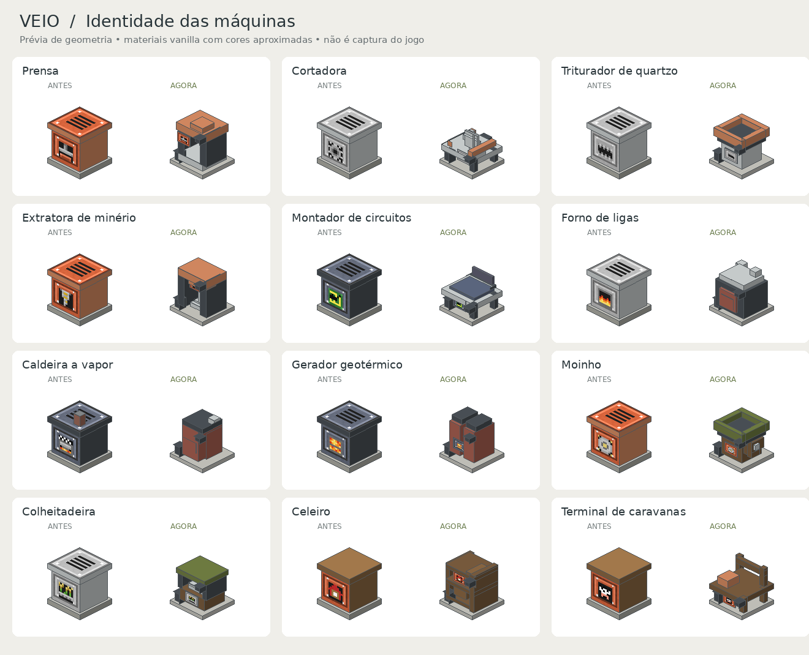
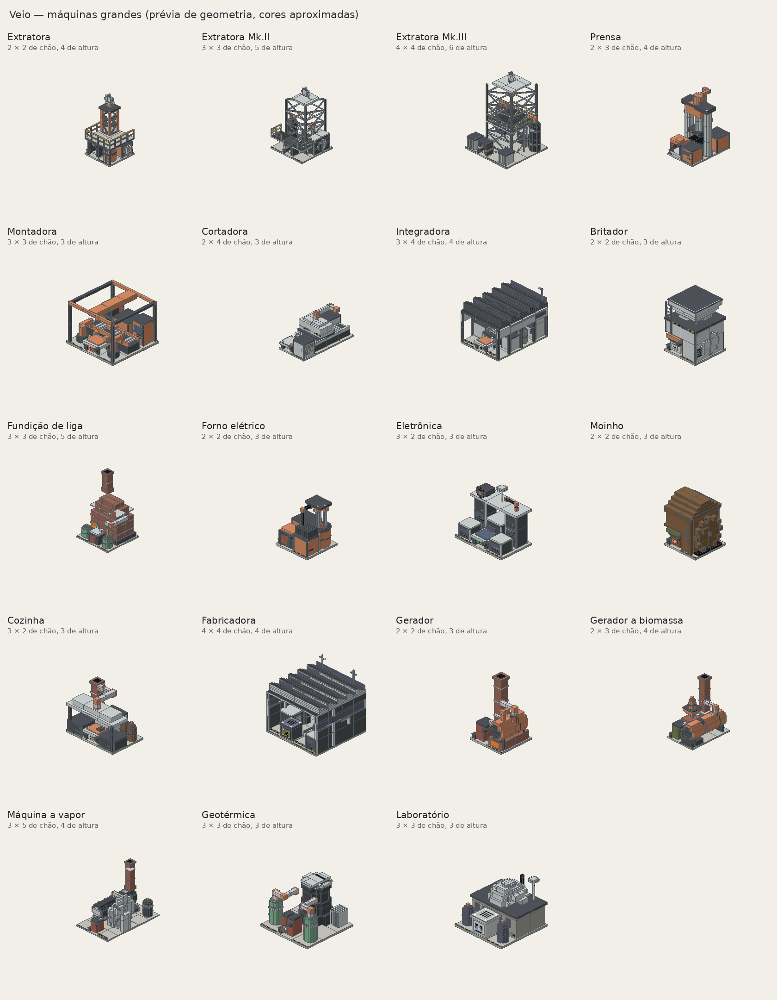

# Identidade visual das máquinas

34 modelos receberam novas formas, com 27 silhuetas diferentes. O objetivo é
reconhecer a função pela estrutura e pelo material, com cores sóbrias e a escala
do Minecraft. Cada máquina continua usando um ponto de colocação. Os novos
modelos cabem nessa célula, com alturas e vazios diferentes. Desde as máquinas grandes (seção no fim), 19 delas montam uma estrutura multibloco em volta desse núcleo.



A imagem é uma prévia dos modelos, não uma captura do jogo. Ela usa as texturas
próprias do Veio e cores aproximadas para os materiais vanilla. Iluminação,
transparência, perspectiva e movimento no Horizon ainda precisam de validação.

## Linguagem das formas

| Função | Forma |
|---|---|
| Extração | estrutura aberta, travessas, motor superior e eixo central |
| Prensa | armação com vão, mesa de apoio e cabeça com pistão |
| Corte e silvicultura | bancada baixa com guias e serra aparente |
| Montagem e integração | mesa de trabalho; o integrador tem uma travessa adicional |
| Trituração e moagem | boca de alimentação; o moinho tem corpo de madeira e roda lateral |
| Eletrônica | bancada baixa com painel e materiais azulados |
| Fundição | câmara escura, porta térmica e saídas superiores distintas |
| Energia | caldeira compacta, tanques duplos ou duas células de acumulador |
| Agricultura | estrutura aberta, recipientes e verde discreto |
| Gestão e trabalhadores | mesas, balcões e consoles em vez de caixas fechadas |
| Armazenagem | prateleiras no celeiro e corpo vertical no silo |
| Transporte | plataforma de carga, pista de pouso ou travessa para caravanas |

Cobre, ferro e ardósia continuam distinguindo a estrutura dos níveis. Terracota
verde, azul e avermelhada diferencia agricultura, eletrônica e calor. A leitura
também depende da forma e dos ícones; a cor não é o único sinal.

As luzes ficam em alojamentos frontais, e a placa do módulo fica em um suporte
próprio. As máquinas com saída de itens conservam o bico traseiro. Unidades
sem saída de itens usam uma ligação metálica, sem a seta de escoamento.

## Modelos, seleção e animação juntos

`tools/machine_forms.py` descreve os componentes. `tools/build_content.py` usa
essa descrição para gerar modelos, formas orientadas de seleção/colisão e
`native/api/src/appearance/data.rs`, com posições das luzes, placas e movimentos.
Não editar esses arquivos gerados manualmente.

- As caixas seguem as quatro orientações da máquina. Não resta um cubo sólido
  invisível em volta de uma bancada baixa ou estrutura aberta.
- O espaço percorrido por serra, eixo e pistão também é reservado na colisão.
- Luz e placa não compartilham uma face opaca no mesmo plano, evitando disputa
  de profundidade. As braçadeiras dos níveis de extratora têm relevo real.
- Indicadores de filtro e drone pousado acompanham a altura dos novos terminais.
- Eixos, pratos e serras usam a rotação em GPU já disponível no Horizon.
  A prensa tem um curso de pistão calculado durante o desenho quando ativa;
  parada, seu desenho pode ser reaproveitado. Isso não é uma medição de FPS.

Os IDs, registros de inventário e pontos de conexão continuam compatíveis com
os blocos colocados. As novas colisões podem mudar por onde um personagem passa
e a altura em que pisa ao subir numa máquina; esse comportamento acompanha a
forma visível e deve ser conferido na fábrica de teste.

## Reproduzir e conferir

```bash
python3 tools/build_content.py
python3 tools/check_machine_forms.py
python3 tools/check_project.py
python3 tools/check_rust.py
```

`check_machine_forms.py` verifica o limite da célula, quatro orientações,
conexões preservadas, alojamento dos indicadores e espaço das partes móveis.
Também verifica que as sete máquinas centrais de processamento têm geometrias
diferentes. Resultado: 34 formas, 27 silhuetas; conteúdo válido e 150 testes
Rust aprovados, sem falhas, com dois testes opcionais ignorados.

Para a prévia, usar Python com Pillow instalado:

```bash
python3 tools/preview_machine_forms.py --before-ref 8b8e8d9
```

O comando grava a comparação e o catálogo em `.build/visual/`. O catálogo
também está em [docs/visual/machine-catalog.png](docs/visual/machine-catalog.png).
As imagens são artefatos de inspeção: não representam texturas vanilla
distribuídas nem demonstram que o jogo foi executado.

Base do lote: `8b8e8d9`, incluindo os transportes e caravanas do trabalho
anterior. Compilação pelo launcher, aparência no jogo e circulação junto às
máquinas ainda precisam de validação local. A versão consolidada e o pacote
jogável continuam com a integração; este lote não gera release.

## Máquinas grandes (0.30, multibloco)

O bloco da máquina passou a ser o **núcleo** de uma estrutura maior. Ao ser colocado, monta
em volta a planta própria da máquina, com peças de estrutura (`veio:structure`) e escotilhas
(`veio:hatch_in`, `veio:hatch_out`). Plantas, peças e modelos ficam em
`tools/machine_frames.py`; a regra de jogo em `native/api/src/frames.rs`.



- Precisa de área livre e chão firme e plano embaixo de toda a planta; senão a máquina não é
  posta e o que atrapalha fica contornado de vermelho.
- O núcleo fica na frente: painel, luz e entrada continuam nele. A saída é a escotilha de trás.
- Quebrar qualquer parte desmonta tudo e devolve o núcleo.
- Cada máquina é desenhada como um modelo único (classe `Machine`) e cortada em blocos; as faces
  do corte saem, então tanques, torres, passarelas e telhados ficam contínuos.

Prévia: `python3 tools/preview_machine_frames.py` (grava `.build/visual/machine-frames.png`).
