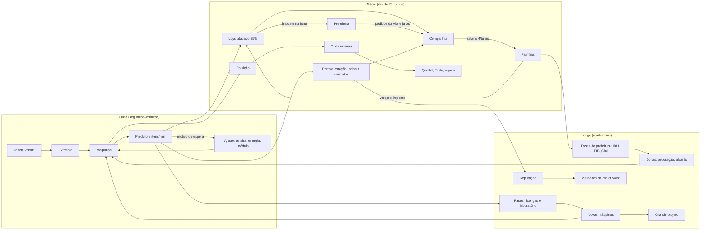

# 02 — Visão e concepção do jogo

Referências: `main@53267af` (Veio 0.25.0, lançada) e `pr47@80980db` (candidata consolidada). Os PRs `#51@a0b0d72` e `#52@0b827f6`, empilhados sobre o pr47, não fazem parte dela.

Toda afirmação traz a origem:

- **[Dono]**: texto do Luiz no chat de 08/11, com hora em UTC (E4, fonte primária).
- **[Dono via agente]**: um documento diz "pedido do usuário", sem registro direto (E3).
- **[Agente]**: decisão de agente, não confirmada pelo dono.
- **[Inferido]**: conclusão desta consolidação.

As regras de cada sistema ficam nas fichas do [atlas](03_ATLAS_DE_SISTEMAS.md), e as decisões em [06](06_HISTORICO_E_DECISOES.md). Este arquivo não repete números.

---

## 1. O que é o Veio

> Um **jogo de fábrica no estilo Factorio/Satisfactory dentro do mundo vanilla do Minecraft**. A fábrica extrai de jazidas reais, é operada por **aldeões contratados** e sustenta uma **vila com economia própria**. Roda no **Horizon** (Minecraft 26.3 em Rust), num PC comum.

- "Jogo de fábrica tipo Factorio/Satisfactory dentro do Minecraft": [Dono] 16:27 ([DEC-001](06_HISTORICO_E_DECISOES.md#dec-001)).
- "Automação industrial no mundo procedural do Minecraft, executada no Horizon": README desde a 0.6 [Agente].
- O nome do repositório é **MineFac**. No jogo, o nome é **Veio**, de veio de minério, a jazida conectada que define a pureza ([SIS-MUN](03_atlas/SIS-MUN.md)). A etimologia é [Inferido].
- No pedido original, "audiões" foi lido como **aldeões** [Inferido]: nenhuma fonte usa outra palavra.
- O Projeto-Moba e o Wasému ficam **fora de escopo**: estavam inacessíveis nesta consolidação.

## 2. Pilares

| # | Pilar | Como aparece no jogo | Evidência | Origem | Situação |
|---|---|---|---|---|---|
| P1 | **Fábrica de verdade** | Razões inteiras entre máquinas; itens/min visíveis; gargalos em sequência (extração → energia → fio → poluição); módulos; cadeia funda; copiadora | Chat 16:27, 16:38 ("razões visíveis"), 17:01 | [Dono] | Firme. Ver [SIS-PRO](03_atlas/SIS-PRO.md) |
| P2 | **Dentro do vanilla, sem remodelá-lo** | Jazidas que não esgotam; combustíveis da fornalha; plantas vanilla com água; rios traçados sobre o terreno; troca vanilla na loja | Chat 15:55 ("não remodelar do zero") | [Dono] para agro/água; [Agente] para o resto | Firme |
| P3 | **Aldeões: mão de obra e sociedade** | Contratados por esmeralda operam postos; a vila cresce até 150; famílias, lojas, prefeito | Chat 16:27 ("muito trabalho vindo em aldeões, vilas"); CLOUD.md | [Dono] reconhece; [Agente] desenha | Firme como eixo. O **peso** da sociedade está em aberto ([Q-12](09_CONFLITOS_LACUNAS_E_RISCOS.md#q-12-peso-da-sociedade-frente-à-fábrica)) |
| P4 | **Dinheiro que circula** | A esmeralda é a moeda. Quatro livros: companhia, lojas, prefeitura e carteiras das famílias. O comércio exterior sustenta a indústria maior | README 0.21–0.25; ECONOMIA.md | [Agente]; o dono decidiu só o fluxo de recompensas ([DEC-035](06_HISTORICO_E_DECISOES.md#dec-035)) | **Não se sustenta como "economia fechada" no código** ([DEC-030](06_HISTORICO_E_DECISOES.md#dec-030)): há bordas que criam e destroem moeda e emissões fora do livro ([Q-01](09_CONFLITOS_LACUNAS_E_RISCOS.md#q-01-esmeraldas-criadas-fora-dos-livros)) |
| P5 | **A fábrica distante continua viva, sem pesar** | Estações de carga/descarga com produção virtual; âncora opcional; cotas por tick | Chat 17:01, 17:03 | [Dono] | Mecanismo existe. **A produção virtual não tem custo** e diverge da intenção ([Q-05](09_CONFLITOS_LACUNAS_E_RISCOS.md#q-05-produção-virtual-e-transporte-longo)) |
| P6 | **Leve num PC de 8 GB, com realismo opcional** | Perfis Realismo e Leve; shader opcional | Chat 20:09 ("8 GB… é Rust, dá para pôr muito mais") | [Dono] | **Contrariado pelo pr47**: +36% de custo por tick e 329 alocações por quadro. Nem #51 nem #52 resolvem ([SIS-DES](03_atlas/SIS-DES.md)) |
| P7 | **Aprender fazendo** | Um objetivo na tela por vez, que só conta com produção nova e automação comprovada; livros para consulta | README pr47; chat 15:55 ("explicar no tutorial") | [Agente]; [Dono] pede explicação | O tutorial na tela termina na 1ª encomenda. Água e rios aparecem só no guia ([SIS-TUT](03_atlas/SIS-TUT.md)) |
| P8 | **Mundo limitado e completo** | Mundo de 15.000 × 15.000, recursos garantidos, Nether em escala 8:1 | MAPA.md; chat 20:09 ("limite do mapa") | [Dono via agente] para o tamanho; [Dono] para o limite | Contrato sem implementação ([SIS-MUN](03_atlas/SIS-MUN.md); [Q-09](09_CONFLITOS_LACUNAS_E_RISCOS.md#q-09-mapa-finito)) |

**O que o Veio não é** [Inferido]:

- **Não é um modpack técnico genérico.** A água é uma NBT própria em mB, não um tanque do Horizon.
- **Não é um simulador de cidade separado do Minecraft.** VILA-CIDADE.md: "sem inventar um sistema paralelo de habitantes".
- **Não é um mundo que progride fora da tela.** A recuperação ao voltar foi abandonada ([DEC-042](06_HISTORICO_E_DECISOES.md#dec-042)).

## 3. Público e plataforma

| Aspecto | Conteúdo | Origem |
|---|---|---|
| Jogador | Já conhece Minecraft ("Você conhece Minecraft; a vila ensina…", README pr47) e gosta de automação | [Agente], [Inferido] |
| Idioma | Português do Brasil principal; inglês nos guias e legendas | README |
| Máquina de referência | PC com 8 GB de RAM | [Dono] 20:09 |
| Sistema | Windows. `launcher.exe` é a porta de entrada e não pode ser compilado na nuvem | README; memória |
| Plataforma | Horizon (Minecraft 26.3 em Rust), Horizon Launcher, instância "Veio" | README, CONTRIBUTING |
| Multijogador | LAN cooperativa: o convidado vai para a vila do anfitrião ([SIS-MP](03_atlas/SIS-MP.md)) | README pr47 |
| Modo | Sobrevivência como alvo; abas no criativo; sem ataques no pacífico | README |

## 4. Identidade

| Traço | Descrição | Origem |
|---|---|---|
| Fábrica no mundo vanilla | A extratora fica sobre a jazida gerada pelo Minecraft. A vila é a `village_plains` que cresce. Combustível, comida, poluição e mobs são vanilla | [Agente] desde a 0.7; [Dono] 15:55 |
| Aldeão como diferencial | O mesmo aldeão é trabalhador (posto, comida, contratação), morador (família, salário, consumo) e vítima (mobs à noite). Nenhuma das referências declaradas tem isso | [Inferido] |
| Dinheiro com contabilidade | Livros, imposto na fonte e preço local entre a exportação e o custo de importar. Salário derivado do custo de vida. Simulador Python com invariantes | [Agente]; E1 só no modelo |
| Referências declaradas | Factorio e Satisfactory: [Dono]. Copiadora e HUB do Satisfactory: [Dono via agente]. Conexões externas de Cities: Skylines: [Agente]. Jazidas conectadas no estilo Shapez: PR #23, autor do pedido ND. Ritmo do dia como em Punch Club: [Agente] | misto |
| Leveza | Produção virtual em vez de simular tudo; cotas por tick; regressões medidas no pr47 ([SIS-DES](03_atlas/SIS-DES.md)) | [Dono] + [Agente] |
| Visual | Estilo Minecraft: painéis de baú e fornalha, 27 silhuetas, realismo opcional. Realismo 2.1, com clima e estações do ano, em PR à parte (#51) | [Agente]; [Dono] pede mais realismo sem custo |

## 5. Experiência pretendida, do minuto 0 às fases tardias

Esta é a experiência **descrita** pelo pr47. Nenhuma partida foi jogada desde a 0.11 (estado J = nenhum). O único número de ritmo documentado é "uma pilha que só uma linha funcionando entrega em um a três minutos" (README pr47, §Progressão).

| Momento | O que o jogador vê e faz | Fichas | Camada |
|---|---|---|---|
| Minuto 0 | O launcher compila e cria a instância. O jogador nasce no centro da vila, que é gerada em até 30 s se não houver uma a 96 blocos. A casa do fundador está pronta: painel, Lar (lareira `veio:home`), cama e mural. O primeiro objetivo aparece acima da barra | [PLT](03_atlas/SIS-PLT.md), [TRB](03_atlas/SIS-TRB.md), [LAR](03_atlas/SIS-LAR.md), [TUT](03_atlas/SIS-TUT.md) | pr47 (a main não tem casa nem tutorial na tela) |
| Primeira oficina | Objetivos 1 a 4: gerador, prensa energizada, 4 chapas, 1 engrenagem | [TUT](03_atlas/SIS-TUT.md), [PRO](03_atlas/SIS-PRO.md), [ENE](03_atlas/SIS-ENE.md) | pr47 |
| Primeira automação | Objetivos 5 a 7: extratora sobre cobre, prensa abastecida por transporte, chapas guardadas | [EXT](03_atlas/SIS-EXT.md), [LOG](03_atlas/SIS-LOG.md) | pr47 |
| Primeira encomenda | Objetivo 8: a central pede 24 chapas e 8 engrenagens e entrega esteiras e cabos. Aqui o tutorial termina | [PRG](03_atlas/SIS-PRG.md) | pr47 |
| Oficina | 32 engrenagens abrem a oficina e o **laboratório de pesquisa**. A energia vira gargalo | [PRG](03_atlas/SIS-PRG.md), [PES](03_atlas/SIS-PES.md), [ENE](03_atlas/SIS-ENE.md) | pr47 |
| Vila operária | Lavrador contratado por 1 esmeralda e alimentado com pão; carregador e capataz; zonas; centro de controle | [TRB](03_atlas/SIS-TRB.md), [AGR](03_atlas/SIS-AGR.md), [CTL](03_atlas/SIS-CTL.md) | main e pr47 |
| Aço e noite | 16 aço e a pesquisa *metallurgy*. Com poluição acima de 400 vem o aviso; acima de 1.200, a onda noturna. Quartel e Tesla | [PES](03_atlas/SIS-PES.md), [DEF](03_atlas/SIS-DEF.md) | main e pr47 |
| Sociedade | Casas, poço, loja, prefeito; a vila passa de Povoado a Vila. Obras, canteiro, prestígio e pedidos da vila | [VIL](03_atlas/SIS-VIL.md), [ECO](03_atlas/SIS-ECO.md), [OBR](03_atlas/SIS-OBR.md) | main (sociedade); pr47 (obras) |
| Eletrônica e água | 16 circuitos e a pesquisa *electronics* (solar, Mk.II, hidrelétrica, âncora, estações). Bombas, canos e aspersores | [AGU](03_atlas/SIS-AGU.md), [AGR](03_atlas/SIS-AGR.md), [ENE](03_atlas/SIS-ENE.md) | pr47 |
| Comércio exterior | Porto ou estação de fronteira; bolsa mundial; contratos que sobem a reputação; importação de comida quando falta | [MER](03_atlas/SIS-MER.md) | main e pr47 |
| Escala | Trem, drones, caravanas; estações com produção virtual; copiadora e elevador; Mk.II das máquinas | [TRA](03_atlas/SIS-TRA.md), [MEG](03_atlas/SIS-MEG.md) | pr47 |
| Fase tardia | Cidade e Metrópole (até 150 aldeões); prestígio "Cidade operária"; Mk.III e esteira expressa; **grande projeto** em 4 fases | [VIL](03_atlas/SIS-VIL.md), [OBR](03_atlas/SIS-OBR.md), [PRG](03_atlas/SIS-PRG.md) | pr47 |
| Fim de jogo | **Indefinido.** Não há condição de vitória nem meta sustentada (FUN-PRG-09 Concebido; [Q-10](09_CONFLITOS_LACUNAS_E_RISCOS.md#q-10-fim-de-jogo)) | [PRG](03_atlas/SIS-PRG.md) | — |

## 6. Loops

| Loop | Escala | Ciclo | Recompensa |
|---|---|---|---|
| Curto | Segundos a minutos | Ler o motivo de espera (material, energia, saída, redstone), corrigir e ver os itens/min subirem | Produção estável; objetivo cumprido |
| Médio | Dia de jogo (20 turnos de 1.200 ticks) | Salários; consumo das famílias; preços locais; pedidos do dia; onda noturna; boletim da manhã; contratos de 3 a 4 dias | Lucro da holding, prestígio, reputação |
| Longo | Muitos dias | Gate de fase e pesquisa → máquina nova → cadeia nova → zona, população e fase da prefeitura → mercados novos → grande projeto | Receitas, população, camadas de mercado, estrelas e faróis |

O loop médio é o que distingue o Veio das referências: a produção tem de voltar como consumo ou exportação [Inferido]. Ele tem quatro furos, todos com questão aberta:

1. Emissões fora do livro ([Q-01](09_CONFLITOS_LACUNAS_E_RISCOS.md#q-01-esmeraldas-criadas-fora-dos-livros)).
2. Produção virtual sem custo ([Q-05](09_CONFLITOS_LACUNAS_E_RISCOS.md#q-05-produção-virtual-e-transporte-longo)).
3. Imposto cobrado duas vezes ([Q-13](09_CONFLITOS_LACUNAS_E_RISCOS.md#q-13-imposto-uma-ou-duas-vezes)).
4. Pedidos diários duplicados ([Q-02](09_CONFLITOS_LACUNAS_E_RISCOS.md#q-02-dois-pedidos-diários)).

## 7. Restrições fundamentais

| Restrição | Efeito no desenho | Fonte |
|---|---|---|
| O Horizon não lê worldgen por datapack | Os rios são traçados em tempo de execução. O mapa finito depende de mixins de motor. `read_columns` e `chunk_load` nunca foram compilados | Memória (E4); MAPA.md; [SIS-MUN](03_atlas/SIS-MUN.md) |
| O pr47 nunca foi compilado contra o Horizon real, e a dependência não tem `rev` | Toda "integração" é offline (stub) | [SIS-PLT](03_atlas/SIS-PLT.md) |
| Contrato do mapa (MAPA.md) | Sistemas de mundo devem caber em 15.000². Hoje é contrato, não funcionalidade | MAPA.md; CODEX.md |
| PC de 8 GB | Cotas por tick, buscas incrementais, produção virtual; realismo opcional | [Dono] 20:09 |
| Não remodelar o Minecraft | Plantas, blocos, troca e mobs vanilla | [Dono] 15:55 |
| Teste em jogo fica com o jogador | Nada da 0.11 à 0.25 foi jogado | [DEC-005](06_HISTORICO_E_DECISOES.md#dec-005) |
| Livros do Minecraft | Página com no máximo 14 linhas; guia principal com no máximo 100 páginas | [SIS-TUT](03_atlas/SIS-TUT.md) |
| Sem histórico das versões 0.1 a 0.5 | Decisões anteriores à 0.6 são irrecuperáveis | git |

## 8. Decisões fundamentais

Os textos e campos estão em [06](06_HISTORICO_E_DECISOES.md).

| Tema | DEC | Quem |
|---|---|---|
| Jogo de fábrica dentro do Minecraft | [DEC-001](06_HISTORICO_E_DECISOES.md#dec-001) | Dono |
| Horizon, Rust nativo e conteúdo gerado | [DEC-002](06_HISTORICO_E_DECISOES.md#dec-002), [DEC-003](06_HISTORICO_E_DECISOES.md#dec-003) | Fato / agente |
| Mundo de 15.000² | [DEC-006](06_HISTORICO_E_DECISOES.md#dec-006) | Dono via agente |
| Agricultura real, água e rios | [DEC-039](06_HISTORICO_E_DECISOES.md#dec-039) | Dono |
| Fábrica distante produz sem carregar | [DEC-041](06_HISTORICO_E_DECISOES.md#dec-041), [DEC-043](06_HISTORICO_E_DECISOES.md#dec-043) | Dono / agente |
| Recompensas da vila pagas pela prefeitura | [DEC-035](06_HISTORICO_E_DECISOES.md#dec-035) | Dono |
| Tempos de receita da 0.25 | [DEC-045](06_HISTORICO_E_DECISOES.md#dec-045) | Dono |
| Casa do fundador com o Lar dentro | [DEC-046](06_HISTORICO_E_DECISOES.md#dec-046) | Dono |
| Tudo no PR #47 | [DEC-047](06_HISTORICO_E_DECISOES.md#dec-047), [DEC-048](06_HISTORICO_E_DECISOES.md#dec-048) | Dono |
| Realismo sem pesar; limite do mapa | [DEC-056](06_HISTORICO_E_DECISOES.md#dec-056) | Dono |
| Dinheiro entre livros | [DEC-030](06_HISTORICO_E_DECISOES.md#dec-030) | Agente, **não confirmada** |

## 9. Quem definiu cada parte da visão

| Elemento | Dono | Dono via agente | Só agente |
|---|---|---|---|
| Fábrica Factorio/Satisfactory no Minecraft; agro, água e rios; fábrica distante viva e leve; itens/min; 8 GB | X | | |
| Mundo de 15.000² com recursos garantidos | limite | tamanho | |
| Aldeões trabalhadores; copiadora; casa do fundador | reconhece / fusão com o Lar | X | |
| Sociedade, IDH, Gini; quatro livros; comércio exterior; obras; quadro; laboratório e grande projeto | só `reward` e aprovação das lacunas | | X |
| Fim de jogo | — | — | — (indefinido) |

**Achado:** a maior parte do que caracteriza o Veio hoje nunca foi ratificada pelo dono. Isso inclui a sociedade, o dinheiro, o comércio, as obras e o quadro, versões 0.18 a 0.25 e o pr47, todos construídos em menos de um dia. As perguntas que fecham essa lacuna são [Q-01](09_CONFLITOS_LACUNAS_E_RISCOS.md#q-01-esmeraldas-criadas-fora-dos-livros) a [Q-15](09_CONFLITOS_LACUNAS_E_RISCOS.md#q-15-o-que-é-de-cada-jogador-em-lan).
