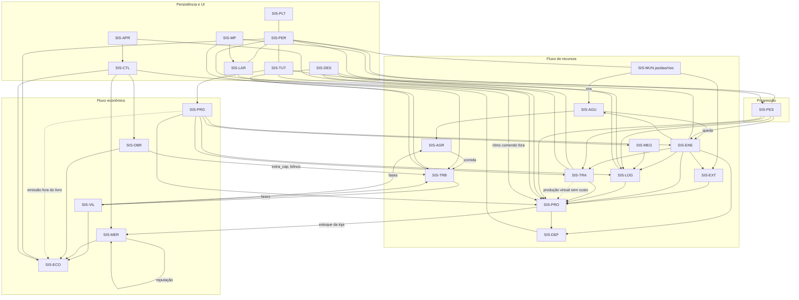

# 03 — Atlas de sistemas

Este documento é o índice das 25 fichas em [`03_atlas/`](03_atlas/). Cada ficha segue o modelo A–G: Identidade, Funcionamento, Experiência, Implementação, Histórico, Pendências e Classificação.

**Referências usadas**
- Commits: `main@53267af` e `pr47@80980db`.
- IDs: canônicos da revisão cruzada. São 25 SIS e 158 FUN, partindo dos 150 FUN do OPUS A, com 2 fundidos, 1 movido e 10 novos.
- Confiança:
  - **Alta**: E1 + E2.
  - **Média**: E2 sem E1 específico.
  - **Baixa**: só E3/E4.
  - Em todos os casos, **J (teste em jogo) = nenhum**.

**Estados por camada**
- Os estados seguem o vocabulário fixo. "ausente" significa que a camada não contém o item; não é um estado.
- Nenhum sistema está "Validado", porque nada foi compilado contra o Horizon real nem jogado.

## 1. Os 25 sistemas

| ID | Nome | Finalidade | main | pr47 | Confiança | Ficha |
|---|---|---|---|---|---|---|
| SIS-PLT | Plataforma, build e ferramentas | Levar o mod ao PC do jogador e verificar sem o jogo | Integrado | Integrado (launcher 0.16.1; sem pacote próprio) | Alta | [ficha](03_atlas/SIS-PLT.md) |
| SIS-MUN | Mundo | Jazidas, rios e limite do mapa como tabuleiro da fábrica | Integrado (pureza 3×3) | Integrado (veio 3D, rios); mapa finito Em desenvolvimento | Média | [ficha](03_atlas/SIS-MUN.md) |
| SIS-EXT | Extração e processamento | Tirar minério das jazidas vanilla e transformá-lo em chapas | Integrado | Integrado | Alta | [ficha](03_atlas/SIS-EXT.md) |
| SIS-PRO | Produção | Receitas, módulos, Mk.II e cadeia funda | Integrado | Integrado | Alta | [ficha](03_atlas/SIS-PRO.md) |
| SIS-ENE | Energia | Gerar e distribuir FE; segundo gargalo | Integrado | Integrado (+ hidrelétrica) | Alta | [ficha](03_atlas/SIS-ENE.md) |
| SIS-AGU | Água encanada | Levar água e lava em mB à lavoura e ao vapor | ausente | Integrado | Média | [ficha](03_atlas/SIS-AGU.md) |
| SIS-AGR | Agro e extrativismo | Comida, biomassa e matérias de origem animal; absorve poluição | Integrado | Integrado (+ irrigação) | Média | [ficha](03_atlas/SIS-AGR.md) |
| SIS-LOG | Logística local | Mover itens dentro da fábrica | Integrado | Integrado (+ expressa, túnel, prancheta) | Alta | [ficha](03_atlas/SIS-LOG.md) |
| SIS-TRA | Transporte entre zonas e produção virtual | Ligar zonas distantes; manter a fábrica longe viva | ausente | Integrado | Média | [ficha](03_atlas/SIS-TRA.md) |
| SIS-TRB | Aldeões trabalhadores | Mão de obra: postos, fila, contratação, crescimento | Integrado | Integrado | Média | [ficha](03_atlas/SIS-TRB.md) |
| SIS-VIL | Sociedade da vila | Casas, famílias, lojas, prefeito, fases e indicadores | Integrado | Integrado | Média | [ficha](03_atlas/SIS-VIL.md) |
| SIS-ECO | Economia e contabilidade | Moeda, livros, salários, imposto e bordas | Integrado | Integrado (+ `reward`) | Média (E1 só no modelo) | [ficha](03_atlas/SIS-ECO.md) |
| SIS-MER | Mercado e comércio exterior | Preço local, atacado, bolsa, contratos e importação | Integrado | Integrado | Média | [ficha](03_atlas/SIS-MER.md) |
| SIS-OBR | Obras e plantas | Prédios da vila com efeito, prestígio, pedidos e decretos | ausente | Integrado; telas Em desenvolvimento | Média | [ficha](03_atlas/SIS-OBR.md) |
| SIS-LAR | Casa do fundador e Lar | Casa do jogador; efeitos de refeição | ausente | Integrado | Média | [ficha](03_atlas/SIS-LAR.md) |
| SIS-CTL | Centro de controle | Painel da holding, metas, cofre, pendências e foco | Integrado | Integrado (+ páginas e foco) | Média | [ficha](03_atlas/SIS-CTL.md) |
| SIS-PRG | Progressão | Avanços, quadro, contratos e grande projeto | Integrado (avanços de 1 item) | Integrado (gate real Indeterminado) | Média | [ficha](03_atlas/SIS-PRG.md) |
| SIS-PES | Pesquisa | Laboratório da fábrica e pesquisa da vila | ausente | Integrado | Média | [ficha](03_atlas/SIS-PES.md) |
| SIS-TUT | Tutorial e guias | Ensinar fazendo; consulta em livros | Integrado (livros) | Integrado (+ tutorial na tela) | Alta | [ficha](03_atlas/SIS-TUT.md) |
| SIS-DEF | Ameaças e defesa | Poluição como custo de crescer; ondas e defesa | Integrado | Integrado | Média | [ficha](03_atlas/SIS-DEF.md) |
| SIS-MEG | Megafábricas | Copiadora, marco de obra e verticalidade | ausente | Integrado | Média | [ficha](03_atlas/SIS-MEG.md) |
| SIS-APR | Apresentação | Painéis, formas, som, shader e realismo | Integrado | Integrado; Realismo 2.1 no #51 | Média | [ficha](03_atlas/SIS-APR.md) |
| SIS-DES | Desempenho | Rodar num PC de 8 GB | Integrado | Integrado com **regressão** | Alta | [ficha](03_atlas/SIS-DES.md) |
| SIS-MP | Multijogador LAN | Jogo cooperativo no mundo do anfitrião | ausente | Integrado | Baixa | [ficha](03_atlas/SIS-MP.md) |
| SIS-PER | Persistência e ciclo de vida do mundo | Salvar e restaurar estado; trocar de mundo | Integrado (só NBT) | Integrado (5 arquivos sem versão) | Média | [ficha](03_atlas/SIS-PER.md) |

## 2. Mapa de dependências

Linhas tracejadas: dependências que contrariam a intenção ([CNF-001](09_CONFLITOS_LACUNAS_E_RISCOS.md#2-conflitos-cnf), [CNF-009](09_CONFLITOS_LACUNAS_E_RISCOS.md#2-conflitos-cnf)).

## 3. Tabela de dependências

| SIS | Depende de | Consumido por | Acoplamento crítico (E2) |
|---|---|---|---|
| PLT | Horizon (sem `rev`) | todos | `native/api/Cargo.toml` |
| MUN | PLT (APIs de chunk) | EXT, AGU, ENE | `rivers.rs` usa `read_columns`/`chunk_load` |
| EXT | MUN, ENE | PRO, ECO (esmeralda Mk.II) | `production/extraction.rs` |
| PRO | EXT, ENE, LOG, LAR (ritmo) | MER, PRG, PES, DEF | `upgrades.rs:44` lê `home::time_factor` |
| ENE | PRO (combustível), AGU (vapor, hidrelétrica) | todos que consomem FE | `power.rs`; `water.rs:328` |
| AGU | MUN (rios), ENE | AGR, ENE | `production/water.rs` |
| AGR | AGU, TRB (lavrador, pastor) | TRB (comida), VIL (despensa), DEF (absorção) | `farm.rs`, `pantry.rs` |
| LOG | ENE | PRO, TUT (prova de automação) | `operations.rs` `container_accepts` |
| TRA | ENE, LOG, PER | PRO | `stations.rs:117-140`; `freight.rs` |
| TRB | AGR, VIL (fase, vaga), OBR (extra_cap) | VIL, CTL, LOG | `village.rs:121-129`; `society::birth_allowed` |
| VIL | TRB, MER, ECO | TRB (limite), CTL | `society/mod.rs`, `mayor.rs` |
| ECO | VIL, MER, OBR, PRG (emissões) | CTL, MER | `ledger.rs`, `center.rs:592-620` |
| MER | PRO, ECO, VIL | ECO | `market.rs`, `trade.rs` |
| OBR | ECO (caixa = Company), TRB (mestre, staff) | TRB, VIL, ECO | `projects.rs`, `site.rs`, `requests.rs` |
| LAR | TRB (spawn), ECO | PRO (ritmo comendo fora), MP | `home/food.rs`, `workforce/home.rs` |
| CTL | ECO, TRB, OBR, MER, APR | jogador | `center.rs`, `focus.rs` |
| PRG | PRO, conteúdo (avanços) | PRO, ENE, LOG, TRA, MEG | `milestones/mod.rs`, `contracts.rs`, advancements JSON |
| PES | PRO, ENE, PER | PRO, ENE, TRA, LOG (receitas); TRB (pesquisa da vila) | `research.rs:166`, `staff.rs` |
| TUT | PRO, LOG, PRG, PER | jogador | `onboarding.rs`, `tutorial.rs` |
| DEF | PRO (poluição), ENE (Tesla), TRB (quartel) | TRB (perdas), PRO (integridade) | `pollution.rs`, `defense.rs` (relógio global) |
| MEG | LOG, PRO | jogador | `blueprint/mod.rs`, `lift.rs`, `ladders.rs` |
| APR | todos (status) | jogador | `presentation.rs` `STATUS_KEYS` (44) |
| DES | todos | jogador | `budget.rs`, `perf/*` |
| MP | TRB (spawn), LAR, PES | jogador | `workforce/spawn.rs:151` |
| PER | PLT (`world_dir`) | ECO, TRA, MUN, PES, TUT, DEF, LAR | `lib.rs:89` (reset parcial) |

## 4. Sistemas estruturantes

Se um destes falhar, o jogo deixa de ser o Veio.

| SIS | Por que é estruturante |
|---|---|
| **SIS-PRO** | É o pilar P1. Todo sistema produz para ele ou consome dele |
| **SIS-TRB** | É o diferencial (P3). Sem aldeões não há vila, sociedade nem economia |
| **SIS-ECO** | Fecha o loop médio. Hoje é a peça mais frágil em relação à intenção: bordas, emissões e imposto duplo |
| **SIS-PRG / SIS-PES** | Definem a curva do jogo inteiro. São dois gates que não se conhecem, e o gate real é Indeterminado (sem `doLimitedCrafting`) |
| **SIS-DES** | Restrição do dono (8 GB). Uma regressão invalida a candidata |
| **SIS-PER** | Um save corrompido ou perdido destrói horas de fábrica. Os 5 arquivos não têm versão; 3 não são gravados de forma atômica |
| **SIS-PLT** | Sem compilação contra o Horizon real, nenhum estado passa de "Integrado offline" |

## 5. Sobreposições (responsabilidades conflitantes)

| Par | Conflito | Fichas | Encaminhamento |
|---|---|---|---|
| PRG (quadro e licenças) × PES (laboratório) | Duas portas para liberar máquinas. O Quadro promete o que só a pesquisa libera | [PRG](03_atlas/SIS-PRG.md), [PES](03_atlas/SIS-PES.md) | [Q-03](09_CONFLITOS_LACUNAS_E_RISCOS.md#q-03-espinha-da-progressão), [CNF-002](09_CONFLITOS_LACUNAS_E_RISCOS.md#2-conflitos-cnf) |
| PES (laboratório) × PES (pesquisa da vila) | Mesmo nome e mesma chave `veio.research.done` com aridade diferente | [PES](03_atlas/SIS-PES.md) | [CNF-018](09_CONFLITOS_LACUNAS_E_RISCOS.md#2-conflitos-cnf) |
| PRG (pedido do dia do quadro) × OBR (pedidos da vila) | Duas recompensas diárias com regras de pagamento opostas | [PRG](03_atlas/SIS-PRG.md), [OBR](03_atlas/SIS-OBR.md) | [Q-02](09_CONFLITOS_LACUNAS_E_RISCOS.md#q-02-dois-pedidos-diários), [CNF-004](09_CONFLITOS_LACUNAS_E_RISCOS.md#2-conflitos-cnf) |
| PRG (central, grande projeto) × ECO | Emissão de esmeraldas fora do livro | [ECO](03_atlas/SIS-ECO.md) | [Q-01](09_CONFLITOS_LACUNAS_E_RISCOS.md#q-01-esmeraldas-criadas-fora-dos-livros), [CNF-001](09_CONFLITOS_LACUNAS_E_RISCOS.md#2-conflitos-cnf) |
| CTL × PRG (quadro) | Ambos mostram metas, alertas e pedidos, com raio 64 e censos separados | [CTL](03_atlas/SIS-CTL.md) | Integrador |
| TRA (âncora) × TRA (estações) | Duas respostas à fábrica distante | [TRA](03_atlas/SIS-TRA.md) | Reconciliado (estações canônicas) |
| TRA × MER (`freight_station`) | O ID foi renomeado sem migração: o terminal antigo vira estação de exportação | [TRA](03_atlas/SIS-TRA.md), [MER](03_atlas/SIS-MER.md) | [CNF-014](09_CONFLITOS_LACUNAS_E_RISCOS.md#2-conflitos-cnf) |
| LAR (Codex: comer fora) × LAR (obras: Lar) | Dois módulos de "casa" (`home/` e `workforce/home.rs`) | [LAR](03_atlas/SIS-LAR.md) | Reconciliado ([DEC-046](06_HISTORICO_E_DECISOES.md#dec-046)) |
| VIL (fases da prefeitura) × OBR (prestígio) × PRG (fases do quadro) | Três escadas com nomes que se cruzam ("Vila", "Cidade"); "Prefeitura" é obra e bloco | [VIL](03_atlas/SIS-VIL.md), [OBR](03_atlas/SIS-OBR.md) | [Q-04](09_CONFLITOS_LACUNAS_E_RISCOS.md#q-04-nomes-que-colidem), [CNF-010](09_CONFLITOS_LACUNAS_E_RISCOS.md#2-conflitos-cnf) |
| APR × TRA × CTL (status 40/41) | O mesmo código tem dois sentidos. Hoje sem efeito, mas é um risco latente | [CTL](03_atlas/SIS-CTL.md) | [CNF-013](09_CONFLITOS_LACUNAS_E_RISCOS.md#2-conflitos-cnf) |
| DEF × SIS-PER | O relógio global vive em `defense.rs` e a poluição só em memória | [DEF](03_atlas/SIS-DEF.md), [PER](03_atlas/SIS-PER.md) | Integrador |
| TRA (produção virtual) × PRO × ECO | A estação "produz" sem consumir insumo nem energia, e o canal é global; trem, drones e caravanas param fora da área simulada | [TRA](03_atlas/SIS-TRA.md) | [Q-05](09_CONFLITOS_LACUNAS_E_RISCOS.md#q-05-produção-virtual-e-transporte-longo), [CNF-009](09_CONFLITOS_LACUNAS_E_RISCOS.md#2-conflitos-cnf) |
| PRG e PES (avanço libera receita) × PLT (Horizon) | Sem `doLimitedCrafting`, a trava pode ser só visual | [PRG](03_atlas/SIS-PRG.md), [PES](03_atlas/SIS-PES.md) | [CNF-003](09_CONFLITOS_LACUNAS_E_RISCOS.md#2-conflitos-cnf) |
| VIL (varejo) × ECO (atacado) | O imposto da fase é cobrado nas duas pontas sobre o mesmo bem | [ECO](03_atlas/SIS-ECO.md) | [Q-13](09_CONFLITOS_LACUNAS_E_RISCOS.md#q-13-imposto-uma-ou-duas-vezes), [CNF-015](09_CONFLITOS_LACUNAS_E_RISCOS.md#2-conflitos-cnf) |
| LAR (comer fora) × PES (`@a`) × MP | Bônus global e avanços para quem está online: em LAN, um jogador acelera as máquinas do outro | [LAR](03_atlas/SIS-LAR.md), [MP](03_atlas/SIS-MP.md) | [Q-15](09_CONFLITOS_LACUNAS_E_RISCOS.md#q-15-o-que-é-de-cada-jogador-em-lan), [CNF-017](09_CONFLITOS_LACUNAS_E_RISCOS.md#2-conflitos-cnf) |
| APR (#51) × DES (#52) | As duas frentes alegam leveza e nenhuma recupera a main; o #52 diz "0 alocações" | [APR](03_atlas/SIS-APR.md), [DES](03_atlas/SIS-DES.md) | [CNF-020](09_CONFLITOS_LACUNAS_E_RISCOS.md#2-conflitos-cnf) |
| VIL (IDH) × OBR (serviços) × #54 (lazer e ânimo) | Duas frentes mexem na fórmula do IDH ao mesmo tempo (depois do corte; ver [07 §3](07_AGENTES_E_WORKFLOW.md#3-duplicações-e-conflitos-entre-agentes)) | [VIL](03_atlas/SIS-VIL.md), [OBR](03_atlas/SIS-OBR.md) | [CNF-022](09_CONFLITOS_LACUNAS_E_RISCOS.md#2-conflitos-cnf); [TAR-017](08_BACKLOG_E_PRIORIDADES.md#tar-017), [TAR-065](08_BACKLOG_E_PRIORIDADES.md#tar-065), [Q-06](09_CONFLITOS_LACUNAS_E_RISCOS.md#q-06-teto-de-população-e-bônus-das-obras) |
