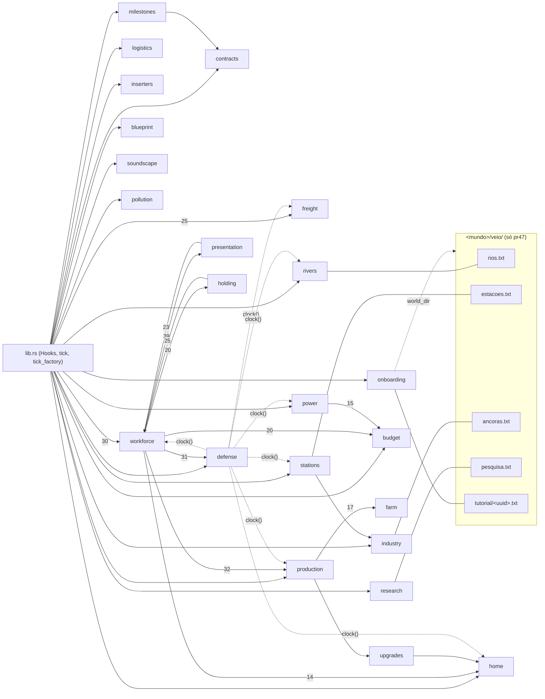
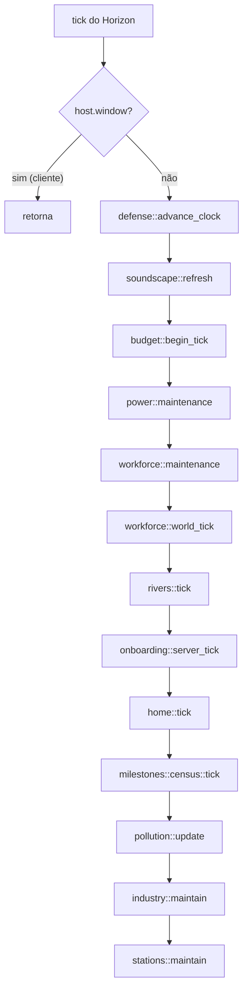
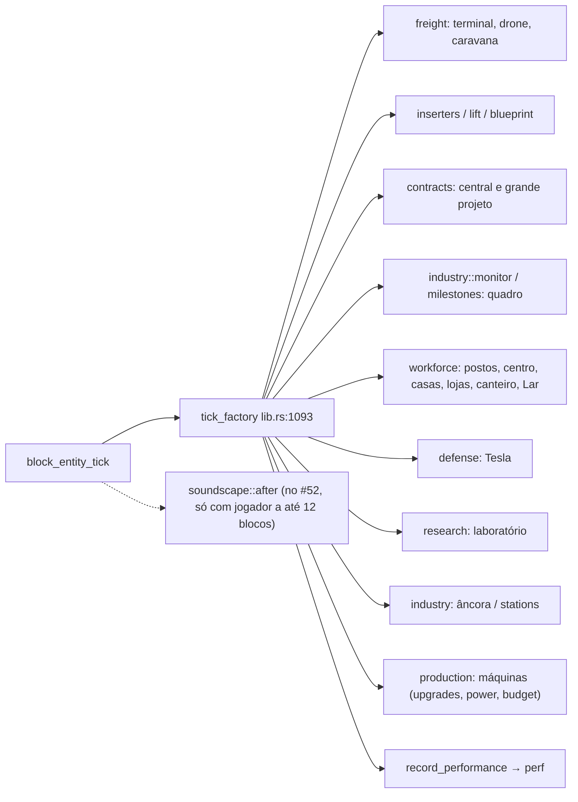

# 04: Arquitetura e dependências

> **Referência:** `main@53267af` (0.25.0) e `pr47@80980db` (candidata). Os PRs `#51@a0b0d72` e `#52@0b827f6` aparecem só onde mudam a arquitetura. Data: 2026-11-08.
> **Caminhos:** salvo indicação, são de `native/api/src/` no pr47.
> **Evidência:** E1 = executado · E2 = lido no código · E3 = documento ou commit · E4 = chat/memória · ND = não determinado · J = visto em jogo (nenhum item).
> **O que é este arquivo:** a arquitetura **real**, lida no código. Ele não registra a intenção.
> **Onde fica o resto:** o estado de cada funcionalidade está em [05](05_ESTADO_REAL_DA_BUILD.md); os riscos, em [09](09_CONFLITOS_LACUNAS_E_RISCOS.md); as tarefas, em [08](08_BACKLOG_E_PRIORIDADES.md).
> **Aviso:** nada daqui foi compilado contra o Horizon real nem visto em jogo.

## 1. Camadas

| Camada | O que é | main | pr47 | Evid. |
|---|---|---|---|---|
| Horizon | Cliente e servidor Minecraft 26.3 em Rust. Carrega mods nativos pelos traits `Hooks`/`Host` e shaders WGSL | **Dependência sem `rev` e sem `Cargo.lock`** (`native/api/Cargo.toml`). Cada build pega o Horizon que estiver no launcher | idem | E2 |
| Mod nativo `mod-veio` | Crate Rust (edition 2024). `pub fn hooks() -> Box<dyn Hooks>` devolve `Factory` | 16 módulos, 16 770 linhas, 23 ganchos (`lib.rs:67`) | 29 módulos, 32 156 linhas, 33 ganchos (`lib.rs:82`) | E2 |
| Conteúdo | Datapack e assets em `content/` (blocos, itens, receitas, avanços, menus, lang, livros) | 529 JSON, 55 blocos, 16 itens, 1 050 chaves pt_br | 742 JSON, 76 blocos, 25 itens, 1 834 chaves | E1/E2 |
| Ferramentas | `tools/`: geradores (`build_*`) e verificações (`check_*`, `sim_economy.py`) | 14 entradas | 31 entradas | E2 |
| Launcher | `launcher/` e `launcher.exe` (Windows): instala o conteúdo e roda `horizon-launcher native-build` | Cargo 0.10.0, perfil `dev` | Cargo 0.16.1, perfil `performance`, escolha de visual | E1/E2 |
| Visual | `visuals/veio-industrial/` (shader `api = "0.1"`), sons Kenney CC0 | — | presente | E2 |
| WIP | `work-in-progress/finite-world/`: mixins de motor, fora do crate | — | presente, desligado | E2/E3 |

Não há thread própria. Todo o mod roda dentro dos ganchos. O estado fica em três lugares: `static Mutex`/atômicos por módulo, NBT dos block entities e, só no pr47, arquivos em `<mundo>/veio/` (§6).

## 2. Fronteira com o Horizon

### 2.1 Ganchos (`impl Hooks for Factory`, E2)

| Grupo | main (23) | pr47 (+10 = 33) |
|---|---|---|
| Block entity | `block_entity`, `_container`, `_energy`, `_render_bounding_box`, `_submit`, `_tick`, `_ticks`, `_update_tag` | = |
| Itens e menus | `container_accepts`, `menu_button`, `menu_slot_rules`, `tooltip`, `trade_with_villager` | + `inventory_move_item`, `living_entity_use_item_finish` |
| Mundo | `tick`, `entity_tick_pre`, `register_goals`, `right_click_block` | + `chunk_load`, `place_block`, `server_about_to_start` |
| Jogador | `player_logged_in`, `player_respawned` | + `player_logged_out`, `player_bed_enter`, `player_spawn_point_set` |
| Telas | `screen`, `screen_click`, `screen_draw`, `screen_tooltip` | = |
| Comandos | — | `register_commands`, `perform_command` |
| #51 | — | + `visuals`, `shader_params` (existem nos `native-hooks.json` 66f3981 e 5f7cadf, E2) |
| **Pedidos e ausentes** | `destroy_block`, `left_click_block`, `use_item_on`, `explosion_detonate` (proteção de obras, `HANDOFF_OBRAS.md`) | ausentes |

### 2.2 `Host`, stub e Horizon real

- **Métodos de `Host`.** main tem 44; pr47 tem 52 (+ `acting_player`, `level_block`, `level_is_loaded`, `mod_block_entity`, `read_columns`, `send_map`, `window`, `world_dir`). No #51 o stub ganha +48 linhas (`fn player()`, `NativePlayer`, `NativeBlockRim`).
- **Stub offline.** `native/offline-check/horizon-client/src/mod_api.rs` copia as assinaturas do Horizon **66f3981** (05/11). O HEAD do Horizon é **5f7cadf** (08/11 19:52 +0100). Os corpos do stub são triviais: `window()` devolve `false`; `world_dir()` é `unimplemented!` e derruba o `bench_large_village`.
- **Conferência contra o Horizon real** (só leitura, cópia de leitura do Horizon em 66f3981 e 5f7cadf, não versionada, E2):
  - os 33 ganchos e os 52 métodos existem como `native_*` em 66f3981 e em 5f7cadf;
  - há duas diferenças de tipo: `set_block_property` (o real tem `&mut Ticks` e `flags: i32` a mais) e `world_dir` (`PathBuf`).
- **Nunca compilados.** `read_columns` e `chunk_load` entraram em `bcfb9d5` (#40), depois da única compilação nativa alegada (`4ffb605`, 0.16.1 do Codex, E3).
- **Não usados.**
  - `native_chunk_tickets.rs`: a âncora usa `run_command("forceload …")` (`industry.rs:285-291`).
  - `native_chunk_generate`: não existe no 66f3981.
- **Comandos de servidor usados como API** (semântica no Horizon ND):
  - `advancement grant @a only veio:<id>` (`research.rs:166`, grande projeto `lib.rs:1101`);
  - `effect give` (`home/food.rs`, `workforce/home.rs:481`);
  - `forceload`.
- **Dois detectores de servidor:** `host.window()` e `industry::on_server` (`industry.rs:106`).

## 3. Módulos (pr47)

| Módulo | SIS | Na main? | Responsabilidade | Estado global (memória) |
|---|---|---|---|---|
| `lib.rs` | PLT, PRO | ✓ | Ganchos, `tick` global, `tick_factory` (despacho por id, `lib.rs:1093`), tabela de chaves NBT (`nbt_key :611`, `rare_nbt_key :950`), `record_performance` | — |
| `budget` | DES | ✓ (igual) | Cotas por tick: faixas Area, Terrain, Topology, Planning, Workforce, HaulSearch; `LIMITS [512,384,4096,2048,512,1024]`, `STALE [2,2,2,2,20,2]` (`budget.rs:6-10`) | fila por faixa |
| `presentation` | APR | ✓ | Telas, cores, `STATUS_KEYS` (§10.1), `DATA_SLOTS = 13` | — |
| `power` | ENE | ✓ (igual) | Postes e rede: madeira 8/120/1000, aço 16/400/4000, `MAX_LINKS 6` | CONNECTIONS |
| `production/` (`data`, `extraction`, `generation`, `crops`, `forestry`, `pantry`, `ranch`, **`water`**, **`stations`**) | PRO, EXT, AGR, AGU, TRA (estações) | ✓ (sem `water`/`stations`) | Máquinas por tabela (`data.rs` gerado), jazidas e pureza, geradores, agro, água, estações | canais de estação |
| `logistics`, `logistics_controls`, `inserters`, `operations`, `lift` | LOG, TRA (`lift`) | ✓ (menos `lift`) | Esteiras, túnel, divisor, unificador, filtros, braços, entregas, prancheta (`veio:clipboard`), elevador | — |
| `upgrades` | PRO | ✓ | Módulos, Mk.II. Multiplica o tempo por `home::time_factor` (`upgrades.rs:44`) | — |
| `workforce/` (`center`, `zones`, `village`, `spawn`, `foreman/`, `society/{mod,ledger,market,trade,mayor}`, `barracks`, **`home`, `projects`, `requests`, `site`, `staff`, `focus`, `ladders`, `blueprints`, `blueprint_data`**) | TRB, VIL, ECO, MER, OBR, CTL, DEF, PES, MEG | ✓ (sem os em negrito) | Aldeões, vila, sociedade, livros, comércio exterior, centro de controle, obras e Lar | ledger, `BORDERS` (`ledger.rs:48`), TRADES |
| `holding` | ECO, CTL | ✓ | 11 abas; divisões 1–9 + `FOREIGN 10` | contas por divisão |
| `contracts` | PRG, ECO | ✓ | Central de contratos, EXPORT perpétuo, fases do grande projeto | — |
| `defense`, `pollution`, `farm`, `tutorial`, `perf` | DEF, AGR, TUT, DES | ✓ | Tesla e **relógio global** `clock()`; poluição e ondas; lavoura; dicas; métricas | relógio, poluição |
| `freight` (+`caravan`) | TRA | — | Terminal ferroviário `veio:rail_terminal`, drones, caravanas | PORTS |
| `milestones` (+`census`) | PRG | — | Quadro da fábrica, licenças, pedido do dia, alertas | censo, `paid_day` |
| `home` (+`food`, `mural`) | LAR | — | Casa do fundador e bônus de comer fora | `MEAL_UNTIL`/`FEAST_UNTIL` (`food.rs:28-29`) |
| `industry`, `research`, `rivers`, `onboarding`, `blueprint`, `appearance`, `motion`, `soundscape` | TRA e PRO (`industry`), PES, MUN e AGU (`rivers`), TUT, MEG, APR | — | Âncora e monitor; laboratório; rios; tutorial por jogador; copiadora; silhuetas; animação; som | em memória e arquivos (§6) |
| #51: `ambience`, `climate` | APR | — | Clima e "estações do ano" (não auditado) | ND |

## 4. Dependências entre módulos

As arestas contam referências `modulo::` no código do pr47 (E2). Linha tracejada significa uso do relógio global.



**Ciclos e dívidas** (riscos R-32 e R-33 em [09](09_CONFLITOS_LACUNAS_E_RISCOS.md#a5-dívidas-técnicas)):
- `workforce ↔ presentation` (39/23 referências).
- `workforce ↔ holding` (20/25).
- `defense` é dono do relógio do mod, embora seu domínio seja a Tesla.
- `tick_factory` é uma cadeia de `if/else` com 13 destinos por bloco.

## 5. Fluxo de um tick

### 5.1 Servidor: gancho `tick` (pr47 `lib.rs:326`; main `lib.rs:232`)



Na main, a ordem é `advance_clock → begin_tick → power → workforce → spawn::tick → pollution`, sem retorno pelo cliente. `server_about_to_start` (`lib.rs:89`, só no pr47) limpa `home`, `census` e `blueprint`. Os demais estados detectam a troca de mundo pelo `world_dir` (`stations.rs:217`; `rivers.rs:47`, a cada 100 ticks) ou não detectam (R-10).

### 5.2 Block entity: `block_entity_tick` (pr47 `lib.rs:462`)



### 5.3 Cliente: quadro

`block_entity_submit` desenha cada block entity; `presentation` publica o painel. A main garante 0 alocações por quadro (`9c94c55`, E1). O pr47 faz 329 (E1, [05 §3](05_ESTADO_REAL_DA_BUILD.md#3-resultados-e1)).

## 6. Persistência

| Onde | main | pr47 | Durável? | Formato e versão |
|---|---|---|---|---|
| NBT de block entity | Livros Company/Public/Shop, carteira, preços, comércio exterior (`trade::persist`, `VERSION 3`, `trade.rs:389`), máquinas, postos, zonas | + "Water", "Home"/"HomeBeds", obras, "Techs", estações | Sim | Chaves em §10.6. Só o comércio tem versão |
| `static` em memória | ledger + `BORDERS`, holding, CONNECTIONS, TRADES (reespelhado no NBT), poluição, relógio (`defense::CLOCK` volta a 0) | + PORTS, censo, `paid_day`, blueprint, home, bônus de refeição | **Não**: perde-se ao reiniciar (R-09) | — |
| `<mundo>/veio/` | — | §10.7 (5 arquivos) | Sim | **Nenhum** tem versão. Só rios e tutorial gravam via temporário (R-08) |
| Command storage e tags | — | `veio:home built`; tag `veio_village` | Sim (vanilla) | — |

## 7. Pipeline de conteúdo

```
tools/production.json ──build_production.py──► production/data.rs + receitas/guias   (57 receitas, 23 jazidas, 28 alimentos)
tools/build_content.py ──► content/data|assets                                        (76 blocos, 25 itens)
tools/build_textures.py, build_belts.py ──► texturas 16×16
tools/build_tutorial.py ──► Guia (100 pág.), Industry guide (26 pág.)
pr47: build_blueprints (9 plantas, 7542 blocos), build_house (251 comandos; Lar = lareira, :177-178),
      build_machine_audio (30 .ogg), build_onboarding, build_first_steps, build_transport_guide
tools/check_project.py ──► JSON, traduções, páginas (≤ 14 linhas; Guia ≤ 100), texturas, sim_economy.py
```

**Reprodutibilidade (E1):**
- Na main, só diferem `belt_rail.png` e `fast_belt_rail.png`, e apenas em bytes (zlib).
- No pr47, só diferem os 30 `.ogg`.
- `data.rs` está em sincronia com o `production.json` (prensa 30t, montador 40t).

**Dívida:** `sim_economy.py` copia constantes à mão (R-38).

## 8. Launcher e pacote

| Aspecto | main | pr47 |
|---|---|---|
| Versão do launcher | Cargo 0.10.0; `.exe` sha 85723581… | Cargo **0.16.1** (binário do Codex, `a3303bb`); sha cc7fefaa… |
| Stamp de recompilação | `built.trim() != version` (`launcher/src/main.rs:52`) | `"{version}\nprofile={NATIVE_PROFILE}"` (`:56-57`). Trocar de camada força recompilar |
| Perfil nativo | `dev` | `performance` (`:26`); `--trust-native-code` (`:66`) |
| Visual | — | `realismo-8gb` / `leve` (`launcher/src/visuals.rs:23-32`); `leve` zera `HORIZON_SHADER_PACK` (`:95`) |
| Pacote | `release/Veio-0.25.0.zip` (blob `e01ef740`) | **o mesmo blob da main**, mais `Veio-Realismo-1.1.zip`, que contém a **0.16.1**. Não há pacote próprio |
| `package.py` | Diz que o `.exe` "é gerado, nunca versionado", mas os dois ramos o versionam (R-40) | idem |

O launcher só existe para Windows e não foi compilado nesta nuvem.

## 9. Testes e verificações (arquitetura)

- **`veio-check`.** O crate `native/offline-check/veio-check` inclui `native/api/src` por caminho e roda os `#[test]` contra o stub. **Não é o Horizon.**
- **Comandos:**
  - `python3 tools/check_rust.py`: todos os testes;
  - `cargo test --release … -- --ignored bench_`: benchmarks;
  - `tools/check_performance.py`: 7 cenários de `profile_scale`.
- **Fora dos cenários:** rios, água, estações, som e obras (R-17).
- **Testes por módulo e resultados E1:** ver [05 §3](05_ESTADO_REAL_DA_BUILD.md#3-resultados-e1).
- **Sem módulo de teste próprio:** `contracts`, `holding`, `defense`, `pollution`, `farm`, `upgrades`, `tutorial`, `presentation`.
- **Sem CI:** não existe `.github/` (R-31).
- **`tools/check_native_api.py`** confere as assinaturas contra o `.rmeta` real. Nunca rodou: precisa do Horizon compilado.

---

## 10. Registro de IDs

Este é o registro a consultar **antes de reservar** um número, uma chave ou um arquivo.

**Regras propostas** (decisão de agente, não confirmada pelo dono; ver [TAR-034](08_BACKLOG_E_PRIORIDADES.md#tar-034)):
- Nenhum índice é reaproveitado.
- Toda reserva nova entra aqui no mesmo PR que a cria.
- Códigos que **não** são índice de `STATUS_KEYS` (como as pendências do centro) passam a usar uma faixa própria, a partir de 100.

### 10.1 `STATUS_KEYS`: índice de status exibido nos painéis

O texto mostrado é `veio.status.<chave>`. São 36 entradas na main e 44 no pr47 (`presentation.rs`). **O próximo índice livre é 44.**

| Índice | Chave | Constante (módulo) | Camada |
|---|---|---|---|
| 0–13 | idle, working, input, blocked, ore, power, fuel, sun, charged, redstone, crops, watch, tier, damaged | máquinas comuns (`production`, `lib.rs`); 3 = bloqueado, também usado por `waiting()` | main+pr47 |
| 14–17 | water, wind, seeds, animals | `production::NO_WATER/NO_WIND/NO_SEEDS/NO_ANIMALS` (`production/mod.rs:42-45`) | main+pr47 |
| 18–25 | no_worker, absent, no_task, no_food, path, walking, idle_work, no_wage | `workforce::NO_WORKER…NO_WAGE` (`workforce/mod.rs:69-78`) | main+pr47 |
| 26–28 | zone, storing, rest | `workforce::ZONE_ACTIVE`, `STORING`, `RESTING` (`:80-83`) | main+pr47 |
| 29–31 | housed, no_permit, empty_home | `society::HOUSED/NO_PERMIT/EMPTY_HOME` (`society/mod.rs:391-393`) | main+pr47 |
| 32–35 | no_company, no_water, not_frontier, locked_market | `trade::NO_COMPANY…LOCKED_MARKET` (`society/trade.rs:37-40`). ⚠ `trade::NO_WATER = 33` tem o mesmo nome de `production::NO_WATER = 14` | main+pr47 |
| 36–39 | site_plan, site_blocked, site_building, site_done | `site::SITE_*` (`workforce/site.rs:42-45`). ⚠ `TRABALHADORES.md:234` diz 32–35 (errado; R-25) | pr47 |
| **40–43** | freight_route, caravan_animal, caravan_feed, caravan_busy | `freight::NO_ROUTE/NO_ANIMAL/NO_FEED/ANIMAL_BUSY` (`freight.rs:15-18`) | pr47 |

**⚠ Colisão** (CNF-013 em [09](09_CONFLITOS_LACUNAS_E_RISCOS.md#2-conflitos-cnf)): os **códigos de pendência** do centro usam 40 e 41 com outro sentido (§10.2).
- **Hoje não há efeito**, porque `waiting()` (`center.rs:111-113`) só aceita {3, 18, 19, 21, 22, 25, 37}.
- `center.rs:197` ainda formata os demais códigos como `STATUS_KEYS[code]`.

### 10.2 Códigos de pendência do centro (não são índice de `STATUS_KEYS`)

| Código | Constante | Sentido | Onde aparece |
|---|---|---|---|
| 40 | `center::ZONE_READY` (`center.rs:39`) | Zona pronta para subir de nível | `problem_text`/`advice` (`center.rs:193-205`), `focus::resolved` (`focus.rs:110-118`) |
| 41 | `center::STORE_FULL` (`:40`) | Armazém cheio | idem |
| 3, 18, 19, 21, 22, 25, 37 | (status reaproveitados) | Postos e canteiros que viram pendência | `waiting()` |

Estados internos do canteiro (não exibidos): `site::PLAN 0`, `BUILDING 2`, `DONE 3`. Retornos de `site`: `NO_CENTER 1`, `ALREADY 3`.

### 10.3 Slots do centro de controle (`veio:control_center`)

| Slot | main (6) | pr47 (8) | Constante |
|---|---|---|---|
| 0 | comida do administrador | = | — |
| 1–3 | metas (item × `META_UNIT 16`) | = | `center::GOAL_SLOTS` |
| 4 | cofre (depósito de esmeraldas → livro Company, borda +) | = | `ledger::COMPANY_VAULT` |
| 5 | saque (1 esmeralda, até 16) | = (saída) | `ledger::COMPANY_CASHOUT` |
| 6 | — | obra (materiais e entregas; esmeralda que nenhuma obra pediu vai para o caixa) | `projects::SITE` |
| 7 | — | decreto | `projects::DECREE` |

Entradas: main `[0, 4]` e pr47 `[0, 4, 6, 7]`; saída `[5]` (`workforce/mod.rs:136@main`, `:147@pr47`). O raio é de 64 blocos (`center::RADIUS`) e há 4 páginas (`PAGES`). **O "caixa da vila" é o livro Company do centro.**

### 10.4 Bits de efeito da vila (`workforce/projects.rs`, pr47)

| Bits | Uso |
|---|---|
| 1, 2, 4, 8, 16, 32, 64, 128, 256, 512 | Obras: CANTEEN, SCHOOL, SMITHY, MARKET, FESTIVAL, LIBRARY, POST_OFFICE, INN, HALL, LAB (`:42-51`) |
| `1<<10`, `1<<11`, `1<<12` | Decretos: CALL, RATION, PLENTY (`:53-55`) |
| 16–17 | Nível de prestígio (`TIER_SHIFT`, 2 bits) |
| 20–24 | Pesquisas da vila (`RESEARCH_SHIFT`; `staff::AGRONOMY 1, CARGO 2, NUTRITION 4, PEDAGOGY 8, ENGINEERING 16`) |
| 26 | "de pé · parado" (`veio.center.project.idle`, `HANDOFF_OBRAS.md`) |
| livres | 13–15, 18–19, 25, 27–31 |

### 10.5 Blocos e itens

**Na main:** 55 blocos e 16 itens. Todos continuam no pr47 (E2).

**Novos no pr47:**
- **+21 blocos:** `belt_tunnel`, `blueprint_designer` (Copiadora), `build_marker`, `caravan_station`, `cargo_lift`, `cargo_station`, `chunk_anchor`, `drone_port`, `express_belt`, `fabricator`, `factory_board`, `factory_monitor`, `home` (Lar), `hydro_turbine`, `pipe`, `pump`, `rail_terminal`, `research_lab`, `site` (canteiro), `sprinkler`, `unloading_station`.
- **+9 itens:** `automation_core`, `clipboard` (**Prancheta**), `mk2_kit`, `motor`, `permit_electronics`, `permit_steel`, `permit_workshop`, `processor`, `route_card`.

**⚠ ID com dois sentidos:** `veio:freight_station`.
- No Codex 0.16.1 (`50995e6`, `freight.rs:7`) era o terminal ferroviário: 6 slots.
- Desde `a79f326` é a estação de exportação (`society/trade.rs:27`): 9 slots de entrada.
- Não há alias nem migração (CNF-014).

**Avanços:**
- `content/data/veio/advancement/*.json`: 52 arquivos, entre eles `engineering`, `steel` e `circuits`, com requisito `[["stock","permit"]]`, e o `grand_project`.
- `research/{metallurgy,electronics,automation,scale}.json`: gatilho `impossible`, concedidos por comando.
- Pastas `tutorial/` e `village/`.

### 10.6 Chaves NBT principais

**Tabela de chaves:** `nbt_key` (`lib.rs:611`, chaves resolvidas na compilação) e `rare_nbt_key` (`:950`). Chave nova deve entrar numa das duas, ou cai na busca lenta.

| Domínio | Chaves |
|---|---|
| Máquina comum | `Status`, `Info` (pureza ou detalhe), `Duration`, `Progress`, `Burn`, `BurnTotal`, `Damage`, `Level`, `Cooldown`, `Swing`, `DisplayItem`, `DisplayCount`, `MeterTicks`, `MeterActive`, `MeterItems`, `MeterReady`, `Bonus`, `BonusItem` |
| Logística | `LogisticsFilter`, `LogisticsPaused`, `RoutingPriority`, `ManualDirection`, `Links`, `PathSig` |
| Orçamento e buscas | `AreaScan`, `AreaFound`, `TerrainPending`, `TopologyPending`, `PlanningPending`, `HaulSearchPending`, `HaulTaskDesk`, `HaulTaskId`, `ScanArea`, `Skipped` |
| Aldeões e postos | `Worker`, `Absent`, `BusyAt`, `Carried`, `Held`, `Herd`, `Posts`, `Queue`, `Admin`, `Action`, `DWorkers`, `DWorking`, `DWaiting`, `DHungry` |
| Livros e vila | `Company`, `Public`, `Wallet`, `Prices`, `Sold`, `SoldToday`, `OfferSig`, `Phase`, `DMade`, `DSold`, `DTax`, `DWages`, `DAssist`, `DExport`, `Trade`, `TradeRecent` |
| Transporte | `FreightExport`, `FreightImport`, `FreightChannel`, `FreightManualImport`, `FlightTarget`, `FlightDelta`, `FlightPhase`, `Caravan{Animal,Entity,Probe,LastPos,Stall}` |
| Água e agro | `Water`, `WaterPort`, `Fertility` |
| Casa, obras e pesquisa | `Home`, `HomeBeds`, `Techs` (pesquisa da vila), chaves de progresso por pesquisa (`staff.rs:75 tech_key`). `Fixed` está **reservada** pelo `HANDOFF_OBRAS.md` para o canteiro de ruína, mas ainda não existe |
| Contratos e poluição | `ContractStage`, `LocalSmog` |

### 10.7 Arquivos em `<mundo>/veio/` (pr47)

| Arquivo | Dono | Conteúdo | Atômico? | Versão |
|---|---|---|---|---|
| `tutorial/<uuid>.txt` | `onboarding` | Progresso do tutorial por jogador | sim | não |
| `rios.txt` | `rivers` (`rivers.rs:769`) | Rios gerados | sim | não |
| `estacoes.txt` | `stations` (`stations.rs:207`) | Linhas `S dim x y z canal visto item ritmo` e `P canal item qtd` | **não** | não |
| `ancoras.txt` | `industry` (`industry.rs:260`) | Âncoras ativas | **não** | não |
| `pesquisa.txt` | `research` (`research.rs:45`) | Pesquisas do laboratório (global) | **não** | não |

### 10.8 Prefixos de tradução

O pr47 tem 1 834 chaves em `content/assets/veio/lang/pt_br.json`; a main, 1 050. Prefixos por número de chaves:

| Prefixo | Nº | | Prefixo | Nº |
|---|---|---|---|---|
| `veio.guide` | 340 | | `veio.project` | 28 |
| `veio.slothelp` | 211 | | `item.veio` | 25 |
| `veio.village` (Guia da Vila) | 131 | | `veio.metric` | 25 |
| `advancement.veio` | 96 | | `veio.componenthelp` | 24 |
| `veio.help` | 77 | | `veio.onboarding` / `veio.transport` | 23 / 23 |
| `block.veio` | 76 | | `subtitles.veio` | 15 |
| `veio.first` (primeiros passos) | 75 | | `veio.report` / `veio.site` | 14 / 14 |
| `veio.center` | 61 | | `veio.house` / `veio.trade` | 13 / 13 |
| `veio.home` (Lar) | 60 | | `veio.zone` / `veio.blueprint` | 12 / 12 |
| `veio.operation` | 55 | | `veio.freight` / `veio.research` / `veio.focus` | 11 / 11 / 11 |
| `veio.hint` | 46 | | `veio.contract` | 10 |
| `veio.status` (§10.1) | 45 | | `veio.decree` / `veio.dir` | 8 / 8 |
| `veio.tutorial` | 36 | | `veio.routing` / `veio.request` / `veio.bulletin` | 6 / 6 / 6 |
| `veio.mayor` / `veio.holding` | 35 / 35 | | +31 prefixos com 1 a 5 chaves | — |
| `veio.industry` / `veio.board` | 32 / 28 | | | |

**⚠ Pendências de tradução** ([TAR-020](08_BACKLOG_E_PRIORIDADES.md#tar-020)):
- `veio.research.<agronomy|cargo|nutrition|pedagogy|engineering>.name/.effect` não existem; o jogo mostra a chave crua (`staff.rs:390-392`).
- `veio.research.done` recebe 1 argumento no laboratório e 2 na vila.
- Faltam ainda `veio.site.no_staff`, `veio.site.next.<papel>`, `veio.center.project.idle` e `veio.project.lab.*`.
