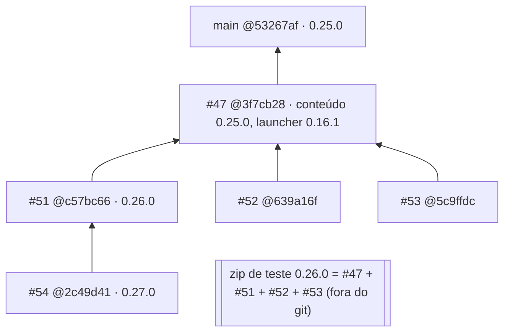
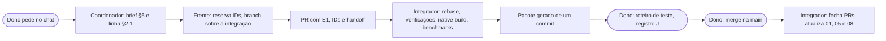

# 07 — Agentes e workflow

> **Referência:** `main@53267af`, `pr47@80980db`, `#51@a0b0d72`, `#52@0b827f6`. O §2 usa as cabeças dos PRs em 2026-11-08 21:41 UTC: `#47@3f7cb28`, `#51@c57bc66`, `#52@639a16f`, `#53@5c9ffdc` e `#54@2c49d41`. Autor: OPUS B.
> **Fontes:**
> - git log de todas as branches (autor, e-mail, fuso);
> - `COORDENACAO.md`, `CLOUD.md`, `CODEX.md`, `GROK.md`, `CHECKPOINT-INTEGRACAO.md` e `HANDOFF_OBRAS.md` (E3);
> - threads e chat do projeto até 21:41 (E4);
> - API do GitHub para os PRs abertos (E3).
>
> **§1 a §3 descrevem o que aconteceu. §4 a §12 são proposta**: decisão de agente, não confirmada pelo dono. Viram regra com uma DEC em [06](06_HISTORICO_E_DECISOES.md). O [11](11_PLANO_DE_CONTINUIDADE.md) tem a versão curta (gatilhos e lista do integrador); aqui fica o detalhe. Branches e PRs um a um estão em [10 §4](10_EVIDENCIAS_E_RASTREABILIDADE.md#4-branches-prs-e-genealogia).

## 1. Mapa de agentes

### 1.1 Quem é quem

| Agente | Produto e modelo | Assinatura no git | Ambiente | Branches e PRs | Frentes | Situação às 21:41 |
|---|---|---|---|---|---|---|
| **Luiz (dono)** | Humano | GitHub `ohariseldon`; merges assinados por "bizi" e por `jefterpereira` (ND quem é quem) | PC Windows com `E:\GPTmodMine` (`.launcher`, `.build`, `.game`); Horizon Launcher; claude.ai Projects | — | Decide, faz merge e, pela [DEC-005](06_HISTORICO_E_DECISOES.md#dec-005), valida em jogo | **Ativo**: testando o pacote combinado 0.26.0 |
| **Coordenador do projeto** | Claude no claude.ai Projects, modelo ND | — | claude.ai | — | Abre threads, encaminha as mensagens do dono, resume para ele | Ativo |
| **Fable** | Claude Opus 5.5, esforço alto (dono, 20:12) | — | Thread "Consolidar a documentação mestra do projeto" (`01HkMwb3xn…`) | — | Supervisor desta consolidação; escreve 00, 01, 09 e 11 | Em execução |
| **OPUS A** | Claude Opus 5.5, Extra High (missão) | — | Subagente do Fable | — | Auditoria técnica; escreve 04, 05, 08 e 10 | Em execução |
| **OPUS B** | Claude Opus 5.5, Extra High (missão) | — | Subagente do Fable | — | Produto, sistemas e governança; escreve 02, 03, 06 e 07 | Em execução |
| **Claude "Cloud"** | Claude, modelo ND | Autor "Claude", +0000; sessão `01APXd4y…`; PRs abertos e fundidos pela conta `jefterpereira` | Claude Code na nuvem, fora deste projeto; não compila `.exe` | `claude/trusting-ritchie-sc9ty8`: PRs #3–#48 e **#54** | Trabalhadores, vila, sociedade e economia (0.10–0.25 na main); agenda da vila 0.27.0 (#54) | **Ativo fora do projeto**: abriu o #54 às 21:36, sobre o #51 |
| **Claude local** | Claude, modelo ND | Autor "Claude", −0300; sessão `01KjyTj4…` | Máquina do dono | `main` antiga (0.7–0.9); `claude/ajustes-vila-mobs` (a segunda 0.16.0) | Visual, Tesla, postes, poluição, produção 0.9; casa do fundador; quartel | Histórica |
| **"Claude (MineFac)"** | Claude, modelo ND | Autor "Claude (MineFac)", com outro e-mail de commit; sessão `01KjyTj6…` | ND (provavelmente local) | `claude/progressao-fases` | Fases da progressão e Quadro da fábrica | Histórica; tempos revogados ([DEC-045](06_HISTORICO_E_DECISOES.md#dec-045)) |
| **Agente das obras** | Claude, modelo ND | Nenhum commit no GitHub; `cloud/obras-planta 4a096e9` só em zip | Nuvem; ficou sem tokens | `cloud/obras-planta` (nunca enviada) | Obras, plantas, Lar, prestígio, centro executivo | Histórica; pendências passadas ao #53 |
| **Thread "Criar agricultura real, água e energia"** | Claude, modelo ND | "Claude", +0000; sessão `01HkMwb4aD…` | Thread do projeto | `claude/project-thread-6tjsil` (#40) | Água, rios, grande indústria, estações de carga, âncora, laboratório, monitor | Concluída às 17:23 |
| **Thread do #47** ("Integrar build parcial ao repositório", renomeada "Testar a build combinada no PC") | Claude, modelo ND | "Claude", +0000; sessão `01HkMwb4qX…` | Thread do projeto; desde 21:14, controle remoto no PC do dono | `claude/project-thread-l94frq` (#47) | Integradora de fato desde 17:13; pacote combinado; primeira compilação real | **Em execução** |
| **Thread "Aumentar o realismo sem pesar o PC"** | Claude Opus 5.5 "extra" (dono, 20:09) | sessão `01HkMwb2fc…` | Thread do projeto | `claude/project-thread-mrtok9` (#51) | Realismo 2.1 e depois 3.0, clima, estações do ano | Thread concluída às 21:11; PR aberto |
| **Thread "Definir limite do mapa e otimizar"** | Claude, modelo ND | sessão `01HkMwb4sM…` | Thread do projeto | `claude/project-thread-e9lkha` (#52) | Sons perto do jogador, mural ocioso, esteiras ociosas, postes em lotes | Thread concluída às 20:55; PR aberto |
| **Thread "Concluir pendências das obras da vila"** | Claude Opus 5.5, esforço médio (dono, 20:38), com um subagente | sessão `01HkMwb3tK…` | Thread do projeto | `claude/project-thread-6fbc15` (#53) | Traduções, menu do canteiro, ruínas, território | Thread concluída às 20:56; PR aberto |
| **Codex local** | OpenAI Codex, modelo ND | Autor "Codex", `codex@users.noreply`, −0300 | Máquina do dono; compilou a 0.16.1 no Horizon em 7 min 14 s | `codex/expansion`, `inserters`, `optimization`, `scaling`, `global-budget`, `incremental-*`, `consolidated-016` → `checkpoint-consolidacao`; mapa finito `c8e94dc` | Expansão, logística, desempenho, integração, tutorial na tela, megafábricas, mapa finito | **Interrompido a pedido do dono** ([DEC-049](06_HISTORICO_E_DECISOES.md#dec-049)) |
| **Codex nuvem** | OpenAI Codex, modelo ND | Autor "Jefter Pereira", conta `jefterpereira` | Nuvem | `codex/interzone-logistics` (#28), `machine-identity` (#31), `machine-audio` (#49), ambiente (#50), `research/connected-veins` (#23) | Transporte, formas, sons, pesquisa de jazidas | Histórica; PRs abertos já contidos no #47 |
| **Grok** | xAI Grok pelo Cursor | Autor "Cursor Agent", +0000 | Cursor na nuvem | `cursor/grok-*`, `grok/*` (lotes 1–8, #7, #19, #21, #25, #30) | Desempenho e balanço | Histórica; PRs #7, #19, #20, #21, #25 e #30 abertos |

### 1.2 Identidades não resolvidas (ND)

- O e-mail de commit de "bizi" sugere o dono. O titular do e-mail de "Claude (MineFac)" é desconhecido (os e-mails ficam no `git log`, não aqui).
- A conta `jefterpereira` aparece em três papéis: autora dos commits do Codex nuvem, autora dos merges dos PRs do Cloud e autora do #54. O `CONTEXTO_FABLE` a descreve como "conta usada por agentes".
- Os balanços de missões e de economia da 0.15 dizem "continuação da frente Grok", mas os commits são de "Jefter Pereira" (`c5db4f6`, `3b3008d`). A frente declarada e a autoria no git não batem.
- O dono disse às 15:55 que "outro agente" estava "fazendo revoluções na questão da vila" e não tinha acesso ao zip das obras. Pela autoria, é o Cloud (E4 + E3; inferência).

### 1.3 Atribuído, entregue e pendente

| Frente | Atribuído (fonte) | Entregue (camada) | Pendente |
|---|---|---|---|
| Cloud | Aldeões trabalhadores (`CLOUD.md`, "atribuída pelo usuário", [DEC-007](06_HISTORICO_E_DECISOES.md#dec-007)); vila que vira cidade (`VILA-CIDADE.md`) | Do lavrador à economia 0.25 (main); plantas e obras (pr47, pelo zip do agente das obras); agenda da vila (#54, ordem não vista neste projeto: ND) | Nenhum teste em jogo desde a 0.11; casas variadas e praça ([TAR-060](08_BACKLOG_E_PRIORIDADES.md#tar-060)); serviços no IDH ([TAR-017](08_BACKLOG_E_PRIORIDADES.md#tar-017)) |
| Codex local | Expansão e integração; logística; restrição do mapa (`CODEX.md`, [DEC-007](06_HISTORICO_E_DECISOES.md#dec-007)) | Braços e filtros, otimizações #22–#38 (main); consolidação, tutorial, megafábricas (pr47) | Mapa finito: rascunho desligado, auditoria do Nether falha ([TAR-025](08_BACKLOG_E_PRIORIDADES.md#tar-025)) |
| Grok | Desempenho e balanço (`GROK.md`, [DEC-007](06_HISTORICO_E_DECISOES.md#dec-007)) | Lotes 1 e 3–8 (main); balanço, cama livre, LAN (pr47) | Duas prensas, substituída; PRs abertos ([TAR-012](08_BACKLOG_E_PRIORIDADES.md#tar-012)) |
| Codex nuvem | ND: nenhuma ordem escrita | Transporte, formas, sons (pr47) | Rotas longas fora da área simulada ([CNF-009](09_CONFLITOS_LACUNAS_E_RISCOS.md#2-conflitos-cnf)) |
| Claude (MineFac) | ND | Fases e Quadro (pr47) | Tempos revogados; documentos desatualizados ([TAR-015](08_BACKLOG_E_PRIORIDADES.md#tar-015)) |
| Agente das obras | Obras e Lar ("frente Cloud", README) | pr47 (`f1452f5`) | Passadas ao #53 |
| Thread #40 | Agricultura, água, rios; "conserte essas lacunas" (dono 15:55 e 16:32) | pr47 | Itens fora da bolsa ([TAR-056](08_BACKLOG_E_PRIORIDADES.md#tar-056)); rios em jogo ([TAR-024](08_BACKLOG_E_PRIORIDADES.md#tar-024)) |
| Thread do #47 | Integrar tudo (dono 17:13, 17:51, 19:14); conferir perdas (20:07); teste local (20:59, [DEC-065](06_HISTORICO_E_DECISOES.md#dec-065)) | #47; pacote combinado; correção `3f7cb28` | Recompilação, teste em jogo, merge, versão |
| Thread realismo | "Realismo maior sem pesar o PC", 8 GB (dono 20:09, [DEC-056](06_HISTORICO_E_DECISOES.md#dec-056)) | #51: Realismo 2.1 → 3.0, clima, estações do ano, 0.26.0 (disperso, não auditado depois de `a0b0d72`) | FPS e memória medidos ([TAR-039](08_BACKLOG_E_PRIORIDADES.md#tar-039)); WGSL ([TAR-055](08_BACKLOG_E_PRIORIDADES.md#tar-055)); efeito do clima ([Q-07](09_CONFLITOS_LACUNAS_E_RISCOS.md#q-07-realismo-clima-e-estações-do-ano)); +29% por tick e 329 alocações |
| Thread mapa | Limite do mapa, buscas em lotes, teto global de ticks (dono 20:09, [DEC-056](06_HISTORICO_E_DECISOES.md#dec-056)) | #52: sons perto do jogador, mural ocioso, medição de escala, esteiras ociosas, postes em lotes | **Limite do mapa não feito** ([TAR-025](08_BACKLOG_E_PRIORIDADES.md#tar-025), [Q-09](09_CONFLITOS_LACUNAS_E_RISCOS.md#q-09-mapa-finito)); teto global sem commit com esse nome ([TAR-038](08_BACKLOG_E_PRIORIDADES.md#tar-038)); +35% por tick |
| Thread obras | Pendências do `HANDOFF_OBRAS.md` (dono 20:38, [DEC-064](06_HISTORICO_E_DECISOES.md#dec-064)) | #53 | Auditoria; ganchos de proteção só confirmados na compilação |

## 2. O que roda agora (08/11, 21:41 UTC)

### 2.1 Uma linha por frente

Esta é a tabela que o [11 §4](11_PLANO_DE_CONTINUIDADE.md#4-quando-atualizar-o-quê) manda atualizar quando uma frente começa ou termina.

| Frente | Agente | Branch@commit (PR) | Base | SIS | TAR | Estado | Última atividade |
|---|---|---|---|---|---|---|---|
| Integração e teste local | Thread do #47 | `claude/project-thread-l94frq@3f7cb28` (#47) | `main@53267af` | todos; [SIS-PLT](03_atlas/SIS-PLT.md) no teste | [TAR-001](08_BACKLOG_E_PRIORIDADES.md#tar-001), [TAR-002](08_BACKLOG_E_PRIORIDADES.md#tar-002), [TAR-003](08_BACKLOG_E_PRIORIDADES.md#tar-003), [TAR-011](08_BACKLOG_E_PRIORIDADES.md#tar-011) | **Em desenvolvimento**: recompilando no PC do dono depois de 4 erros | 21:41 |
| Realismo | Thread realismo | `claude/project-thread-mrtok9@c57bc66` (#51) | #47 | [SIS-APR](03_atlas/SIS-APR.md), [SIS-DES](03_atlas/SIS-DES.md) | [TAR-014](08_BACKLOG_E_PRIORIDADES.md#tar-014), [TAR-055](08_BACKLOG_E_PRIORIDADES.md#tar-055), [TAR-063](08_BACKLOG_E_PRIORIDADES.md#tar-063) | Em desenvolvimento: PR aberto, thread concluída | 21:11 |
| Mapa e desempenho | Thread mapa | `claude/project-thread-e9lkha@639a16f` (#52) | #47 | [SIS-DES](03_atlas/SIS-DES.md), [SIS-APR](03_atlas/SIS-APR.md), [SIS-MUN](03_atlas/SIS-MUN.md) | [TAR-013](08_BACKLOG_E_PRIORIDADES.md#tar-013), [TAR-025](08_BACKLOG_E_PRIORIDADES.md#tar-025), [TAR-038](08_BACKLOG_E_PRIORIDADES.md#tar-038) | Em desenvolvimento: PR aberto, thread concluída | 20:55 |
| Obras | Thread obras | `claude/project-thread-6fbc15@5c9ffdc` (#53) | #47 | [SIS-OBR](03_atlas/SIS-OBR.md), [SIS-CTL](03_atlas/SIS-CTL.md), [SIS-PES](03_atlas/SIS-PES.md) | [TAR-006](08_BACKLOG_E_PRIORIDADES.md#tar-006), [TAR-020](08_BACKLOG_E_PRIORIDADES.md#tar-020), [TAR-021](08_BACKLOG_E_PRIORIDADES.md#tar-021), [TAR-022](08_BACKLOG_E_PRIORIDADES.md#tar-022) | Em desenvolvimento: PR aberto, thread concluída | 20:56 |
| Agenda da vila | Claude "Cloud", fora do projeto | `claude/trusting-ritchie-sc9ty8@2c49d41` (#54) | **#51** | [SIS-VIL](03_atlas/SIS-VIL.md), [SIS-ECO](03_atlas/SIS-ECO.md), [SIS-OBR](03_atlas/SIS-OBR.md), [SIS-MER](03_atlas/SIS-MER.md) | **nenhuma**: frente sem registro | Em desenvolvimento: PR aberto, não auditado | 21:36 |
| Consolidação documental | Fable, OPUS A, OPUS B | pasta `docs/consolidacao-mestra/` | `main@53267af`, `pr47@80980db` | todos | [TAR-015](08_BACKLOG_E_PRIORIDADES.md#tar-015), [TAR-048](08_BACKLOG_E_PRIORIDADES.md#tar-048) | Em desenvolvimento | 21:41 |

As frentes com thread concluída continuam **Em desenvolvimento** até a auditoria. O PR existe e o próprio agente diz que as verificações passaram (E3/E4), mas a auditoria não rodou nada nessas cabeças, e E3 não promove (§8.1).

### 2.2 A pilha de PRs



O que a pilha causa:

1. **O alvo do merge continua andando.** O #47 mudou de novo às 21:40 (`3f7cb28`), agora para consertar a compilação ([R-42](09_CONFLITOS_LACUNAS_E_RISCOS.md#apêndice-a-registro-completo-de-riscos-técnicos-r-01r-43), [TAR-011](08_BACKLOG_E_PRIORIDADES.md#tar-011)).
2. **Cada commit no #47 obriga a rebasear quatro PRs.** O #54 depende do #51, que ninguém auditou depois de `a0b0d72`, e do #47, que mudou depois da auditoria.
3. **Três números de versão circulam ao mesmo tempo:** 0.25.0, 0.26.0 e 0.27.0. A [Q-08](09_CONFLITOS_LACUNAS_E_RISCOS.md#q-08-número-de-versão-e-quem-numera) ainda não foi respondida.
4. **O pacote que o dono vai jogar não existe no git.** O zip combinado antecipa, sem DEC, a alternativa C da [Q-08](09_CONFLITOS_LACUNAS_E_RISCOS.md#q-08-número-de-versão-e-quem-numera) ("fundir #47+#51+#52 numa 0.26.0"). Um primeiro registro J feito com ele não aponta para nenhum commit.
5. **O E1 offline não garante a compilação.** O substituto offline divergia do Horizon em `Mob::on_climbable`, e o #47 só descobriu isso no PC do dono ([DEC-065](06_HISTORICO_E_DECISOES.md#dec-065)). Os 325, 331 e 351 testes que cada thread relata rodam contra esse substituto.

Ações sugeridas (decisão de agente, não confirmada pelo dono):
- Congelar o #47 assim que compilar ([TAR-011](08_BACKLOG_E_PRIORIDADES.md#tar-011)).
- Publicar o zip combinado como branch, que a própria thread ofereceu, antes de registrar qualquer J.
- Pôr o #54 na fila depois da auditoria do #51 ([TAR-014](08_BACKLOG_E_PRIORIDADES.md#tar-014)), da [Q-08](09_CONFLITOS_LACUNAS_E_RISCOS.md#q-08-número-de-versão-e-quem-numera) e da [Q-12](09_CONFLITOS_LACUNAS_E_RISCOS.md#q-12-peso-da-sociedade-frente-à-fábrica), porque o #54 aumenta o peso da sociedade.

### 2.3 PRs abertos que já estão no #47

#7, #19, #20, #21, #23, #25, #28, #31, #40, #49 e #50 são ancestrais do pr47; o #30 já está na main. Fecham depois do merge do #47 ([TAR-012](08_BACKLOG_E_PRIORIDADES.md#tar-012); lista em [10 §4.3](10_EVIDENCIAS_E_RASTREABILIDADE.md#43-prs)).

## 3. Duplicações e conflitos entre agentes

| # | O que colidiu | Agentes | Efeito | Situação |
|---|---|---|---|---|
| 1 | Duas espinhas de progressão | Claude (MineFac): fases e licenças × thread #40: laboratório | Dois gates; o texto "Libera" está errado | **Aberto**: [CNF-002](09_CONFLITOS_LACUNAS_E_RISCOS.md#2-conflitos-cnf), [Q-03](09_CONFLITOS_LACUNAS_E_RISCOS.md#q-03-espinha-da-progressão) |
| 2 | Casa do jogador | Claude local: casa do fundador × agente das obras: Lar | Dois bônus de casa | Reconciliado: [DEC-046](06_HISTORICO_E_DECISOES.md#dec-046) |
| 3 | ID `veio:freight_station` | Codex: terminal ferroviário × Cloud: estação de exportação | Mesmo bloco com dois sentidos | Reconciliado: [DEC-044](06_HISTORICO_E_DECISOES.md#dec-044). Saves antigos: [CNF-014](09_CONFLITOS_LACUNAS_E_RISCOS.md#2-conflitos-cnf) |
| 4 | Tempos de receita | Cloud 30 t × Claude (MineFac) 40 t × Grok 80 t | Um auto-merge já trouxe tempos errados | Reconciliado: [DEC-045](06_HISTORICO_E_DECISOES.md#dec-045) |
| 5 | Pedido do dia | Quadro × pedidos da vila | Duas recompensas diárias | **Aberto**: [CNF-004](09_CONFLITOS_LACUNAS_E_RISCOS.md#2-conflitos-cnf), [Q-02](09_CONFLITOS_LACUNAS_E_RISCOS.md#q-02-dois-pedidos-diários) |
| 6 | Pesquisa | Laboratório (#40) × pesquisa da vila (obras) | Mesma chave, regras diferentes | **Aberto**: [CNF-018](09_CONFLITOS_LACUNAS_E_RISCOS.md#2-conflitos-cnf) |
| 7 | Integrador | Codex local × Cloud ("build consolidada" 0.15) × Claude local (segunda 0.16.0) × thread do #47 | Três consolidações paralelas | De fato, a thread do #47; o Codex foi interrompido ([DEC-049](06_HISTORICO_E_DECISOES.md#dec-049)) |
| 8 | Versões | Todos | Duas 0.16.0; o #40 renumerado cinco vezes; agora 0.25.0, 0.26.0 e 0.27.0 juntas | **Aberto**: [CNF-005](09_CONFLITOS_LACUNAS_E_RISCOS.md#2-conflitos-cnf), [Q-08](09_CONFLITOS_LACUNAS_E_RISCOS.md#q-08-número-de-versão-e-quem-numera), [DEC-008](06_HISTORICO_E_DECISOES.md#dec-008) |
| 9 | Status e slots | Obras × Cloud × Codex nuvem | Canteiro 32 → 33 → 36; descanso 28/29; 40/41 com dois sentidos | Parcial: [DEC-052](06_HISTORICO_E_DECISOES.md#dec-052); 40/41 latente em [CNF-013](09_CONFLITOS_LACUNAS_E_RISCOS.md#2-conflitos-cnf) |
| 10 | Emissão de moeda | Cloud (economia fechada) × Quadro, central e grande projeto | Princípio violado | **Aberto**: [CNF-001](09_CONFLITOS_LACUNAS_E_RISCOS.md#2-conflitos-cnf), [Q-01](09_CONFLITOS_LACUNAS_E_RISCOS.md#q-01-esmeraldas-criadas-fora-dos-livros) |
| 11 | Documento de coordenação | `COORDENACAO.md` parado na 0.9.1 | Agentes novos leem regras velhas | Substituído por este arquivo (status em [10 §6](10_EVIDENCIAS_E_RASTREABILIDADE.md#6-status-dos-documentos-legados)) |
| 12 | Desempenho | Thread realismo × thread mapa | Os dois PRs alegam leveza; nenhum recupera a main; o #52 diz "0 alocações" | **Aberto**: [CNF-020](09_CONFLITOS_LACUNAS_E_RISCOS.md#2-conflitos-cnf), [TAR-008](08_BACKLOG_E_PRIORIDADES.md#tar-008), [TAR-009](08_BACKLOG_E_PRIORIDADES.md#tar-009) |
| 13 | Visitantes | Obras (funcionários e visitantes, FUN-OBR-11) × Cloud, #54 (`veio:visitor`) | Possível mecânica e nome duplicados | **Novo**, sem CNF (pendência do supervisor) |
| 14 | IDH | Cloud, #54 (lazer como 4º serviço; ânimo de 0,9× a 1,1×) × [TAR-017](08_BACKLOG_E_PRIORIDADES.md#tar-017) (serviços das obras no IDH) | Duas frentes mexem na mesma fórmula | **Novo**, sem CNF; toca a [Q-12](09_CONFLITOS_LACUNAS_E_RISCOS.md#q-12-peso-da-sociedade-frente-à-fábrica) |
| 15 | "Estações" | #51 (estações do ano) e #54 (calendário) × estações de carga | O nome colide em mais um sistema | **Aberto**: [CNF-010](09_CONFLITOS_LACUNAS_E_RISCOS.md#2-conflitos-cnf), [Q-04](09_CONFLITOS_LACUNAS_E_RISCOS.md#q-04-nomes-que-colidem) |
| 16 | Base das frentes | #51, #52, #53 e #54 sobre um #47 que não estava congelado | Rebase em cadeia; alvo móvel | **Aberto**: [R-42](09_CONFLITOS_LACUNAS_E_RISCOS.md#apêndice-a-registro-completo-de-riscos-técnicos-r-01r-43), [TAR-011](08_BACKLOG_E_PRIORIDADES.md#tar-011) |

## 4. Fluxo consolidado (1 dono, vários agentes)

Princípio: **poucos papéis e um único caminho até a main**. O dono continua decidindo pelo chat. Tudo o mais é rastreável por ID ([11 §3](11_PLANO_DE_CONTINUIDADE.md#3-identificadores-estáveis)).

### 4.1 Papéis

| Papel | Quem hoje | Faz | Não faz |
|---|---|---|---|
| **Dono** | Luiz | Aprova DEC; responde às Q; **é o único que faz merge na main** (recomendação, [Q-11](09_CONFLITOS_LACUNAS_E_RISCOS.md#q-11-condições-para-fundir-o-47)); joga o roteiro de teste ou o delega | Resolver conflito de código |
| **Coordenador** | Coordenador do projeto | Abre a frente com o brief do §5; atualiza o §2.1; leva as Q ao dono por cartão; registra a DEC quando recebe a resposta | Codar; numerar versão |
| **Integrador único** | Thread do #47, de fato | Mantém a branch de integração; resolve conflito técnico; regenera os arquivos gerados; compila no Horizon; **numera a versão** (se a [Q-08](09_CONFLITOS_LACUNAS_E_RISCOS.md#q-08-número-de-versão-e-quem-numera) for A); gera o pacote; abre o PR para a main | Criar funcionalidade; decidir produto |
| **Frente** | Uma thread ou agente por conjunto de SIS | Trabalha na própria branch sobre a integração; reserva IDs antes de codar; entrega com o DoD do §8 e o handoff do §11 | Mudar a versão; mexer em SIS de outra frente sem TAR combinada; abrir PR sobre outro PR aberto |
| **Auditor** | Opcional (nesta sessão, OPUS A) | Revisão cruzada E1/E2; confirma as fichas | Editar código |

### 4.2 Ciclo



## 5. Política de delegação

1. **Uma frente, um conjunto de SIS.** Antes de abrir uma frente, conferir o §2.1. Se um SIS já tem frente ativa, a nova espera ou combina por TAR. Exemplo de falha: o #54 e a [TAR-017](08_BACKLOG_E_PRIORIDADES.md#tar-017) mexem no IDH ao mesmo tempo.
2. **A base é a branch de integração congelada**, nunca outro PR aberto. Uma frente sobre outra frente (#54 sobre #51) só com DEC do dono.
3. **Modelo e esforço ficam registrados** na linha do §2.1. O dono costuma escolhê-los ("5.5 extra", "no médio", "no alto").
4. **Agentes de fora do projeto** (Cloud no Claude Code, Codex, Grok pelo Cursor) não veem esta pasta, a menos que estejam numa branch que a contenha. O dono ou o coordenador cola o brief e o link para o §12. O PR deles passa pelo mesmo portão.
5. **Brief mínimo** de cada frente:

```
Frente:            <nome curto>  ·  Agente / modelo / esforço:
Pedido do dono:    "<texto literal>" (<dd/mm hh:mm UTC>)  →  DEC-NNN
SIS e FUN alvo:    SIS-XXX (FUN-XXX-NN, …)          TAR: TAR-NNN, …
Base:              <branch@commit da integração>
Não tocar:         SIS de outras frentes ativas (§2.1); versão; release/; launcher
IDs a reservar:    status, slots, blocos, NBT, arquivos de mundo (04 §10)
Verificações:      check_project, check_rust, check_performance; benchmarks se mexer em tick ou quadro
Entrega:           PR sobre a base + HANDOFF-<frente>.md (§11.1) + atualizações do §8.2
Perguntar ao dono: só as Q de produto; conflito técnico vai ao integrador
```

## 6. Propriedade

| O quê | Dono do conteúdo | Regra |
|---|---|---|
| Código de um SIS | A frente ativa daquele SIS (§2.1) | Sem frente ativa, o integrador |
| Arquivos compartilhados: `lib.rs` (ganchos e `tick_factory`), `presentation.rs` (`STATUS_KEYS`), `content/` (blocos e itens), `tools/production.json`, substituto offline | Integrador | A frente propõe no PR, com reserva em [04 §10](04_ARQUITETURA_E_DEPENDENCIAS.md#10-registro-de-ids) |
| Versão (`Cargo.toml`, `horizon-mod.toml`, launcher), `release/` e pacotes | Integrador | Pendente da [Q-08](09_CONFLITOS_LACUNAS_E_RISCOS.md#q-08-número-de-versão-e-quem-numera) ([TAR-040](08_BACKLOG_E_PRIORIDADES.md#tar-040)). As frentes usam o sufixo `-<frente>.<n>` nos pacotes de teste, nunca em `release/` |
| Ficha `03_atlas/SIS-XXX.md` | B, D e F: a frente. G (estado): o integrador até **Integrado**; o dono para **Aprovado** e **Validado** | Ninguém promove o estado sem a evidência do §8 |
| [05](05_ESTADO_REAL_DA_BUILD.md) | Coluna "disperso": a frente. Camadas main e candidata: o integrador. Coluna J: quem testou | — |
| [06](06_HISTORICO_E_DECISOES.md) | Quem recebeu a decisão ou quem a tomou (§7) | Só acrescenta |
| [09](09_CONFLITOS_LACUNAS_E_RISCOS.md) | Qualquer um abre CNF ou Q; só uma DEC ou uma TAR concluída fecha | — |
| Este arquivo | Quem delegou (§2.1); o supervisor (o resto) | — |

**Uma branch, um agente por vez.** Duas threads nunca escrevem na mesma branch. Para revisar a frente de outra, abre-se um PR para a branch dela.

## 7. Registro de decisões

- **Onde:** [06 §3](06_HISTORICO_E_DECISOES.md#3-registro-de-decisões). O número seguinte é o último mais um; hoje, `DEC-067`. Nada é renumerado. Uma DEC revogada fica no lugar, marcada "Revogada por DEC-…".
- **Quem escreve:**
  - a decisão do dono, quem recebeu a resposta ([11 §4](11_PLANO_DE_CONTINUIDADE.md#4-quando-atualizar-o-quê));
  - a decisão de agente, o próprio agente, no corpo do PR, numa seção "Decisões de agente". O integrador a copia para o 06 na integração. Exemplo: as ruínas a 50–62 blocos do #53 ([DEC-064](06_HISTORICO_E_DECISOES.md#dec-064)).
- **Como o dono decide:** por cartão de decisão, com 2 a 4 opções e uma recomendação, como nas opções 0 e 1 de 16:38, 17:18, 17:41 e 19:16. Registra-se o texto literal e a hora UTC.
- **Tipos:** os cinco de [06 §1](06_HISTORICO_E_DECISOES.md#1-como-ler). Uma "proposta em documento" nunca vira "aprovada" sem mensagem do dono.
- **Rodapé de commit:** `Refs: FUN-…, DEC-…, TAR-…` ([11 §3](11_PLANO_DE_CONTINUIDADE.md#3-identificadores-estáveis)).

Modelo:

```
#### DEC-NNN
**<Decisão em uma frase.>** <dd/mm hh:mm UTC> · <Dono | Dono, só em documento | Decisão de agente (não confirmada pelo dono) | Proposta>
- **Fonte:** <mensagem do chat com hora (E4) | documento@commit (E3) | arquivo:linha@commit (E2)>
- **FUN:** <FUN-XXX-NN, …>. **TAR:** <TAR-NNN, …>.
- **Código:** <acompanha | não acompanha | parcial>, com `arquivo:linha@commit`.
- **Relação:** <substitui DEC-… | substituída por DEC-… | fecha Q-… / CNF-…>
- **Canônico:** <sim | não | pendente>
```

## 8. Definition of Done

### 8.1 Por estado

Os 11 estados são os de [05 §0](05_ESTADO_REAL_DA_BUILD.md#estados-evidência-e-ids). **E3 e E4 nunca promovem**: um "feito" em documento ou chat, sem E1 ou E2, mantém o estado anterior.

| Estado | Quem promove | Evidência mínima |
|---|---|---|
| Concebido | Qualquer um | FUN escrita na ficha SIS, com a origem |
| **Aprovado** | **Só o dono** | DEC com o texto do dono (E4 com hora) ou cartão respondido |
| Em desenvolvimento | Frente | Branch criada; TAR aberta com FUN e DEC; linha no §2.1 |
| **Implementado isoladamente** | Frente | E2 (`arquivo:linha`) e E1 na branch (`check_project`, `check_rust` e `check_performance`, com o comando e a saída no PR); ficha atualizada; IDs reservados |
| **Integrado** | Integrador | E1 na branch de integração, depois de regenerar os arquivos gerados; nenhuma colisão em [04 §10](04_ARQUITETURA_E_DEPENDENCIAS.md#10-registro-de-ids); guias dentro dos limites; nenhum documento contra o código |
| Integrado, apto para a main | Integrador | O de cima, mais: `native-build` com exit 0 contra o Horizon na revisão fixada ([TAR-002](08_BACKLOG_E_PRIORIDADES.md#tar-002)), com hash e tempo registrados no [05](05_ESTADO_REAL_DA_BUILD.md); benchmarks dentro do limite aprovado ([Q-11](09_CONFLITOS_LACUNAS_E_RISCOS.md#q-11-condições-para-fundir-o-47)); pacote gerado de um commit, com a mesma versão no launcher e no conteúdo |
| **Validado** | Dono ou testador designado | Roteiro de teste em partida, com versão, commit do pacote, passos, resultado e capturas, no registro J. "Validado offline" não existe |
| Bloqueado / Suspenso | Integrador ou dono | Motivo e a TAR ou Q que destrava |
| Substituído / Descartado | Dono, ou integrador com DEC | A DEC que substitui. Nenhum documento é apagado |
| Indeterminado | Qualquer um | O que falta para saber |

Lição da [DEC-065](06_HISTORICO_E_DECISOES.md#dec-065): um erro de compilação causado pelo substituto offline é corrigido **também no substituto**, no mesmo commit. Foi o que fez o `3f7cb28`.

### 8.2 Critério de conclusão documental

Uma TAR só fecha quando, no mesmo PR:

1. a ficha do SIS tem B (regra), D (`arquivo:linha@commit` e linha FUN) e F (pendência fechada ou nova) atualizados;
2. o [05](05_ESTADO_REAL_DA_BUILD.md) mostra o estado da FUN na camada certa, com evidência;
3. o [04 §10](04_ARQUITETURA_E_DEPENDENCIAS.md#10-registro-de-ids) tem os IDs que a mudança reservou ou usou;
4. o [06](06_HISTORICO_E_DECISOES.md) tem uma DEC para cada decisão tomada, do dono ou de agente;
5. o [08](08_BACKLOG_E_PRIORIDADES.md) fecha a TAR com a evidência (commit, PR, comando) e abre TAR para o que sobrou;
6. o [09](09_CONFLITOS_LACUNAS_E_RISCOS.md) fecha ou abre as CNF e Q afetadas;
7. o §2.1 deste arquivo mostra o novo estado e o commit da frente;
8. o [10 §6](10_EVIDENCIAS_E_RASTREABILIDADE.md#6-status-dos-documentos-legados) tem o status de qualquer documento novo em `frentes/`;
9. o corpo do PR traz os comandos com a saída (E1), as decisões de agente e a seção "O que não foi testado".

Os gatilhos de cada atualização estão no [11 §4](11_PLANO_DE_CONTINUIDADE.md#4-quando-atualizar-o-quê).

## 9. Integração

A lista de conferência do integrador está no [11 §5](11_PLANO_DE_CONTINUIDADE.md#5-procedimento-de-integração-resumo-operacional). Estas são as regras que ela pressupõe:

1. **Congelar.** A branch de integração congelada só recebe commits do caminho crítico ([08 §1](08_BACKLOG_E_PRIORIDADES.md#1-caminho-crítico-para-declarar-o-47-pronto)). O resto espera o merge ([TAR-011](08_BACKLOG_E_PRIORIDADES.md#tar-011)).
2. **Ordem de entrada.** Primeiro o que conserta a compilação, depois o desempenho, por último o conteúdo. Um PR feito sobre outro PR só entra depois da sua base. Por exemplo, o #54 só entra depois do #51.
3. **Rebase da frente sobre a integração**, um PR por vez, nunca o merge de uma pilha inteira.
4. **Compilar de verdade.** `native-build` contra o Horizon fixado ([TAR-002](08_BACKLOG_E_PRIORIDADES.md#tar-002)), numa máquina com Horizon. Hoje, a única é o PC do dono, alcançado por controle remoto, como às 21:14. Registrar no [05](05_ESTADO_REAL_DA_BUILD.md) a revisão, o tempo e o resultado.
5. **Pacote rastreável.** Gerar o pacote de teste só de um commit que exista no git. O nome leva o sufixo `-teste.<n>` até a versão ser decidida, e o pacote nunca vai para `release/`. O zip combinado de 21:01 não cumpre isso.
6. **J só de pacote rastreável.** O registro J do [05](05_ESTADO_REAL_DA_BUILD.md) cita o commit de onde o pacote saiu. Antes do primeiro teste, o dono copia os mundos, como a thread do #47 pediu.
7. **Merge na main:** só o dono (proposta; [Q-11](09_CONFLITOS_LACUNAS_E_RISCOS.md#q-11-condições-para-fundir-o-47)).
8. **Depois do merge:** fechar os PRs contidos ([TAR-012](08_BACKLOG_E_PRIORIDADES.md#tar-012)), rebasear as frentes e atualizar 01, 05 e 08 ([11 §4](11_PLANO_DE_CONTINUIDADE.md#4-quando-atualizar-o-quê)).

## 10. Controle de conflitos

- **Conflito técnico** (código, IDs, merge): o integrador resolve e registra a decisão de agente no 06. Se a solução muda o que o jogador vê, vira Q.
- **Conflito de produto:** abre uma CNF em [09 §2](09_CONFLITOS_LACUNAS_E_RISCOS.md#2-conflitos-cnf) com as fontes em choque e o encaminhamento. Nunca se corrige em silêncio ([11 §2](11_PLANO_DE_CONTINUIDADE.md#2-regras-de-leitura-quando-as-fontes-divergem)).
- **Prevenção.** As cinco fontes de colisão que já aconteceram têm uma regra cada:

| Fonte de colisão | Caso | Regra |
|---|---|---|
| IDs | `freight_station`, 40/41 | Reservar antes de codar ([04 §10](04_ARQUITETURA_E_DEPENDENCIAS.md#10-registro-de-ids); [TAR-034](08_BACKLOG_E_PRIORIDADES.md#tar-034)) |
| SIS | IDH no #54 e na [TAR-017](08_BACKLOG_E_PRIORIDADES.md#tar-017) | Uma frente por SIS (§5) |
| Nomes | "estações", "prancheta", "visitantes" | Conferir a [Q-04](09_CONFLITOS_LACUNAS_E_RISCOS.md#q-04-nomes-que-colidem) e as fichas antes de batizar um bloco ou sistema |
| Versão | [Q-08](09_CONFLITOS_LACUNAS_E_RISCOS.md#q-08-número-de-versão-e-quem-numera) | As frentes não mexem na versão |
| Base | [R-42](09_CONFLITOS_LACUNAS_E_RISCOS.md#apêndice-a-registro-completo-de-riscos-técnicos-r-01r-43) | Nenhuma frente sobre um PR não auditado |

- **Escalar ao dono** só o que muda o objetivo do jogo ou não tem volta. Uma pergunta por cartão, com 2 a 4 opções e uma recomendação. A fila de Q está em [09 §5](09_CONFLITOS_LACUNAS_E_RISCOS.md#5-decisões-pendentes-do-dono).

## 11. Handoff e recuperação de contexto

### 11.1 Handoff

Ao terminar, ou antes de parar por tokens, a frente escreve `HANDOFF-<frente>.md` na própria branch, com no máximo 60 linhas. O `CHECKPOINT-INTEGRACAO.md` do Codex serve de exemplo bom.

```
Frente / agente / modelo e esforço / sessão:
Branch e commit final (enviado? sim/não; se não, onde estão o zip ou o bundle):
Base (commit da integração) e PRs empilhados sobre esta branch:
FUN entregues (ID, estado, evidência E1/E2):
Decisões de agente (texto, motivo; aguardam o dono? sim/não):
IDs reservados ou usados (status, slots, blocos, NBT, arquivos de mundo):
Verificações rodadas (comando e resultado):
Pacotes gerados fora do git (nome, caminho, de que commits):
Não feito / pendente (TAR):
Riscos e conflitos conhecidos com outras frentes:
O que NÃO foi testado (sempre: jogo real; Horizon real, se não compilou):
```

### 11.2 Recuperação de contexto

Vale para um agente que perdeu o contexto (resumo automático, fim de tokens, sessão nova):

1. **Reler, nesta ordem:** a linha da frente no §2.1, o handoff, a ficha do SIS e os commits da própria branch desde a base.
2. **Conferir se a base andou.** O #47 andou várias vezes durante esta auditoria, a última às 21:40.
3. **Conferir quem está em cima.** Ver os PRs abertos cuja base é a sua branch.
4. **Não confiar na memória** para IDs, números ou decisões. Conferir no [04 §10](04_ARQUITETURA_E_DEPENDENCIAS.md#10-registro-de-ids) e no [06](06_HISTORICO_E_DECISOES.md).
5. **Antes de parar, fazer push.** A branch das obras nunca subiu, e o agente ficou sem tokens. Sem push possível, gerar um bundle e dizer onde ele está.
6. **Push a cada passo verde.** Trabalho só local é invisível, e era justamente esse o medo do dono às 20:07.

## 12. Onboarding em cinco leituras

A ordem das cinco leituras está no [11 §1](11_PLANO_DE_CONTINUIDADE.md#1-retomar-o-projeto-em-cinco-leituras). Um agente que entra numa frente acrescenta só duas: a sua linha no §2.1 e o handoff anterior da frente.

Regras de entrada:
- Partir da branch de integração do §2.1, não de uma `main` local antiga. A `main` local do dono estava em 0.17.2 quando a remota já era 0.25.
- Rodar as três verificações antes de mexer em qualquer coisa.
- Documentos marcados como históricos em [10 §6](10_EVIDENCIAS_E_RASTREABILIDADE.md#6-status-dos-documentos-legados) não são regra.
- Perguntar ao dono só as Q de produto. Conflito técnico vai ao integrador.

Cadência sugerida:

| Evento | Quando | Quem |
|---|---|---|
| Integração | Ao fim de cada entrega de frente; no máximo uma por dia | Integrador |
| Roteiro de teste em jogo (cerca de 30 min) | Antes de cada merge na main | Dono ou testador |
| Revisão do registro de decisões | A cada integração | O integrador propõe; o dono confirma |
| Revisão da fila de Q | Quando houver 3 ou mais Q abertas | Dono |
| Revisão do §2.1 | A cada frente aberta ou fechada | Coordenador |
