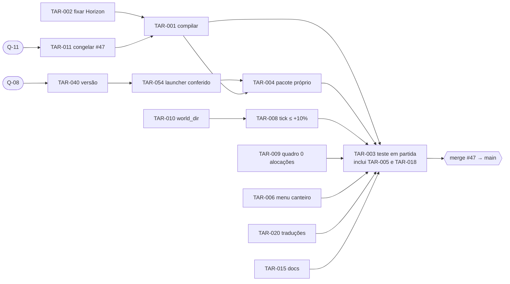

# 08: Backlog e prioridades

> **Referência:** `main@53267af` · `pr47@80980db` · `#51@a0b0d72` · `#52@0b827f6`. Data: 2026-11-08. Autor: OPUS A.
> **Origem das TAR** (deduplicadas; o mapa de origem está no §9):
> - pendências técnicas do A2 §F e do A6 (R-01…R-43, em [09]);
> - pendências de design do B2 §F;
> - `HANDOFF_OBRAS.md`;
> - questões do B6 que viram tarefa (marcadas **"aguarda Q-NN"**).
>
> **Prioridade (sugestão de agente, não decisão do dono):** P0 = caminho crítico do #47 · P1 = alta, logo depois · P2 = média · P3 = baixa.
> **Estado da TAR:** um dos 11 estados.
> - **Aprovado** = pedido ou decisão do dono.
> - **Concebido** = proposta de agente.
> - **Em desenvolvimento** = há uma thread trabalhando.
> - **Bloqueado** = aguarda uma Q ou outra TAR.
>
> **Evidência:** E1–E4/ND, como em [05](05_ESTADO_REAL_DA_BUILD.md). Nenhuma TAR foi iniciada por este documento.

## 0. Próximas 10 ações recomendadas

| # | TAR | Ação | Impacto | Centralidade | Dependência | Risco se adiar | Esforço relativo |
|---|---|---|---|---|---|---|---|
| 1 | [TAR-011] | Congelar o #47 (obter a [Q-11]) | Alto: fixa o alvo | Todas as TAR P0 | Nenhuma | Retrabalho: o #47 já mudou duas vezes durante a auditoria (R-42) | Mínimo (decisão) |
| 2 | [TAR-002] | Fixar a revisão do Horizon | Alto | Pré-requisito do TAR-001, do TAR-022 e do TAR-044 | Nenhuma | Cada build pega um Horizon diferente | Pequeno |
| 3 | [TAR-001] | Compilar o pr47 contra o Horizon real | **Crítico** (R-01) | Destrava o TAR-003, o TAR-005, o TAR-018 e o TAR-024 | TAR-002; máquina Windows com Horizon | O #47 pode nem carregar | Médio |
| 4 | [TAR-010] | `world_dir` no harness | Médio: volta a medir a vila | Destrava o TAR-008 e o TAR-037 | Nenhuma | A escala de 150 aldeões fica sem medida | Pequeno |
| 5 | [TAR-009] | Quadro sem alocação (bisseção) | Alto: 329 → 0, determinístico | DEC-056 (8 GB) | Nenhuma | Engasgo por quadro em todo PC | Médio |
| 6 | [TAR-008] | Custo por tick da fábrica a ≤ +10% | Alto: +36% hoje | DEC-056 | TAR-010 | Fábricas grandes passam do tick | Médio-alto |
| 7 | [TAR-006] | Menu do canteiro com 3 slots | Alto: obras inutilizáveis pela tela | SIS-OBR | Nenhuma | Teste em jogo falha | Pequeno |
| 8 | [TAR-020] | Traduções das obras e da pesquisa da vila | Médio-alto: o jogador vê chave crua | SIS-OBR e SIS-PES | Nenhuma | Teste em jogo inconclusivo | Pequeno |
| 9 | [TAR-015] | Corrigir README e docs do pr47 | Médio: o jogador instala a 0.16.1 | Pacote e tutorial | Nenhuma | Instalação errada | Pequeno |
| 10 | [TAR-040] | Política e número de versão (obter a [Q-08]) | Alto | Destrava o TAR-004 e o TAR-054 | Q-08 | Terceira colisão de versão (#51 já usa a 0.26.0) | Mínimo (decisão) |

**Depois:** [TAR-004] (pacote) → [TAR-005] (gate de receitas, dentro do roteiro) → [TAR-003] (teste em partida). Com isso fecha o caminho crítico do §1.

## 1. Caminho crítico para declarar o #47 pronto

| Condição | TAR | Critério objetivo |
|---|---|---|
| Compilação real pelo launcher | TAR-002, TAR-001 | `native-build` com exit 0 no `rev` fixado; `check_native_api.py` executado |
| Teste em jogo com roteiro | TAR-003 (+ TAR-005, TAR-018) | Roteiro de cerca de 30 min passado em mundo novo e em save 0.25; resultado J por passo em [05](05_ESTADO_REAL_DA_BUILD.md) |
| Regressões de desempenho | TAR-008, TAR-009, TAR-010 | `bench_factory` ≤ 1,10 × main (mediana de 5 rodadas intercaladas); `bench_frame` = 0 alocações; `bench_large_village` roda |
| Pacote próprio | TAR-004, TAR-054 | Zip gerado do pr47 com versão coerente em Cargo, `horizon-mod.toml`, launcher e nome; Realismo 1.1 rotulado como 0.16.1 |
| Versão | TAR-040 | DEC do dono com o número e com quem numera |
| Telas e textos que o teste exercita | TAR-006, TAR-020, TAR-015 | `check_project` acusa chave ausente; menu × código coerentes |
| Alvo fixo | TAR-011 | DEC da Q-11 |

## 2. Resumo por categoria

| Categoria | Faixa | Nº | P0 | P1 | P2 | P3 |
|---|---|---|---|---|---|---|
| 1. Impede funcionamento | TAR-001…007 | 7 | 6 | 1 | 0 | 0 |
| 2. Integração | TAR-008…019 | 12 | 6 | 4 | 2 | 0 |
| 3. Completar parciais | TAR-020…031 | 12 | 1 | 3 | 6 | 2 |
| 4. Lacunas estruturais | TAR-032…044 | 13 | 1 | 3 | 6 | 3 |
| 5. Qualidade, balanceamento e UX | TAR-045…057 | 13 | 0 | 1 | 5 | 7 |
| 6. Expansões não essenciais | TAR-058…063 | 6 | 0 | 0 | 0 | 6 |
| **Total** | | **63** | 14 | 12 | 19 | 18 |

**Responsáveis conhecidos:**
- thread **"Definir limite do mapa e otimizar"** (#52): TAR-008, TAR-013, TAR-025, TAR-038;
- thread **"Aumentar o realismo sem pesar o PC"** (#51): TAR-014, TAR-063;
- **integrador** (a thread que montou o #47): as TAR de texto, pacote e CI;
- **dono**: as decisões;
- teste em jogo e compilação: **quem tiver Windows e Horizon** (o dono, Luiz, ou outro testador que ele indicar; ND).

---

## 3. Impede funcionamento

### TAR-001 · Compilar o pr47 contra o Horizon real
- **SIS** [SIS-PLT] · **Estado** Concebido · **P0** · **Responsável:** quem tiver Windows e Horizon (ND). O launcher só existe para Windows.
- **Objetivo:** provar que o pr47 compila como mod nativo e que as assinaturas batem.
- **Evidência:** R-01, R-03; FUN-PLT-04 Indeterminado; `read_columns`/`chunk_load` nunca compilados (`bcfb9d5`); `set_block_property` difere (E2).
- **Depende de:** [TAR-002], [TAR-011].
- **Aceite:**
  - `launcher.exe` (ou `horizon-launcher native-build`) termina com exit 0 no `rev` fixado;
  - `tools/check_native_api.py` roda com o `.rmeta` e lista 0 divergências, ou cada divergência vira uma TAR;
  - o log fica anexado ao #47.
- **Próxima ação:** rodar o launcher do pr47 numa máquina Windows e guardar o log completo.
- **Atualização após o corte (21:40):** o commit `3f7cb28` ("Corrige a compilação real contra o Horizon 66f3981") mostra que houve uma primeira compilação real e que ela falhou em pontos de visibilidade (`pub(super)`→`pub(crate)`) e em `Mob::on_climbable`, onde o substituto offline divergia do Horizon. Se a recompilação passou é ND. Estado efetivo: **Em desenvolvimento** (thread do #47).

### TAR-002 · Fixar a revisão do Horizon
- **SIS** [SIS-PLT] · **Estado** Concebido · **P0** · **Responsável:** integrador.
- **Objetivo:** build reprodutível.
- **Evidência:** R-02; FUN-PLT-11; `native/api/Cargo.toml` usa `git` sem `rev` e não há `Cargo.lock`. O stub é do 66f3981; o HEAD do Horizon é 5f7cadf (E2).
- **Depende de:** —.
- **Aceite:**
  - `rev = "<hash>"` no Cargo do mod;
  - o mesmo hash anotado no README e no cabeçalho do stub (`mod_api.rs`);
  - as diferenças entre o stub e esse hash listadas.
- **Próxima ação:** escolher entre o 66f3981 (o do stub) e o 5f7cadf (o que o #51 usa, com `native_visuals`/`native_player_*`).

### TAR-003 · Teste em partida com roteiro (registro J)
- **SIS** todos · **Estado** Concebido · **P0** · **Responsável:** dono ou testador com Windows (ND).
- **Objetivo:** a primeira evidência J da 0.11 em diante.
- **Evidência:** R-41; README do pr47 l. 31; a coluna J está vazia nas 158 FUN.
- **Depende de:** [TAR-001], [TAR-004], [TAR-006], [TAR-020], [TAR-008], [TAR-009].
- **Aceite:**
  - roteiro de cerca de 30 min, num mundo novo e num save 0.25: tutorial → extratora → prensa → energia → carregador e capataz → centro → porto ou estação → obra → Lar → noite com onda;
  - cada passo com ok/falha e print, registrado em 05;
  - sem crash.
  - Inclui os passos do [TAR-005] e do [TAR-018].
- **Próxima ação:** escrever o roteiro, um passo por FUN central.

### TAR-004 · Pacote próprio do pr47 e instruções de instalação
- **SIS** [SIS-PLT] · **Estado** Bloqueado (aguarda [Q-08]) · **P0** · **Responsável:** integrador.
- **Objetivo:** o jogador instala a build certa.
- **Evidência:** R-23, R-24; [CNF-005]. O zip 0.25.0 do pr47 é o blob `e01ef740` da main (E1). O README (l. 86) manda usar `Veio-0.16.1.zip`. `Veio-Realismo-1.1.zip` contém a 0.16.1. O launcher é o 0.16.1.
- **Depende de:** [TAR-040], [TAR-054], [TAR-001].
- **Aceite:**
  - `tools/package.py` gera `release/Veio-<versão>.zip` a partir do pr47;
  - o `native/api` dentro dele declara a mesma versão;
  - os zips Realismo 1.1 saem do repositório ou ficam rotulados "0.16.1 (histórico)";
  - o README aponta o zip certo, com sha256 registrado.
- **Próxima ação:** preparar o README sem número enquanto a Q-08 não é respondida.

### TAR-005 · Verificar se o avanço tranca a receita (`doLimitedCrafting`)
- **SIS** [SIS-PRG] · **Estado** Concebido · **P0** · **Responsável:** testador.
- **Objetivo:** saber se a progressão inteira tranca alguma coisa.
- **Evidência:** R-21; [CNF-003]; FUN-PRG-01 Indeterminado; grep vazio na main e no pr47 (E2).
- **Depende de:** [TAR-001].
- **Aceite:**
  - num mundo novo, sem o avanço `steel`, tentar fabricar `veio:electronics` e registrar o resultado;
  - se não bloquear, aplicar `doLimitedCrafting true` na criação do mundo do Veio e repetir o teste até passar.
- **Próxima ação:** incluir o teste no roteiro do TAR-003.

### TAR-006 · Menu do canteiro com 3 slots
- **SIS** [SIS-OBR] · **Estado** Concebido (HANDOFF: "ainda pendente") · **P0** · **Responsável:** integrador (o agente das obras ficou sem tokens).
- **Objetivo:** o 2º insumo e a saída aparecerem na tela.
- **Evidência:** R-30; `content/data/veio/horizon/menu/site.json` tem `slots: 1`; o código usa 3 (`workforce/mod.rs:150`).
- **Depende de:** —.
- **Aceite:**
  - `tools/build_content.py` gera 3 slots (comida, entrada, produto);
  - um teste Rust compara o número de slots de cada menu com `screen_slots` e falha se divergirem;
  - `check_project` ok.
- **Próxima ação:** corrigir o gerador e escrever o teste de coerência.
- **Atualização após o corte:** o PR #53 (`claude/project-thread-6fbc15@5c9ffdc`, aberto às 20:56 sobre o #47) declara resolver isto. Não foi auditado. Estado efetivo: **Em desenvolvimento**. Ver [TAR-064].

### TAR-007 · Proteger saves 0.16.1 e Realismo 1.1 da troca de sentido de `veio:freight_station`
- **SIS** [SIS-TRA], [SIS-MER], [SIS-PER] · **Estado** Concebido · **P1** · **Responsável:** integrador.
- **Objetivo:** não exportar por engano a carga de um terminal antigo.
- **Evidência:** [CNF-014]. Em `50995e6`, `freight.rs:7` era o terminal; hoje `society/trade.rs:27` é a estação de exportação. O rename foi em `a79f326`. Não há alias.
- **Depende de:** [TAR-032] (opcional).
- **Aceite:**
  - um `veio:freight_station` com NBT de terminal (campos a confirmar no `50995e6`) é convertido em `veio:rail_terminal`, ou fica travado com aviso;
  - teste Rust com um NBT antigo;
  - nota de migração no README.
- **Próxima ação:** extrair do `50995e6` o NBT do terminal e escrever o teste.

## 4. Integração

### TAR-008 · Recuperar o custo por tick da fábrica
- **SIS** [SIS-DES] · **Estado** Aprovado ([DEC-056]: leveza num PC de 8 GB) · **P0** · **Responsável:** thread "Definir limite do mapa e otimizar".
- **Objetivo:** voltar perto da main.
- **Evidência:**
  - R-14. Mediana R1: main 268,7 × pr47 364,8 µs/tick, +36% (E1).
  - O #52 atribui o aumento (12,58 → 17,88 bi de instruções) a sons, censo, holding, indústria, medidor e poluição rodando em todo bloco, e corta 7,7% (E3).
- **Depende de:** [TAR-010].
- **Aceite:**
  - `bench_factory` ≤ 1,10 × main (mediana de 5 rodadas intercaladas, comando R1 de [05 §3](05_ESTADO_REAL_DA_BUILD.md#3-resultados-e1));
  - `factory_digest` inalterado;
  - callgrind registrado.
- **Próxima ação:** callgrind por sistema e, depois, as duas propostas do #52 (postes a cada N ticks; máquinas paradas dormindo). Elas mudam comportamento e pedem decisão técnica registrada.

### TAR-009 · Quadro sem alocação de novo
- **SIS** [SIS-APR], [SIS-DES] · **Estado** Aprovado ([DEC-056]) · **P0** · **Responsável:** não atribuído (o #52 não cobre).
- **Objetivo:** restaurar a garantia da 0.17.1.
- **Evidência:** R-15; FUN-APR-08. R1: 0 alocações por quadro na main × 329 no pr47, no #51 e no #52 (E1).
- **Depende de:** —.
- **Aceite:** `bench_frame` = 0 alocações, com um teste que falha se passar de 0.
- **Próxima ação:** `git bisect` entre `53267af` e `80980db` com o `bench_frame` como critério. Suspeitos: `appearance`, `motion`, `soundscape`.

### TAR-010 · `world_dir` no harness de teste
- **SIS** [SIS-PLT], [SIS-TRB] · **Estado** Concebido · **P0** · **Responsável:** não atribuído.
- **Objetivo:** o `bench_large_village` voltar a medir.
- **Evidência:** R-16; FUN-TRB-12 Bloqueado; pânico `not implemented: world_dir` (`horizon-client/src/lib.rs:475`) via `onboarding::session` (E1, R2).
- **Depende de:** —.
- **Aceite:** `cargo test --release -- --ignored bench_` sem falhas; a vila mede µs/tick (main: 3,4).
- **Próxima ação:** o harness devolve um diretório temporário por teste.

### TAR-011 · Congelar o #47 e decidir o destino do #51 e do #52
- **SIS** processo · **Estado** Bloqueado (aguarda [Q-11]) · **P0** · **Responsável:** dono.
- **Objetivo:** alvo fixo até o merge.
- **Evidência:** R-42; #51 e #52 abertos sobre o pr47 às 20:34–20:35Z.
- **Depende de:** Q-11.
- **Aceite:** DEC em [06](06_HISTORICO_E_DECISOES.md). Até o merge, o #47 só recebe commits do §1. O #51 e o #52 são rebaseados depois.
- **Próxima ação:** levar a Q-11 ao dono.

### TAR-012 · Fechar os PRs absorvidos pelo #47
- **SIS** processo · **Estado** Bloqueado (aguarda o merge do #47; o #30 não depende dele) · **P2** · **Responsável:** dono ou integrador.
- **Evidência:** #7, #19, #20, #21, #23, #25, #28, #31, #40, #49 e #50 são ancestrais do pr47; o #30 já está na main ([10 §4](10_EVIDENCIAS_E_RASTREABILIDADE.md#4-branches-prs-e-genealogia)).
- **Depende de:** [TAR-011].
- **Aceite:** cada PR fechado com "contido em #47 (`<commit>`)"; o #7 fechado como substituído; branches arquivadas como em 10 §4.
- **Próxima ação:** propor ao dono o fechamento do #30.

### TAR-013 · Auditar e reintegrar o #52
- **SIS** [SIS-DES], [SIS-APR] · **Estado** Em desenvolvimento · **P1** · **Responsável:** thread "Definir limite do mapa e otimizar".
- **Evidência:** `#52@0b827f6`, 6 arquivos. Declara −7,7% em instruções (E3). R1: sem ganho visível no relógio e ainda com 329 alocações.
- **Depende de:** [TAR-011].
- **Aceite:**
  - o callgrind do #52 reproduzido;
  - o teste `far_blocks_are_skipped_before_reading_nbt_exactly_where_admit_would_refuse` passa;
  - nenhum som some no roteiro do TAR-003.
- **Próxima ação:** reproduzir o callgrind no pr47 e no #52.

### TAR-014 · Auditar o #51 (Realismo 2.1, clima, 0.26.0)
- **SIS** [SIS-APR] · **Estado** Em desenvolvimento (escopo aguarda [Q-07]; número aguarda [Q-08]) · **P2** · **Responsável:** thread "Aumentar o realismo sem pesar o PC".
- **Evidência:** 53 arquivos; ganchos `visuals`/`shader_params`; stub +48; `release/Veio-0.26.0.zip` ([CNF-005]); R1: +29% e 329 alocações.
- **Depende de:** [TAR-011], [TAR-040], [TAR-055].
- **Aceite:**
  - renumerado conforme a Q-08, e sem zip no PR;
  - `check_shaders.py` e `horizon-shader check` ok;
  - o efeito de jogo do clima descrito em FUN-APR-09;
  - `bench_factory` sem piora acima de 5% sobre o pr47.
- **Próxima ação:** listar o que `climate.rs` altera no jogo.

### TAR-015 · Corrigir o README e os docs do pr47 que contradizem o código
- **SIS** [SIS-PLT], [SIS-TUT] · **Estado** Concebido · **P0** · **Responsável:** integrador.
- **Evidência:** [CNF-006]; R-22, R-25, R-26.
  - README do pr47: l. 21 (+15%), l. 24 (duas prensas), l. 86 (zip 0.16.1), l. 307 (64/18 blocos) e §Progressão.
  - `TRABALHADORES.md` l. 131/234/589; números da 0.16.1 no `CONSOLIDACAO.md`.
  - `PROGRESSAO-FASES.md`, `GROK-BALANCE.md`, comentário de `home/food.rs:9`; rios só em chunks novos (R-12), não documentado.
- **Depende de:** —.
- **Aceite:**
  - grep nos docs do pr47 sem "15%", "0.16.1.zip", "64 blocos" nem "duas prensas";
  - cada doc legado com a linha de status de [10 §6](10_EVIDENCIAS_E_RASTREABILIDADE.md#6-status-dos-documentos-legados).
- **Próxima ação:** um PR só de texto sobre o pr47.

### TAR-016 · Alinhar o Quadro e a pesquisa ("Libera")
- **SIS** [SIS-PRG], [SIS-PES] · **Estado** Bloqueado (aguarda [Q-03]) · **P1**.
- **Evidência:** R-20; [CNF-002]; `milestones/mod.rs:37-52,246` × `research/*.json` (E2).
- **Depende de:** Q-03, [TAR-005].
- **Aceite:** um teste lê as fases do Quadro e os avanços e falha se o texto "Libera" citar um item que a licença não concede.
- **Próxima ação:** Q-03.

### TAR-017 · Serviços das obras no IDH
- **SIS** [SIS-VIL], [SIS-OBR] · **Estado** Bloqueado (aguarda [Q-06]) · **P2**.
- **Evidência:** `society/mod.rs:613` (serviços = saneamento, energia e comércio); `society/` não referencia `projects`; pendência registrada em `SOCIEDADE.md`; [CNF-008].
- **Depende de:** Q-06; conflito aberto [CNF-022](09_CONFLITOS_LACUNAS_E_RISCOS.md#2-conflitos-cnf) com o IDH do #54 ([TAR-065]).
- **Aceite:** o IDH conta as obras de pé e funcionando, com teste; `sim_economy` atualizado.
- **Próxima ação:** Q-06.

### TAR-018 · Abrir um save 0.25 no pr47
- **SIS** [SIS-PER] · **Estado** Concebido · **P1** · **Responsável:** testador.
- **Evidência:** R-11. Os 55 blocos e 16 itens da main existem no pr47 (E2). NBT novos nascem vazios. A liberação por `steel` foi para a pesquisa.
- **Depende de:** [TAR-001].
- **Aceite:** um mundo 0.25 com fábrica, vila e comércio abre sem perda de itens nem de saldos (Company, Public, Wallet). As receitas já liberadas continuam liberadas, ou há nota de migração.
- **Próxima ação:** incluir no roteiro do TAR-003.

### TAR-019 · CI mínima
- **SIS** [SIS-PLT] · **Estado** Concebido · **P1** · **Responsável:** integrador.
- **Evidência:** R-31; FUN-PLT-10; `.github/` não existe (E2).
- **Depende de:** —.
- **Aceite:** um workflow roda `check_project`, `check_rust` e `check_performance` em cada PR, e uma falha bloqueia o merge.
- **Próxima ação:** workflow com cache do cargo; o stub não usa rede (X13).

## 5. Completar parciais

### TAR-020 · Traduções das obras e da pesquisa da vila
- **SIS** [SIS-OBR], [SIS-PES] · **Estado** Concebido (HANDOFF item 1) · **P0** · **Responsável:** integrador.
- **Evidência:** R-29, R-30; [CNF-018]; `staff.rs:390-392`; [04 §10.8](04_ARQUITETURA_E_DEPENDENCIAS.md#108-prefixos-de-tradução).
- **Depende de:** —.
- **Aceite:**
  - existem em pt_br e en_us: `veio.site.no_staff`, `veio.site.next.<9 papéis>`, `veio.center.project.idle`, `veio.project.lab.name/effect`, `veio.research.<agronomy|cargo|nutrition|pedagogy|engineering>.name/effect`;
  - a vila usa uma chave própria no lugar de `veio.research.done`;
  - `check_project` falha quando o código usa uma chave ausente no lang.
- **Próxima ação:** extrair os `tr("…")` do código e cruzar com o lang.
- **Atualização após o corte:** o PR #53 (`claude/project-thread-6fbc15@5c9ffdc`, aberto às 20:56 sobre o #47) declara resolver isto. Não foi auditado. Estado efetivo: **Em desenvolvimento**. Ver [TAR-064].

### TAR-021 · Ruínas
- **SIS** [SIS-OBR] · **Estado** Concebido · **P3**.
- **Evidência:** HANDOFF item 2; FUN-OBR-09; `workforce/ruins.rs` não existe.
- **Depende de:** [TAR-022], [TAR-001] (`surface_heights` e `edit_blocks` em jogo).
- **Aceite:**
  - num mundo novo, 1–3 canteiros `Fixed` num anel de 48–80 blocos do centro, com planta parcial;
  - sorteio determinístico testado;
  - `cycle` recusa trocar a planta.
- **Próxima ação:** confirmar com o integrador que entra depois do merge (sugestão).

### TAR-022 · Proteção de território das obras
- **SIS** [SIS-OBR] · **Estado** Concebido · **P2**.
- **Evidência:** HANDOFF item 3; FUN-OBR-10; os 4 ganchos não existem ([04 §2.1](04_ARQUITETURA_E_DEPENDENCIAS.md#21-ganchos-impl-hooks-for-factory-e2)).
- **Depende de:** [TAR-002].
- **Aceite:**
  - `destroy_block`, `left_click_block`, `use_item_on` e `explosion_detonate` no stub e em `lib.rs`;
  - dentro da planta + 3, as ações são canceladas para quem não está em criativo, e os blocos naturais ficam liberados;
  - testes no stub.
- **Próxima ação:** conferir os 4 ganchos no `native-hooks.json` do `rev` fixado.

### TAR-023 · Guia e tutorial cobrindo o que o pr47 acrescentou
- **SIS** [SIS-TUT] · **Estado** Concebido · **P2**.
- **Evidência:**
  - HANDOFF item 1: páginas do laboratório e dos funcionários;
  - B2 TUT F.4: o tutorial termina na central;
  - B2 AGU F: a água só aparece no guia.
- **Depende de:** [TAR-030].
- **Aceite:** páginas de obras, laboratório e funcionários. Passos do tutorial para água, sociedade, comércio exterior e pesquisa, ou DEC do dono aceitando que fiquem só no guia.
- **Próxima ação:** listar as FUN do pr47 sem página.

### TAR-024 · Rios em jogo
- **SIS** [SIS-MUN] · **Estado** Concebido · **P1**.
- **Evidência:** R-04, R-12; FUN-MUN-03; APIs nunca compiladas.
- **Depende de:** [TAR-001].
- **Aceite:** rios visíveis a menos de 500 blocos do spawn num mundo novo; `rios.txt` gravado; tempo por chunk novo medido e registrado.
- **Próxima ação:** passo no roteiro do TAR-003.

### TAR-025 · Mapa finito e limite do mapa
- **SIS** [SIS-MUN], [SIS-DES] · **Estado** Em desenvolvimento (aguarda [Q-09]) · **P2** · **Responsável:** thread "Definir limite do mapa e otimizar".
- **Evidência:** FUN-MUN-04/05; R-06; [CNF-019]; `CONTINUAR.md` (22/24 injeções; Nether falhou).
- **Depende de:** Q-09, [TAR-001].
- **Aceite:** a borda que a Q-09 definir; portais dentro do limite; teste em partida.
- **Próxima ação:** Q-09; manter desligado até lá.

### TAR-026 · Lava nos canos
- **SIS** [SIS-AGU] · **Estado** Aprovado (lacunas aprovadas às 16:32, [DEC-017]) · **P2**.
- **Evidência:** FUN-AGU-04 Indeterminado; só constantes (`water.rs:41-42`).
- **Depende de:** —.
- **Aceite:** comportamento descrito (o que a lava abastece), coberto por teste Rust e com página no guia.
- **Próxima ação:** ler o caminho da lava em `water.rs`.

### TAR-027 · Produção virtual com canal por dimensão, invalidação e custo
- **SIS** [SIS-TRA] · **Estado** Concebido (parte técnica); o custo está Bloqueado (aguarda [Q-05]) · **P1**.
- **Evidência:** R-13; [CNF-009]; `stations.rs:117-140`; B2 TRA F.1 (drones e caravanas param fora da simulação).
- **Depende de:** Q-05 (custo), [TAR-032].
- **Aceite:**
  - os canais são indexados por (dimensão, canal);
  - uma estação quebrada enquanto descarregada encerra a simulação no próximo `maintain`;
  - se a Q-05 pedir custo, a simulação consome insumo e energia;
  - testes em `stations`.
- **Próxima ação:** a parte técnica não depende do dono e pode entrar já.

### TAR-028 · Pedido do dia persistente ou fundido
- **SIS** [SIS-PRG], [SIS-OBR] · **Estado** Bloqueado (aguarda [Q-02]) · **P2**.
- **Evidência:** `census.rs:114` (`paid_day` em memória, zerado em `server_about_to_start`): reabrir o mundo paga de novo ([CNF-004]).
- **Depende de:** Q-02.
- **Aceite:** reabrir no mesmo dia não paga de novo (teste).
- **Próxima ação:** Q-02.

### TAR-029 · Persistir o que some ao reiniciar
- **SIS** [SIS-PER], [SIS-DEF], [SIS-ECO], [SIS-TRA], [SIS-MEG] · **Estado** Concebido · **P1**.
- **Evidência:** R-09. Ficam em memória: poluição ([DEC-059]), holding, `BORDERS`, PORTS, `defense::CLOCK`, projetos da copiadora (B2 MEG F).
- **Depende de:** [TAR-032].
- **Aceite:** depois de salvar e reabrir, poluição, contas da holding, `BORDERS` e rotas de drone são iguais às de antes (teste de ida e volta).
- **Próxima ação:** escolher o NBT do centro ou um arquivo em `<mundo>/veio/`. Revogar a DEC-059 como correção técnica (decisão de agente, avisando o dono).

### TAR-030 · Guias dentro dos limites
- **SIS** [SIS-TUT] · **Estado** Concebido · **P2**.
- **Evidência:** R-18; [CNF-012]: 29 páginas acima de 14 linhas (contadas por idioma: 17 em pt_br e 12 em en_us), duas páginas "8.", `industry_guide` fora do `check_page_fit`, guia principal em 100/100.
- **Depende de:** —.
- **Aceite:** `check_project` sem aviso; todos os livros no `check_page_fit`; guia principal com no máximo 95 páginas.
- **Próxima ação:** dividir o Guia da Vila.

### TAR-031 · Testar irrigação × lavrador × colheitadeira
- **SIS** [SIS-AGR], [SIS-AGU] · **Estado** Concebido · **P3**.
- **Evidência:** A2 SIS-AGR F.2; B2 AGR F.2 (interação não descrita).
- **Depende de:** —.
- **Aceite:** teste de integração no stub com os três na mesma área, cobrindo rendimento e conflito de blocos.
- **Próxima ação:** escrever o teste.

## 6. Lacunas estruturais

### TAR-032 · Formato versionado e gravação atômica em `<mundo>/veio/`
- **SIS** [SIS-PER] · **Estado** Concebido · **P1**.
- **Evidência:** R-08. `stations.rs:207`, `industry.rs:260` e `research.rs:45` gravam sem temporário, e nenhum arquivo tem versão ([04 §10.7](04_ARQUITETURA_E_DEPENDENCIAS.md#107-arquivos-em-mundoveio-pr47)).
- **Depende de:** —.
- **Aceite:**
  - uma escrita atômica comum, com cabeçalho de versão nos 5 arquivos;
  - versão desconhecida é recusada sem apagar o arquivo;
  - um arquivo truncado não perde o anterior (teste).
- **Próxima ação:** extrair a gravação dos rios, que já é atômica, e reutilizá-la.

### TAR-033 · Reset central de estado entre mundos
- **SIS** [SIS-PER] · **Estado** Concebido · **P2**.
- **Evidência:** R-10; `lib.rs:89` limpa só 3 módulos; a main não tem reset.
- **Depende de:** —.
- **Aceite:** um reset único em `server_about_to_start`; um teste abre dois mundos seguidos no stub sem vazamento.
- **Próxima ação:** inventariar os `static` ([04 §3](04_ARQUITETURA_E_DEPENDENCIAS.md#3-módulos-pr47)).

### TAR-034 · Registro central de status, slots e reservas
- **SIS** [SIS-CTL], [SIS-APR] · **Estado** Concebido · **P2**.
- **Evidência:** R-34; [CNF-013]; [04 §10](04_ARQUITETURA_E_DEPENDENCIAS.md#10-registro-de-ids).
- **Depende de:** —.
- **Aceite:**
  - as constantes de status num único módulo;
  - um teste falha com índice repetido ou fora de `STATUS_KEYS`;
  - as pendências do centro numa faixa própria (≥ 100);
  - a regra de reserva escrita no `CONTRIBUTING.md`.
- **Próxima ação:** mover as constantes listadas em 04 §10.1.

### TAR-035 · Contabilizar a moeda criada fora do livro
- **SIS** [SIS-ECO] · **Estado** Concebido (instrumentação); o destino está Bloqueado (aguarda [Q-01]) · **P1**.
- **Evidência:** [CNF-001]; R-28; FUN-ECO-09. As fontes são EXPORT, o contrato Povoado, o grande projeto, o pedido do dia, a despensa e a Mk.II em esmeralda.
- **Depende de:** Q-01 (destino).
- **Aceite:**
  - já: cada emissão soma num contador por categoria, mostrado no relatório, sem mudar valores;
  - depois: o que a Q-01 decidir.
- **Próxima ação:** instrumentar.

### TAR-036 · Simulador econômico ligado ao código
- **SIS** [SIS-ECO], [SIS-PLT] · **Estado** Concebido · **P2**.
- **Evidência:** R-38; FUN-PLT-09.
- **Depende de:** [TAR-035].
- **Aceite:** `sim_economy.py` lê as constantes de um arquivo gerado a partir do Rust e modela bordas e emissões; os 7 invariantes continuam passando.
- **Próxima ação:** gerar o arquivo de constantes junto com o `data.rs`.

### TAR-037 · Benchmarks dos sistemas novos
- **SIS** [SIS-DES] · **Estado** Aprovado ([DEC-056]) · **P2**.
- **Evidência:** R-17. Rios, água, estações em escala, som, obras, copiadora (6 000 blocos) e pureza com centenas de brocas (A2 EXT F.2) não têm medida.
- **Depende de:** [TAR-010].
- **Aceite:** um cenário por sistema, com número de referência registrado em 05.
- **Próxima ação:** começar pelos rios e pela água.

### TAR-038 · Teto global de tempo por tick
- **SIS** [SIS-DES] · **Estado** Em desenvolvimento · **P2** · **Responsável:** thread "Definir limite do mapa e otimizar".
- **Evidência:** R-19; FUN-DES-04; as cotas são fixas (`budget.rs:8`).
- **Depende de:** [TAR-039].
- **Aceite:** orçamento por tempo medido. Com 16 080 blocos (`bench_factory_scale`), o Veio fica abaixo do teto fixado no TAR-039.
- **Próxima ação:** esperar o número do TAR-039.

### TAR-039 · Critério numérico para 8 GB e medição no Horizon
- **SIS** [SIS-DES] · **Estado** Aprovado ([DEC-056], ainda sem medida) · **P1** · **Responsável:** o dono fixa o número; o testador mede.
- **Evidência:** FUN-DES-05; nenhum lote mede FPS no Horizon.
- **Depende de:** [TAR-001].
- **Aceite:** critério escrito (fábrica de referência com N blocos, FPS ≥ X, memória ≤ Y), registrado como DEC, e medição J em 05.
- **Próxima ação:** propor números ao dono.

### TAR-040 · Política de versão
- **SIS** [SIS-PLT] · **Estado** Bloqueado (aguarda [Q-08]) · **P0** · **Responsável:** dono.
- **Evidência:** R-39; [CNF-005]. Houve duas 0.16.0 e duas 0.16.1; o #40 foi renumerado cinco vezes; o #51 já se chama 0.26.0.
- **Depende de:** Q-08.
- **Aceite:** DEC com o número do #47 e quem numera; `CONTRIBUTING.md` atualizado; `check_project` falha se Cargo, `horizon-mod.toml`, launcher e zip divergirem.
- **Próxima ação:** Q-08.

### TAR-041 · O que é de cada jogador em LAN
- **SIS** [SIS-MP] · **Estado** Bloqueado (aguarda [Q-15]) · **P3**.
- **Evidência:** R-43; [CNF-017]. O bônus de comida é global, há concessões a `@a`, o cofre é por dimensão, e a bolsa é uma por dimensão mesmo com vários povoados (B2 MER F.3).
- **Depende de:** Q-15.
- **Aceite:** a regra da Q-15 aplicada e um teste com dois jogadores.
- **Próxima ação:** Q-15.

### TAR-042 · Imposto uma ou duas vezes
- **SIS** [SIS-ECO] · **Estado** Bloqueado (aguarda [Q-13]) · **P2**.
- **Evidência:** [CNF-015]; `market.rs` (`receive_sale` e `settle`).
- **Depende de:** Q-13.
- **Aceite:** a regra da Q-13 aplicada; `sim_economy` recalibrado e passando.
- **Próxima ação:** Q-13.

### TAR-043 · Fim de jogo e meta sustentada
- **SIS** [SIS-PRG] · **Estado** Bloqueado (aguarda [Q-10]) · **P3**.
- **Evidência:** FUN-PRG-09 Concebido.
- **Depende de:** Q-10.
- **Aceite:** conforme a Q-10.
- **Próxima ação:** Q-10.

### TAR-044 · Âncora pela API de tickets
- **SIS** [SIS-TRA] · **Estado** Concebido · **P3**.
- **Evidência:** R-05; `industry.rs:285-291` usa `forceload`; o Horizon tem `native_chunk_tickets.rs`.
- **Depende de:** [TAR-002].
- **Aceite:** âncora sem `run_command`, com teste no stub; funciona sem permissão de operador (J).
- **Próxima ação:** ler `native_chunk_tickets.rs` no `rev` fixado.

## 7. Qualidade, balanceamento e UX

### TAR-045 · Produtividade 10% ou 20%
- **SIS** [SIS-PRO] · **Estado** Bloqueado (aguarda [Q-14]) · **P3**.
- **Evidência:** [CNF-016]; R-27; `upgrades.rs:31@main` × `:35`.
- **Depende de:** Q-14.
- **Aceite:** um valor único, decidido, e com teste.
- **Próxima ação:** Q-14.

### TAR-046 · Teto de população e bônus das obras
- **SIS** [SIS-TRB], [SIS-OBR] · **Estado** Bloqueado (aguarda [Q-06]) · **P3**.
- **Evidência:** [CNF-008]; `village.rs:121-129`; `projects.rs:440-458`.
- **Depende de:** Q-06.
- **Aceite:** o bônus tem efeito numa vila madura, com teste.
- **Próxima ação:** Q-06.

### TAR-047 · Nomes que colidem
- **SIS** [SIS-VIL], [SIS-OBR], [SIS-MEG], [SIS-PES], [SIS-APR] · **Estado** Bloqueado (aguarda [Q-04]) · **P2**.
- **Evidência:** [CNF-010]. Colidem "Vila"/"Cidade", a "Prefeitura" (bloco e obra), "estações" (de carga e do ano), Prancheta × Copiadora, e "Logística" (o nome) × `cargo` (a chave).
- **Depende de:** Q-04.
- **Aceite:** nenhum nome de exibição com dois sentidos (teste no lang).
- **Próxima ação:** Q-04.

### TAR-048 · Textos do guia desatualizados (PIB, Comércio)
- **SIS** [SIS-TUT], [SIS-VIL], [SIS-MER] · **Estado** Concebido · **P2**.
- **Evidência:** [CNF-007]: lang pt_br `:1720` no pr47 (`page.24`/`:1033` na main) diz "tarefas e vendas" e o código faz `mayor.rs:188` = DSold + DExport. B2 MER F.2: a página "Comércio" ainda fala da central.
- **Depende de:** —.
- **Aceite:** pág. 33 com "PIB = consumo no varejo + exportações"; a página Comércio descreve o porto e a estação.
- **Próxima ação:** PR de texto (pode ir junto com o TAR-015).

### TAR-049 · Calibrar hidrelétrica × carvão × vapor
- **SIS** [SIS-ENE] · **Estado** Concebido · **P3**.
- **Evidência:** B2 ENE F: uma queda de 10 blocos dá 240 FE/t, seis vezes o gerador. Combustível: gerador 10 FE e vapor 20 FE por tick de queima (`generation.rs:14-20`).
- **Depende de:** [TAR-024].
- **Aceite:** tabela de FE/t e FE por item de cada fonte, com decisão registrada e teste de balanço.
- **Próxima ação:** montar a tabela.

### TAR-050 · Despacho e acoplamentos
- **SIS** [SIS-PLT] · **Estado** Concebido · **P3**.
- **Evidência:** R-32 e R-33. `tick_factory` é uma cadeia de `if/else` (`lib.rs:1093`); `workforce ↔ presentation` e `workforce ↔ holding` formam ciclos; o relógio fica em `defense`; há dois detectores de servidor.
- **Depende de:** [TAR-008] (medir antes e depois).
- **Aceite:** despacho por tabela; `clock()` num módulo próprio; um único detector; benchmarks sem piora.
- **Próxima ação:** depois do merge.

### TAR-051 · Código morto e avisos
- **SIS** [SIS-PLT] · **Estado** Concebido · **P3**.
- **Evidência:** R-35 (`sites_near`, `research_percent`, `distance`).
- **Depende de:** —.
- **Aceite:** `check_rust` sem avisos.
- **Próxima ação:** remover ou usar as funções.

### TAR-052 · Testes de onboarding em paralelo
- **SIS** [SIS-TUT] · **Estado** Concebido · **P3**.
- **Evidência:** R-36 (X8).
- **Depende de:** [TAR-010].
- **Aceite:** passam sem `--test-threads=1`.
- **Próxima ação:** isolar o estado global por teste.

### TAR-053 · Testes nos módulos sem cobertura
- **SIS** vários · **Estado** Concebido · **P2**.
- **Evidência:** [04 §9](04_ARQUITETURA_E_DEPENDENCIAS.md#9-testes-e-verificações-arquitetura): `contracts`, `holding`, `defense`, `pollution`, `farm`, `upgrades`, `tutorial` e `presentation` não têm módulo de teste.
- **Depende de:** —.
- **Aceite:** pelo menos um teste de regra por módulo.
- **Próxima ação:** começar por `upgrades` e `contracts`, que mexem no balanço.

### TAR-054 · Launcher versionado e conferido
- **SIS** [SIS-PLT] · **Estado** Concebido · **P1**.
- **Evidência:** R-24, R-40. O launcher do pr47 é o 0.16.1; `package.py` diz que o `.exe` não é versionado, mas os dois ramos o versionam.
- **Depende de:** [TAR-040].
- **Aceite:** `check_project` falha se a versão do launcher divergir da do mod; política sobre `launcher.exe` no git escrita no `CONTRIBUTING.md`.
- **Próxima ação:** adicionar a checagem.

### TAR-055 · Validar o WGSL do shader
- **SIS** [SIS-APR] · **Estado** Concebido · **P2**.
- **Evidência:** R-07; o manifesto 0.1 é aceito (E2), mas o WGSL nunca foi validado.
- **Depende de:** [TAR-002].
- **Aceite:** `horizon-shader check`, ou o `tools/check_shaders.py` do #51, passa em `visuals/veio-industrial`.
- **Próxima ação:** rodar a checagem do #51 sobre o pacote do pr47.

### TAR-056 · Grande indústria na bolsa
- **SIS** [SIS-MER], [SIS-PRO] · **Estado** Bloqueado (aguarda [Q-01] e [Q-03]) · **P3**.
- **Evidência:** [CNF-011]: `trade.rs` tem PRODUCTS = 34, sem motor, processador nem núcleo.
- **Depende de:** Q-01, Q-03.
- **Aceite:** conforme as Q; `sim_economy` passando.
- **Próxima ação:** aguardar as Q.

### TAR-057 · Bolsa: índice previsível e importação em escala
- **SIS** [SIS-MER] · **Estado** Concebido · **P3**.
- **Evidência:** A2 MER F.1 (o índice diário é determinístico) e F.2 (16 unidades por importação com 150 aldeões, ND).
- **Depende de:** [TAR-010].
- **Aceite:** teste de escala com 150 aldeões sem fome por importação insuficiente; decisão sobre a semente do índice.
- **Próxima ação:** cenário no `bench_large_village`.

## 8. Expansões não essenciais

### TAR-058 · Jazidas maiores e espaçadas em terreno novo
- **SIS** [SIS-MUN] · **Estado** Concebido · **P3**.
- **Evidência:** FUN-MUN-06; `JAZIDAS-CONECTADAS.md`, parte 2; DEC-011.
- **Aceite:** proposta aprovada pelo dono antes de começar.
- **Próxima ação:** nenhuma antes do merge.

### TAR-059 · Subproduto (escória) e fluido industrial
- **SIS** [SIS-PRO], [SIS-EXT] · **Estado** Concebido · **P3**.
- **Evidência:** B2 EXT F.2 e PRO F.4; documento de lacunas ([DEC-017]).
- **Aceite:** DEC de escopo.
- **Próxima ação:** nenhuma antes do merge.

### TAR-060 · Vila-cidade (casas variadas, praça, vida)
- **SIS** [SIS-VIL] · **Estado** Concebido · **P3**.
- **Evidência:** `frentes/VILA-CIDADE.md`; B2 VIL F.4.
- **Aceite:** DEC de escopo, que depende da [Q-12].
- **Próxima ação:** nenhuma.

### TAR-061 · Visão global da fábrica no centro
- **SIS** [SIS-CTL] · **Estado** Concebido · **P3**.
- **Evidência:** B2 CTL F (hoje só há listas).
- **Aceite:** DEC de escopo; custo medido.
- **Próxima ação:** nenhuma.

### TAR-062 · Logística compacta
- **SIS** [SIS-LOG] · **Estado** Concebido · **P3**.
- **Evidência:** B2 LOG F; documento de lacunas.
- **Aceite:** DEC de escopo.
- **Próxima ação:** nenhuma.

### TAR-063 · Clima e estações do ano com efeito de jogo
- **SIS** [SIS-APR], [SIS-AGR] · **Estado** Bloqueado (aguarda [Q-07]) · **P3** · **Responsável:** thread "Aumentar o realismo sem pesar o PC".
- **Evidência:** #51 (`climate.rs`, `ambience.rs`); efeito ND.
- **Depende de:** Q-07, [TAR-014].
- **Aceite:** conforme a Q-07; benchmark sem piora.
- **Próxima ação:** Q-07.

---

## 9. Mapa de origem (deduplicação)

| Origem | → TAR |
|---|---|
| **R-01…R-43** ([09]) | R-01→001 · R-02→002 · R-03→001 · R-04→001/024 · R-05→044 · R-06→025 · R-07→055 · R-08→032 · R-09→029 · R-10→033 · R-11→018 · R-12→015/024 · R-13→027 · R-14→008 · R-15→009 · R-16→010 · R-17→037 · R-18→030 · R-19→038 · R-20→016 · R-21→005 · R-22→015 · R-23→004/015 · R-24→004/054 · R-25→015 · R-26→015 · R-27→045 · R-28→035 · R-29→020 · R-30→006/020 · R-31→019 · R-32→050 · R-33→050 · R-34→034 · R-35→051 · R-36→052 · **R-37: sem TAR** (o histórico triplicado não se reescreve; fica registrado em [10](10_EVIDENCIAS_E_RASTREABILIDADE.md)) · R-38→036 · R-39→040 · R-40→054 · R-41→003 · R-42→011 · R-43→041 |
| **A2 §F** | Coberto pelos R, mais: EXT F.1/2→037 · PRO F.3→053 · TRA F.4→029 · MER F.1/2→057 · AGR F.2→031 · LAR F.3→003 |
| **`HANDOFF_OBRAS.md`** | Traduções→020 · menu com 3 slots→006 · páginas do guia→023 · ruínas→021 · proteção→022 · docs, checks e zip→015/004 |
| **B2 §F** (por SIS) | PLT 1→040/054, 2→001, 3→004 (os zips são **idênticos**, não diferentes), 4→019, 5→001 · MUN 1→025, 2→001/024, 3→024, 4→058 · EXT 1→035, 2→059 · PRO 1: resolvido (E1, `data.rs` em sincronia), 2→015, 3→056, 4→059 · ENE→049/024 · AGU→023/003 · AGR 1: resolvido ([05] TRB-06), 2→031 · LOG→062 · TRA 1→027, 2→034 (sem efeito hoje), 3→007 · TRB 1→003, 2: resolvido (cama livre ativa), 3→046 · VIL 1→048, 2→017, 3→047, 4→060 · ECO 1→035/042, 2: resolvido (caixa = Company), 3→028, 4→003 · MER 1→056, 2→048, 3→041, 4→003 · OBR 1→020, 2→021, 3→022, 4→006, 5→017, 6→046 · LAR→015 · CTL→061 · PRG 1→016/005, 2→015, 3→035, 4→028 · PES 1→020/047, 2→016 · TUT 1/2→030, 3→048, 4→023 · DEF→015/029 · MEG→003/029 · APR→014/012 · DES→008/009/010/039 · MP 1/2→041, 3→003 |
| **Q do B6** ([09 §5](09_CONFLITOS_LACUNAS_E_RISCOS.md#5-decisões-pendentes-do-dono)) | Q-01→035/056 · Q-02→028 · Q-03→016/056 · Q-04→047 · Q-05→027 · Q-06→017/046 · Q-07→014/063 · Q-08→040/004 · Q-09→025 · Q-10→043 · Q-11→011/012 · **Q-12: sem TAR** (é estratégica; condiciona a 060) · Q-13→042 · Q-14→045 · Q-15→041 |

[09]: 09_CONFLITOS_LACUNAS_E_RISCOS.md#apêndice-a-registro-completo-de-riscos-técnicos-r-01r-43
[05]: 05_ESTADO_REAL_DA_BUILD.md
[Q-01]: 09_CONFLITOS_LACUNAS_E_RISCOS.md#q-01-esmeraldas-criadas-fora-dos-livros
[Q-02]: 09_CONFLITOS_LACUNAS_E_RISCOS.md#q-02-dois-pedidos-diários
[Q-03]: 09_CONFLITOS_LACUNAS_E_RISCOS.md#q-03-espinha-da-progressão
[Q-04]: 09_CONFLITOS_LACUNAS_E_RISCOS.md#q-04-nomes-que-colidem
[Q-05]: 09_CONFLITOS_LACUNAS_E_RISCOS.md#q-05-produção-virtual-e-transporte-longo
[Q-06]: 09_CONFLITOS_LACUNAS_E_RISCOS.md#q-06-teto-de-população-e-bônus-das-obras
[Q-07]: 09_CONFLITOS_LACUNAS_E_RISCOS.md#q-07-realismo-clima-e-estações-do-ano
[Q-08]: 09_CONFLITOS_LACUNAS_E_RISCOS.md#q-08-número-de-versão-e-quem-numera
[Q-09]: 09_CONFLITOS_LACUNAS_E_RISCOS.md#q-09-mapa-finito
[Q-10]: 09_CONFLITOS_LACUNAS_E_RISCOS.md#q-10-fim-de-jogo
[Q-11]: 09_CONFLITOS_LACUNAS_E_RISCOS.md#q-11-condições-para-fundir-o-47
[Q-12]: 09_CONFLITOS_LACUNAS_E_RISCOS.md#q-12-peso-da-sociedade-frente-à-fábrica
[Q-13]: 09_CONFLITOS_LACUNAS_E_RISCOS.md#q-13-imposto-uma-ou-duas-vezes
[Q-14]: 09_CONFLITOS_LACUNAS_E_RISCOS.md#q-14-produtividade-10-ou-20
[Q-15]: 09_CONFLITOS_LACUNAS_E_RISCOS.md#q-15-o-que-é-de-cada-jogador-em-lan
[CNF-001]: 09_CONFLITOS_LACUNAS_E_RISCOS.md#2-conflitos-cnf
[CNF-002]: 09_CONFLITOS_LACUNAS_E_RISCOS.md#2-conflitos-cnf
[CNF-003]: 09_CONFLITOS_LACUNAS_E_RISCOS.md#2-conflitos-cnf
[CNF-004]: 09_CONFLITOS_LACUNAS_E_RISCOS.md#2-conflitos-cnf
[CNF-005]: 09_CONFLITOS_LACUNAS_E_RISCOS.md#2-conflitos-cnf
[CNF-006]: 09_CONFLITOS_LACUNAS_E_RISCOS.md#2-conflitos-cnf
[CNF-007]: 09_CONFLITOS_LACUNAS_E_RISCOS.md#2-conflitos-cnf
[CNF-008]: 09_CONFLITOS_LACUNAS_E_RISCOS.md#2-conflitos-cnf
[CNF-009]: 09_CONFLITOS_LACUNAS_E_RISCOS.md#2-conflitos-cnf
[CNF-010]: 09_CONFLITOS_LACUNAS_E_RISCOS.md#2-conflitos-cnf
[CNF-011]: 09_CONFLITOS_LACUNAS_E_RISCOS.md#2-conflitos-cnf
[CNF-012]: 09_CONFLITOS_LACUNAS_E_RISCOS.md#2-conflitos-cnf
[CNF-013]: 09_CONFLITOS_LACUNAS_E_RISCOS.md#2-conflitos-cnf
[CNF-014]: 09_CONFLITOS_LACUNAS_E_RISCOS.md#2-conflitos-cnf
[CNF-015]: 09_CONFLITOS_LACUNAS_E_RISCOS.md#2-conflitos-cnf
[CNF-016]: 09_CONFLITOS_LACUNAS_E_RISCOS.md#2-conflitos-cnf
[CNF-017]: 09_CONFLITOS_LACUNAS_E_RISCOS.md#2-conflitos-cnf
[CNF-018]: 09_CONFLITOS_LACUNAS_E_RISCOS.md#2-conflitos-cnf
[CNF-019]: 09_CONFLITOS_LACUNAS_E_RISCOS.md#2-conflitos-cnf
[DEC-017]: 06_HISTORICO_E_DECISOES.md#dec-017
[DEC-056]: 06_HISTORICO_E_DECISOES.md#dec-056
[DEC-059]: 06_HISTORICO_E_DECISOES.md#dec-059
[SIS-PLT]: 03_atlas/SIS-PLT.md
[SIS-MUN]: 03_atlas/SIS-MUN.md
[SIS-EXT]: 03_atlas/SIS-EXT.md
[SIS-PRO]: 03_atlas/SIS-PRO.md
[SIS-ENE]: 03_atlas/SIS-ENE.md
[SIS-AGU]: 03_atlas/SIS-AGU.md
[SIS-AGR]: 03_atlas/SIS-AGR.md
[SIS-LOG]: 03_atlas/SIS-LOG.md
[SIS-TRA]: 03_atlas/SIS-TRA.md
[SIS-TRB]: 03_atlas/SIS-TRB.md
[SIS-VIL]: 03_atlas/SIS-VIL.md
[SIS-ECO]: 03_atlas/SIS-ECO.md
[SIS-MER]: 03_atlas/SIS-MER.md
[SIS-OBR]: 03_atlas/SIS-OBR.md
[SIS-LAR]: 03_atlas/SIS-LAR.md
[SIS-CTL]: 03_atlas/SIS-CTL.md
[SIS-PRG]: 03_atlas/SIS-PRG.md
[SIS-PES]: 03_atlas/SIS-PES.md
[SIS-TUT]: 03_atlas/SIS-TUT.md
[SIS-DEF]: 03_atlas/SIS-DEF.md
[SIS-MEG]: 03_atlas/SIS-MEG.md
[SIS-APR]: 03_atlas/SIS-APR.md
[SIS-DES]: 03_atlas/SIS-DES.md
[SIS-MP]: 03_atlas/SIS-MP.md
[SIS-PER]: 03_atlas/SIS-PER.md
[TAR-001]: #tar-001
[TAR-002]: #tar-002
[TAR-003]: #tar-003
[TAR-004]: #tar-004
[TAR-005]: #tar-005
[TAR-006]: #tar-006
[TAR-008]: #tar-008
[TAR-009]: #tar-009
[TAR-010]: #tar-010
[TAR-011]: #tar-011
[TAR-014]: #tar-014
[TAR-015]: #tar-015
[TAR-018]: #tar-018
[TAR-020]: #tar-020
[TAR-022]: #tar-022
[TAR-024]: #tar-024
[TAR-030]: #tar-030
[TAR-032]: #tar-032
[TAR-035]: #tar-035
[TAR-039]: #tar-039
[TAR-040]: #tar-040
[TAR-054]: #tar-054
[TAR-055]: #tar-055

## 9-bis. Tarefas abertas após o corte (21:00–21:41)

### TAR-064 · Auditar o #53 (pendências das obras)
- **SIS** [SIS-OBR] · **Estado** Concebido · **P0** · **Responsável:** integrador.
- **Objetivo:** confirmar que o #53 fecha TAR-006 e TAR-020, e verificar o que mais ele traz (ruínas, proteção de território) contra o `HANDOFF_OBRAS.md`.
- **Evidência:** PR #53, 20 arquivos, +1.611/−151, base `pr47@80980db` (E3).
- **Depende de:** [TAR-011].
- **Aceite:**
  - `check_project`, `check_rust` e `check_performance` passam sobre o #53;
  - o menu do canteiro tem 3 slots;
  - `check_project` não acusa chave de tradução ausente nas obras e na pesquisa da vila;
  - os benchmarks não pioram em relação ao pr47.
- **Próxima ação:** rodar as três verificações e os benchmarks no head do #53.

### TAR-065 · Auditar o #54 (0.27.0, agenda da vila) e resolver a sobreposição com as obras e o IDH
- **SIS** [SIS-VIL], [SIS-OBR] · **Estado** Bloqueado (aguarda [TAR-011] e [Q-08]) · **P1** · **Responsável:** integrador; autor do #54 é o agente "Cloud".
- **Objetivo:** o #54 (`claude/trusting-ritchie-sc9ty8@2c49d41`, 56 arquivos, sobre o #51) traz calendário, feriados, domingos, visitantes `veio:visitor`, obras cívicas e ânimo/lazer no IDH. Antes de entrar, ele precisa ser conciliado com os funcionários das obras (FUN-OBR-11; CNF-021) e com os serviços das obras no IDH ([TAR-017]; CNF-022).
- **Evidência:** descrição do PR #54 (E3); não auditado.
- **Depende de:** [TAR-011], [TAR-014], [Q-08] (o #54 se declara 0.27.0).
- **Aceite:**
  - as três verificações passam;
  - existe uma regra única para o IDH (uma fórmula que inclua ou não as obras, documentada em SIS-VIL);
  - visitantes e funcionários das obras não se sobrepõem, ou a sobreposição foi decidida;
  - os benchmarks da vila rodam.
- **Próxima ação:** ler o diff do #54 e comparar com SIS-VIL e SIS-OBR.

[TAR-064]: #tar-064
[TAR-065]: #tar-065
[TAR-017]: #tar-017
