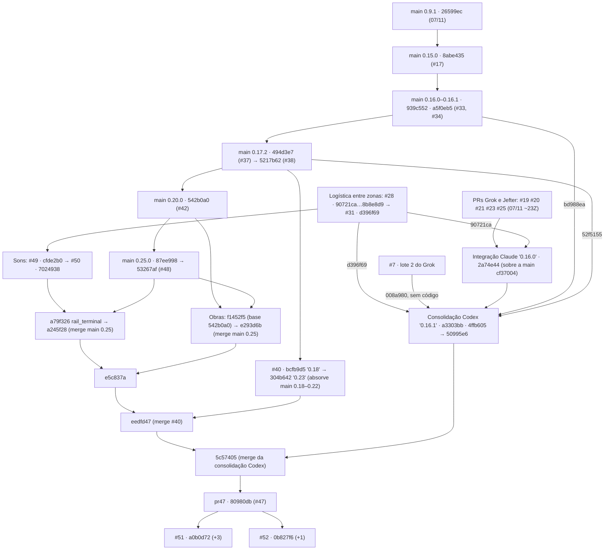

# 10: Evidências e rastreabilidade

> **Referência:** `main@53267af` · `pr47@80980db` · `#51@a0b0d72` · `#52@0b827f6`. Data: 2026-11-08, ~21h30 UTC.
> **Autor:** OPUS A, a partir de A4, A5 e A7. A tabela do §6 vem do B5 §7, com os ajustes listados em §6.0.
> **Níveis:** E1 executado nesta auditoria · E2 lido no código · E3 documento, commit ou metadado · E4 chat ou memória · ND não determinado · J visto em jogo (**nenhum caso**). Ver [05 §0](05_ESTADO_REAL_DA_BUILD.md#0-como-ler).
> **Horários** em UTC (Z). Commits feitos em −03:00 foram convertidos.

Este arquivo diz **de onde vem cada afirmação** da pasta e **até onde ela vale**. Não repete os resultados: os números estão em [05 §3](05_ESTADO_REAL_DA_BUILD.md#3-resultados-e1), a arquitetura em [04], os riscos em [09] e as tarefas em [08].

---

## 1. Índice de fontes

### 1.1 Código (E2)

| Fonte | `main@53267af` | `pr47@80980db` | O que sustenta | Detalhe |
|---|---|---|---|---|
| `native/api/src/` (crate do mod) | 50 `.rs`; `lib.rs` 872 linhas, 16 módulos, 23 ganchos | 90 `.rs`; `lib.rs` 1 255 linhas, 29 módulos, 33 ganchos | Todo estado "Integrado" de [05 §1]; arquivo:linha na coluna "Evidência" | [04 §2–§5] |
| `native/offline-check/horizon-client/src/mod_api.rs` (stub) | 955 linhas, 44 métodos de `Host` | 1 090 linhas, 52 métodos | **Limite do E1**: cópia manual das assinaturas do Horizon 66f3981 | [04 §2.2] |
| `native/api/Cargo.toml` | `horizon-client` por `git` (`horizon-rust/horizon`), sem `rev`, sem `Cargo.lock` | idem; versão do crate 0.25.0 | R-02 → [TAR-002] | |
| `content/` (JSON, texturas, traduções) | 529 JSON válidos e 65 texturas (X1); 1 050 chaves de tradução | 742 JSON, 89 texturas; 1 834 chaves | Blocos, itens, receitas, avanços, menus | [04 §7], [04 §10.5–10.8] |
| `tools/` | 13 arquivos (6 geradores) | 30 arquivos (12 geradores) | Geração de conteúdo e verificações | §1.3 |
| `tools/production.json` | 53 receitas | as mesmas 53 ([DEC-045]) | Tempos de receita | [05 §1.4] |
| `launcher/`, `launcher.exe` | Cargo 0.10.0 | Cargo 0.16.1 (binário da 0.16.1 do Codex) | Instalação | [04 §8] |
| `release/` | `Veio-0.25.0.zip` | o mesmo + `Veio-Realismo-1.1.zip` e `Veio-Realismo-1.1-atualizacao.zip` (0.16.1 do Codex) | Não há pacote do pr47 | [TAR-004] |
| `work-in-progress/finite-world/` | — | 10 `.rs`, `hooks/`, `horizon-mixin.toml.draft`, `CONTINUAR.md`, fora do crate | Mapa finito: Em desenvolvimento | [TAR-025] |
| Horizon `horizon-rust/horizon` em 66f3981 (2026-11-05) e 5f7cadf (2026-11-08 18:52Z) | — | — | Ganchos (`native-hooks.json`), métodos (`game/native_*.rs`) e manifesto de shader (`horizon-shader-api/src/manifest.rs:600-660`) existem. Só leitura, nada compilado | [04 §2.2] |

### 1.2 Documentos

**Do repositório.** Os 52 arquivos de texto do pr47 (28 deles também na main) estão no §6. A tabela traz camada, linhas, último commit, escopo, confiabilidade e status.

**Fora do repositório:**

| Fonte | Data | Escopo | Nível | Como foi usada |
|---|---|---|---|---|
| Contexto da missão (falas do dono transcritas pelo supervisor, com horário) | 08/11 | Decisões do dono de 16:32 a 20:09 | E4 | Base das DEC "dono" em [06] |
| Artefato "Veio: lacunas em relação a jogos de fábrica" (Claude Docs `e04da5cb` / `UhUqLwEVPnRrKFzKbK6NMD`) | 08/11, ~16:30 | 6 lacunas de design | E3 | Origem da [DEC-017] (lido pelo OPUS B) |
| Upload `bfe368aa…` (zip, 724 KB, 17:13) | 08/11 | Build parcial das obras: `BASELINE` com base 542b0a0, head 4a096e9, `cloud/obras-planta` e patches 0001–0005 | E2 | 67 arquivos idênticos aos de `f1452f5` (§4.5) |
| Uploads `4feab01a…` e `6e71c2e3…` (PNG 457×254 e 528×305, 21:04) | 08/11 | Duas imagens de referência visual: casa num lago e vila ao entardecer | — | Vistas. Não mostram blocos do Veio e **não contam como J**. Alvo provável do realismo ([Q-07]) |
| Zips 0.15.1 e 0.15.2 (branches `codex/arquivos-*`) | 08/11 | Pacotes locais do Codex | E2 | Comparados blob a blob (§4.5) |
| Metadados REST dos PRs (`gh api repos/ohariseldon/MineFac/pulls`; GraphQL indisponível) | 20:45Z | #1–#52: título, head, base, autor, datas | E3 | §4.3 |
| Relatórios intermediários A1–A7 (Opus A), B1–B7 (Opus B), contexto da missão e validação | 08/11 | Auditoria | derivado | Versionados em [`evidencias/relatorios/`](evidencias/relatorios/) para rastreabilidade. Os documentos 00–11 prevalecem sobre eles |

### 1.3 Testes, scripts e logs

| Script ou teste | Camada | Verifica | Executado? | Resultado |
|---|---|---|---|---|
| `tools/check_project.py` | ambas | JSON, traduções, páginas do guia, texturas, invariantes de `sim_economy.py` | Sim (X1) | [05 §3.1] |
| `tools/check_rust.py` (`cargo test` offline contra o stub) | ambas | Testes `#[test]` de `native/api/src` | Sim (X2): main 176/0/5, pr47 325/0/9 | [05 §3.1]; por módulo em [04 §9] |
| `tools/check_performance.py` | ambas | 7 cenários `profile_scale` | Sim (X3) | [05 §3.1] |
| Testes `#[ignore]`: `bench_factory`, `bench_frame`, `bench_large_village`, `profile_scale`, `preview`; no pr47 também 3 de onboarding e `stations_cost` | ambas | Custo por tick e por quadro, alocações | Sim (X5–X9; R1/R2 em `--release`) | [05 §3.2] |
| `cargo test` do launcher | ambas | 2 testes (main), 6 (pr47) | Sim (X4) | [05 §3.1] |
| `tools/check_machine_audio.py`, `check_machine_forms.py` | pr47 | 30 sons licenciados; 34 formas e 27 silhuetas | Sim (X10, X11) | [05 §3.1] |
| `tools/build_*.py` | ambas | Geradores | Sim, em cópia, com diff contra a árvore (X12) | [05 §3.1] |
| `tools/check_native_api.py` | ambas | Assinaturas contra o `.rmeta` real do Horizon | **Não**: exige o Horizon compilado | [TAR-001] |
| `tools/package.py` | ambas | Monta o zip | **Não**: escreveria em `dist/` | [TAR-004] |
| `tools/benchmark_factory.py`, `prepare_world_map_check.py`, `world_map_probe.rs`, `preview_*` | pr47 | Apoio ao mapa finito e prévias | **Não** | — |
| `tools/check_shaders.py` | só #51 | Shaders | **Não** | [TAR-014] |

**Logs E1** versionados em [`evidencias/logs/`](evidencias/logs/):
- verificações: `{main,pr47}_check_{project,rust,perf}.log`, `*_perf.json`, `*_launcher.log`, `pr47_check_{audio,forms}.log`;
- benchmarks: `{main,pr47}_bench_{factory,frame,large_village}.log`, `bench_repeat.log` (R1), `bench_interleaved.log` (R2), `pr51_52_bench{,_release}.log`, `pr47_ignored_onboarding.log`, `pr47_stations_cost.log`;
- inventários: `{blocks,items,host,hooks}_{main,pr47}.txt`, `consts_pr47.txt`.

**Esses logs não estão no repositório e somem com a sessão.** Para refazer, rode os comandos de [05 §3].

---

## 2. Cobertura

### 2.1 Examinado

| Objeto | Profundidade | Método |
|---|---|---|
| Código Rust da main e do pr47 | Todos os módulos ligados a ganchos; arquivo:linha para as 158 FUN; diff main × pr47 | Leitura e `git grep` (E2) |
| Stub × Horizon 66f3981 × 5f7cadf | Existência e assinatura dos 33 ganchos e 52 métodos; manifesto de shader | Leitura de cópia de leitura do Horizon em 66f3981 e 5f7cadf, não versionada (E2) |
| `content/` e `tools/` | Validação completa (X1); listas de blocos, itens e traduções; todos os geradores rodados em cópia (X12) | E1/E2 |
| Testes e benchmarks | Tudo o que roda offline, nas duas camadas e nos PRs #51/#52 | E1 (§1.3) |
| Documentos | Os 52 do pr47, com data e último commit. Leitura integral dos que sustentam regra ou decisão (README, TRABALHADORES, CONSOLIDACAO, HANDOFF_OBRAS, MAPA, CONTINUAR, ECONOMIA, SOCIEDADE, GRANDE-INDUSTRIA, PROGRESSAO-FASES, DESEMPENHO, INTERFACE_POSTOS); os demais nos trechos citados | E3 |
| Git | As 42 branches remotas e as 2 dos PRs #51/#52; ancestralidade de todas; `patch-id` e blobs das 3 que ficam fora; os 79 commits do pr47 em grupos | E2 (§4) |
| PRs | Metadados REST de #1 a #52 | E3 |
| #51 e #52 | Diffstat, arquivos tocados, benchmarks E1 | E1/E2, **sem auditoria de código** |
| Uploads | O zip `bfe368aa…`, comparado por blob; as duas imagens, vistas | E2 |

### 2.2 Acessível, mas não examinado

- **Código do #51 e do #52, linha a linha** → [TAR-013], [TAR-014].
- **WGSL** dos shaders do pr47 e os 9 shaders do #51: `horizon-shader check` não foi executado → [TAR-055].
- `tools/check_native_api.py`, `tools/package.py` e os scripts de apoio do mapa finito (§1.3).
- **`work-in-progress/finite-world/`:** lidos o `CONTINUAR.md` e a lista de arquivos. Os 10 `.rs` não foram compilados nem auditados, porque ficam fora do crate.
- **Zips de `release/`:** só a versão declarada e o blob foram conferidos; o conteúdo não foi aberto.
- **Comentários e revisões dos PRs, e as issues:** não consultados.
- **Histórico anterior à 0.9** (0.6–0.8): só os títulos de commit.
- **Horizon:** nada além dos ganchos, dos `native_*.rs` e do manifesto de shader.
- **Texturas e sons:** só as verificações automáticas (X1, X10), sem inspeção visual nem auditiva.

### 2.3 Inacessível

| Fonte | Por quê | Consequência | Como fechar |
|---|---|---|---|
| Commits locais não enviados (do dono ou de agentes) | Só o GitHub e esta sessão são visíveis | "Nada ficou fora do #47" (§4.5) vale só para o que foi enviado | Pedir push antes de integrar ([TAR-011]) |
| Máquina do Luiz (`C:\Users\User\Desktop\clauduxu`) | Pasta local citada no contexto. Só chegou o que foi enviado ao GitHub ou como upload | Builds, saves e logs de lá são desconhecidos | Idem |
| Horizon real compilado e executado | A sessão não tem o cliente do Minecraft 26.3, e a compilação nativa não foi tentada | Toda FUN fica no máximo "Integrado"; `read_columns` e `chunk_load` nunca compilaram | [TAR-001], [TAR-002] |
| Partidas jogadas (J) | Não há registro | Nenhuma FUN está "Validado" | [TAR-003] |
| Descrições completas dos PRs | Foram usados commits e metadados; os corpos não foram lidos por inteiro | A intenção declarada de cada PR é inferida dos commits | Ler ao fechar cada PR ([TAR-012]) |
| Repositórios Projeto-Moba e Wasému | Fora do escopo; a sessão só alcança o MineFac | Nada | — |
| Histórico completo dos chats e das threads | Só os trechos transcritos no contexto (E4) | Horários e textos das DEC "dono" dependem dessa transcrição | Conferir no chat ao fechar cada Q |
| Memória do projeto (notas persistentes de agentes) | Não estava disponível ao OPUS A | O B5 §7.3 a classifica como E4 secundária | Migrar os fatos para esta pasta |
| Execução do `launcher.exe` no Windows | Só houve `cargo test` no Linux (X4) | Instalação e perfis gráficos são ND | [TAR-003], [TAR-054] |
| Saves reais (0.16.1, Realismo 1.1, 0.25) | Nenhum disponível | CNF-014 e a abertura de save 0.25 no pr47 são ND | [TAR-007], [TAR-018] |

**Esta pasta** (`docs/consolidacao-mestra/`) não estava versionada quando foi escrita (`git status`: `?? docs/`).

---

## 3. Confiabilidade

### 3.1 Por tipo de fonte

| Fonte | Nível | Confiabilidade | Limite |
|---|---|---|---|
| Execuções desta auditoria | E1 | **Alta** para o que medem | Rodam contra o stub 66f3981. O relógio da máquina (Linux de nuvem, 4 núcleos) oscila ±20%. Nada dizem sobre o jogo |
| Código | E2 | **Alta** para existência, números e ligações | Comportamento em jogo é ND. Duas APIs nunca compiladas ([04 §2.2]) |
| Stub do Horizon | E2 | **Média** | É cópia manual. O #51 o altera (+48 linhas), então compilar offline não prova compatibilidade |
| Código do Horizon (66f3981, 5f7cadf) | E2 | **Alta** para a existência de ganchos e métodos | Assinaturas não conferidas contra o `.rmeta` |
| Mensagens de commit | E3 | **Média** | Alegam fatos não reproduzidos, como `4ffb605` "after full Horizon native compilation" |
| Documentos do repositório | E3 | Variável, por documento | Coluna "Conf." do §6 |
| Metadados REST dos PRs | E3 | **Alta** para head, base, autor e datas | O corpo não foi lido |
| Falas do dono | E4 | **Alta** como intenção | Não verificáveis no código. O horário é o da transcrição |
| Afirmações de agente ("decisão de produto", "compilado", "0 alocações") | E3/E4 | **Baixa** até haver prova | §3.2 |
| Relatórios A1–A7 e B1–B7 | derivado | **Média-alta** | Erros conhecidos corrigidos (A7 §0, B7 §1). Esta pasta prevalece |

### 3.2 Afirmações de documento que a auditoria refutou ou não confirmou

| Afirmação | Onde | Situação | Prova |
|---|---|---|---|
| "Compilação nativa da 0.16.1 sobre 66f3981 em 7 min 14 s" | `CONSOLIDACAO.md`, `4ffb605` | **Não reproduzida.** Mesmo se verdadeira, não cobre a 0.25.0 nem o pr47: `read_columns` e `chunk_load` entraram depois, em `bcfb9d5` | E3 × E2 |
| "Quadro com 0 alocações" | `frentes/DESEMPENHO.md`, seção 0.17.1 (`494d3e7`), herdada por pr47, #51 e #52 | **Verdadeira na main** (X6) e **falsa** no pr47, no #51 e no #52 (329 por quadro) | E1 |
| "A consolidação subiu o custo de 12,58 bi para 17,88 bi (+42%)" e "−7,7%" com o #52 | `DESEMPENHO.md` no #52, seção "Depois da consolidação" | **Direção confirmada** (+36% no relógio, E1). Callgrind não refeito. Os −7,7% ficam abaixo do ruído. O #52 não afirma 0 alocações; só não corrige a seção antiga | E3/E1 |
| "Em casa as fábricas rendem 15% mais" | README pr47 l. 21; `TRABALHADORES.md` "sexta entrega" | **Refutada**: `home/mod.rs:101` não tem bônus de casa ([DEC-046]) | E2 |
| "Use `release/Veio-0.16.1.zip`" | README pr47 l. 86 | **Refutada**: o arquivo não existe | E2 |
| Poluição: 64 e 18 blocos | README pr47 §Poluição | **Refutada**: `ARRIVAL 26.0` (`pollution.rs:47`) | E2 |
| Estados do canteiro 32–35; "30 entradas"; "26 estados" | `TRABALHADORES.md` pr47 l. 234, 131 e 589 | **Refutada**: 36–39; 44 entradas ([04 §10.1]) | E2 |
| `freight_route` = 28, `resting` = 29 | `COORDENACAO.md` pr47 l. 55 | **Refutada**: `rest` = 28, `freight_route` = 40 | E2 |
| 558 JSON, 68 texturas, 248 testes; "as fases substituem os tempos" | `CONSOLIDACAO.md` | **Desatualizada** (742/89/325) e **revogada** ([DEC-045]) | E1 |
| Prensa a 80 ticks: "duas prensas por veio" | `GROK-BALANCE.md`; README pr47 l. 24 | **Substituída**: prensa a 30 ticks na 0.25 ([DEC-045]) | E2 |
| "Decisão de produto de 7 de novembro": mapa de 15 000 × 15 000 | `MAPA.md` | **Decisão de agente (não confirmada pelo dono)** → [Q-09] | E3 |
| Menu do canteiro com 1 slot | `content/data/veio/horizon/menu/site.json` (é dado, não doc) | **Diverge** do código (3 slots, `workforce/mod.rs:150`) | E2 → [TAR-006] |
| "Candidata não compilada; cache incoerente impediu verificar a API" | `frentes/CHECKPOINT-INTEGRACAO.md` | **Confirmada** | E2 |

---

## 4. Branches, PRs e genealogia

Método (E2):
- `git merge-base --is-ancestor <head> 53267af` (main) e `… 80980db` (pr47);
- `git rev-list --count 53267af..<head>`;
- para quem não é ancestral, `git cherry`, `patch-id` e comparação de blobs.

O destino de cada branch e PR está em [TAR-011] e [TAR-012] (**decisão de agente, não confirmada pelo dono**).

### 4.1 Genealogia

### 4.2 As 42 branches remotas e as 2 dos PRs #51/#52

**Contidas na main e no pr47 (20):**

| Branch | Head | PR |
|---|---|---|
| `main` | 53267af | — |
| `claude/trusting-ritchie-sc9ty8` | 53267af (idêntica à main) | #3…#48, a linha Cloud de 0.10 a 0.25 |
| `codex/expansion` · `global-budget` · `incremental-foremen` · `incremental-hauler-search` · `incremental-topology` · `inserters` · `optimization` · `scaling` | 20f9dba · 690f554 · 13758bd · 604369d · cad77c3 · d5a85fa · 65cab50 · 350f064 | #1 · #27 · #32 · #38 · #29 · #8 · #22 · #24 |
| `logistics/merger` | 26599ec | — |
| `cursor/grok-performance-balance-c7d9` | 068a61b | #2 |
| `cursor/grok-lote3…lote8-c7d9` (6) | b6a6cdf · 0a435a3 · 4c541ac · 8d64fe3 · dda34fa · a8e4741 | #9 · #11 · #12 · #14 · #16 · #18 |
| `cursor/grok-noite-c7d9` | ce0e7d1 | #26 |
| `cursor/grok-quartel-c7d9` | a6d2744 | **#30, aberto** (o conteúdo já está na main) |

**Só no pr47 (19):**

| Branch | Head | Autor, data | +n sobre a main | PR | Conteúdo |
|---|---|---|---|---|---|
| `claude/project-thread-l94frq` | 80980db | Codex, 08/11 19:29Z | 79 | **#47** | Candidata consolidada |
| `claude/project-thread-6tjsil` | 304b642 | Claude, 17:07Z | 7 | #40 | Água, rios, grande indústria, estações |
| `codex/checkpoint-consolidacao` = `codex/consolidated-016` | 50995e6 | Codex, 18:11Z | 60 | — | Consolidação Codex |
| `codex/factory-ambience-motion` | 7024938 | Jefter, 17:11Z | 8 | #50 (draft) | Ambiente sonoro e animação |
| `codex/machine-audio` | cfde2b0 | Jefter, 16:42Z | 7 | #49 (draft) | Som posicional (30 `.ogg`) |
| `codex/machine-identity` | d396f69 | Jefter, 00:25Z | 6 | #31 | Silhuetas e colisão |
| `codex/interzone-logistics` | 8b8e8d9 | Jefter, 00:00Z | 5 | #28 | Ferrovia, drones, caravanas |
| `codex/import-factory-board` · `import-megafactories` · `import-progressao` | fe30583 · e0ee148 · 2b9a3f9 | Claude (MineFac), 05:35Z · 13:11Z · 05:17Z | 4 · 5 · 2 | — | Quadro; megafábricas; progressão por fases |
| `codex/local-snapshot` · `codex/realismo-performance` | c1b3ba5 · fd2a446 | Codex, 05:04Z · 05:07Z | 2 · 2 | — | Tutorial, casa do fundador, checkpoint do mapa finito |
| `cursor/grok-lote2-c7d9` | 2d5a202 | Cursor Agent | 1 | #7 | Lote 2; no pr47 só "registrado" (`008a980`), sem o código |
| `cursor/grok-balance-c7d9` · `grok-lan-c7d9` · `grok-vilas-c7d9` | 96458cf · cf2a63c · 19a311e | Cursor Agent | 1 cada | #19 · #25 · #21 | Duas prensas; convidado LAN; cama livre |
| `grok/mission-balance` | c5db4f6 | Jefter, 07/11 23:06Z | 2 | #20 | Projetos industriais; produtividade 10% → 20% ([Q-14]) |
| `research/connected-veins` | 2edc6c0 | Jefter, 07/11 23:13Z | 1 | #23 (draft) | Pesquisa de jazidas conectadas |

**Fora da main e do pr47 (3), sem código único (§4.5):** `codex/consolidated-0161` (bc2d0ca), `codex/arquivos-builds-anteriores` (bd626c7) e `codex/arquivos-historicos` (4ddad22).

**Buscadas na Fase III (2), fora do pr47:** `claude/project-thread-mrtok9` (a0b0d72, #51) e `claude/project-thread-e9lkha` (0b827f6, #52). Ver §4.7.

### 4.3 PRs

**Abertos (15, às 20:45Z).** A missão previa 13; o #51 e o #52 surgiram durante a auditoria.

| PR | Head → base | Autor | No pr47? | Destino |
|---|---|---|---|---|
| **#52** | `e9lkha`@0b827f6 → `l94frq` | ohariseldon (20:35Z) | **Não** | [TAR-013] |
| **#51** | `mrtok9`@a0b0d72 → `l94frq` | ohariseldon (20:34Z) | **Não** | [TAR-014] |
| #50 | `factory-ambience-motion` → `machine-audio` | jefterpereira (draft) | Sim | [TAR-012] |
| #49 | `machine-audio` → `machine-identity` | jefterpereira (draft) | Sim | [TAR-012] |
| **#47** | `l94frq`@80980db → main | ohariseldon | — | [TAR-011], [Q-11] |
| #40 | `6tjsil`@304b642 → main | ohariseldon | Sim (`eedfd47`) | [TAR-012] |
| #31 | `machine-identity` → `interzone-logistics` | jefterpereira | Sim | [TAR-012] |
| #30 | `grok-quartel` → `grok-noite` | ohariseldon | Sim, e na main | [TAR-012] (fechar já) |
| #28, #25, #23, #21, #20, #19 | → main | jefterpereira / ohariseldon | Sim | [TAR-012] |
| #7 | `grok-lote2` → main | ohariseldon | Ancestral, mas o código não foi reaplicado (`008a980`) | Fechar como substituído pelo lote 3 |

**Fundidos (37), todos com base `main`:** #1–#6, #8–#18, #22, #24, #26, #27, #29, #32–#39, #41–#46 e #48. Nenhum PR foi fechado sem merge. Os números de #1 a #52 estão todos ocupados.

### 4.4 Versões da main e colisões de número

| Versão | Commit | PR, merge (UTC) | Título |
|---|---|---|---|
| 0.6 · 0.7 · 0.8 · 0.9 | 5eaea2c · 819ba92 · 7644aab · 5944d37 | — (07/11) | Base inicial → jazidas com pureza, receitas por tabela, renováveis, lavoura, rancho |
| 0.10.0 | 9421883 | #3, 21:06Z (com #1 e #2) | Três frentes + launcher |
| 0.11.0 · 0.12.0 · 0.13.0 · 0.14.0 · 0.15.0 | 903c4ec · 6ac0c62 · 36e43b6 · a691802 · 8abe435 | #6 · #10 · #13 · #15 · #17 (21:34Z–22:39Z) | Carregador e capataz → zonas → vilas até 150 → build consolidada |
| 0.16.0 · 0.16.1 | 939c552 · 7208324 | #33 · #34 (08/11 05:26Z, 05:36Z) | Cérebro dos aldeões; trabalhador segura a carga |
| 0.17.0 · 0.17.1 · 0.17.2 | 0deee22 · 0472750 · 494d3e7 | #35 · #36 · #37 | Inimigo e quartel; ticks e quadros leves; esteira aguardando |
| 0.18.0 → 0.25.0 | 0aa3fbb · a48e14c · 95a1f7c · 9331dee · cbc53a9 · e8ac991 · b25b9d0 · 87ee998 | #39, #41–#46, #48 (16:06Z–17:29Z) | Sociedade → contas e impostos → holding → economia fechada → comércio exterior → balanço |

**Colisões de número (E2), insumo para [Q-08] e [TAR-040]:**
- **0.16.0:** main `939c552` × integração Claude `2a74e44` (08/11 00:50Z) e "pacote refeito" `3cd563d`, hoje dentro do pr47.
- **0.16.1:** main `7208324` × Codex `a3303bb` (05:25Z) e `4ffb605`. O `launcher.exe` e os zips Realismo 1.1 do pr47 vêm dessa 0.16.1.
- **0.18 a 0.23 no #40:** `bcfb9d5` → `55579bc` → `1a38b93` → `46152c8` → `304b642`, colidindo com as da main.
- **0.15.1 e 0.15.2:** só zips locais do Codex.
- **0.26.0:** o #51 já usa o próximo número.

### 4.5 Verificação: nenhum código ficou fora do #47

| Verificação | Resultado (E2) |
|---|---|
| Ancestralidade das 42 branches em relação a `80980db` | 39 contidas; 3 não (§4.2) |
| Commits dessas 3 fora do pr47 | `bd626c7` (builds de tutorial), `4ddad22` (zips 0.15.1/0.15.2), `bc2d0ca` (arquiva os zips) e **`c8e94dc`** (mapa finito e portais) |
| `c8e94dc` × `80980db` | `patch-id` idêntico (`b6d1ef2e…`); `git cherry` marca "−". É o mesmo patch, reaplicado como head do pr47 |
| Zip 0.15.1 (blobs normalizados CRLF→LF contra os 5 586 objetos do pr47) | 12 arquivos sem equivalente, 6 deles nativos: iteração anterior do tutorial (`TRACE_TTL 200` × 6000 hoje), já substituída |
| Zip 0.15.2 | 5 arquivos sem equivalente: é `c1b3ba5` sem a casa do fundador, portanto um subconjunto |
| Upload `bfe368aa…` | 67 arquivos de `consolidada/arquivos/` idênticos aos de `f1452f5` |
| Heads dos PRs abertos #7–#50 | Todos ancestrais do pr47; o #30 também da main |
| **Conclusão** | **Confirmado até `80980db`.** Duas ressalvas: commits locais não enviados são invisíveis (§2.3); o **#51 e o #52** são código novo fora do pr47 |

### 4.6 O pr47 por dentro: 79 commits em 10 grupos

1. **PRs do Grok e do Jefter** (07/11 21:35–23:19Z): 2d5a202, 3b3008d, c5db4f6, 2edc6c0, cf2a63c, 96458cf, 19a311e.
2. **Logística entre zonas** (Codex e Jefter): b616285 (realismo opcional), 90721ca, afbc389, 8b8e8d9, d396f69.
3. **Integração Claude "0.16.0"** (07/11 23:55Z – 08/11 00:51Z): d1e2f30 (casa do fundador), 4145e3d (quartel), merges de connected-veins, grok-lan, grok-vilas, grok-balance, mission-balance e interzone-logistics; 7d2e0be (guias com até 14 linhas), 2a74e44, 848e1b8 (clippy), 3cd563d.
4. **Consolidação Codex** (08/11 05:04–05:49Z): c1b3ba5, 9457afa, fd2a446, 07eaff2, 730e305, 355f24a, 008a980, 8d3659b, 6227e24, a3303bb (0.16.1), 4ffb605 (compilação nativa alegada), 3106849, 2bc62ec (gráficos 1.1), bd988ea.
5. **Importações de patches em três cópias** (mesmo conteúdo, rebaseado): progressão por fases 0ce91a4/0be045c/823d626 e 2b9a3f9/13074eb/32aa2a5; quadro a19ebd7/a3e79d5 e fe30583/799aa13; megafábricas e0ee148. O `c8c43c5` registra a equivalência por range-diff.
   - **R-37 fica registrado aqui, sem TAR:** o histórico triplicado não se reescreve. Ao bisseccionar ou ler o `git log`, trate as três cópias como um só patch.
6. **Codex** (13:11–13:36Z): cb45a27, 2720da4, fa96ceb, 52f5155 (merge da 0.17.2 da main), f99f66a.
7. **PR #40** (Claude, 16:23–17:07Z): bcfb9d5, 55579bc, 1a38b93, 82ccaf6, 46152c8, e36ee2e, 304b642.
8. **Sons e movimento** (Jefter, 16:42–17:11Z): cfde2b0, 7024938.
9. **Obras e integração final** (Claude, 17:14–19:29Z): f1452f5 (build parcial das obras), 843a286, f12f980, e293d6b e a245f28 (merges da main 0.25), a79f326 (`rail_terminal`), e5c837a, 50995e6 (checkpoint Codex), eedfd47 (merge do #40), 5c57405 (merge da consolidação Codex).
10. **Head `80980db`** (Codex, "Checkpoint finite world generation and portal safety work"; autoria 18:16Z, commit 19:29Z).

O que está desligado ou em WIP no pr47 (mapa finito, ferramentas de mapa, funções mortas, pesquisas sem tradução) está em [05 §2.1](05_ESTADO_REAL_DA_BUILD.md#21-desconectadas-existem-mas-não-chegam-ao-jogador).

### 4.7 PRs #51 e #52

| PR | Branch | Commits sobre `80980db` | Origem (E4) |
|---|---|---|---|
| #51 | `claude/project-thread-mrtok9` | 83d0712 (20:23Z, Realismo 2.0), 2186b28 (20:34Z, "Veio 0.26.0: clima, estações"), a0b0d72 (20:44Z, Realismo 2.1) | Thread "Aumentar o realismo sem pesar o PC" |
| #52 | `claude/project-thread-e9lkha` | 0b827f6 (20:35Z, sons só perto do ouvinte, mural ocioso mais lento) | Thread "Definir limite do mapa e otimizar" |

O que tocam e os benchmarks estão em [05 §2.6](05_ESTADO_REAL_DA_BUILD.md#26-trabalho-em-branch-fora-da-main). A auditoria de código é [TAR-013] e [TAR-014].

---

## 5. Commits-chave

| Ref. | Autor, data (UTC) | O que prova | Nível |
|---|---|---|---|
| `53267af` | jefterpereira, 08/11 17:29Z | Head da main (merge do #48) | Alta |
| `87ee998` | Claude, 17:29Z | Veio 0.25.0 | Alta |
| `80980db` | Codex, 19:29Z | Head do pr47; `patch-id` = `c8e94dc` | Alta |
| `e293d6b` / `a245f28` | Claude, 17:37Z / 17:46Z | Entrada da main 0.25.0 no pr47 | Alta |
| `5c57405` / `eedfd47` | Claude, 19:29Z / 19:06Z | Merges da consolidação Codex e do #40 no pr47 | Alta |
| `f1452f5` | Claude, 17:14Z | Build parcial das obras = upload do usuário (67 arquivos) | Alta |
| `a79f326` | Claude, 17:41Z | `veio:rail_terminal`; `freight_station` passa a ser só exportação (CNF-014, [DEC-044]) | Alta |
| `bcfb9d5` | Claude, 16:23Z | Entrada de `read_columns` e `chunk_load` no stub, depois da única compilação alegada | Alta |
| `c1b3ba5`, `fd2a446`, `d1e2f30`, `90721ca` | Codex / Claude / Jefter, 07–08/11 | Origem dos demais métodos novos do stub | Alta |
| `a3303bb` / `4ffb605` | Codex, 05:25Z / 05:35Z | "Veio 0.16.1" do Codex e a alegação de compilação nativa | Média (E3) |
| `2a74e44` / `3cd563d` | Claude, 00:50Z / 00:51Z | A segunda "0.16.0" | Alta |
| `008a980` | Codex, 05:10Z | Lote 2 do Grok registrado como substituído, sem reaplicar o código | Alta |
| `c8c43c5` | Codex, 13:11Z | Range-diff das importações triplicadas (R-37) | Média |
| `9c94c55` | Claude, 06:09Z | "Quadro e tick sem alocações": vale na main | Alta (main) |
| `a5f0eb5` | jefterpereira, 05:36Z | Base 0.16.1 dos 9 commits perf/fluid, presentes na main **e** no pr47: a regressão não vem de commit perdido | Alta |
| `494d3e7` | Claude, 13:13Z | 0.17.2; última edição do `DESEMPENHO.md` antes do #52 | Alta |
| `b616285` / `3106849` / `2bc62ec` | Codex, 07/11 23:31Z / 05:39Z / 05:41Z | Realismo opcional e gráficos 1.1 | Alta |
| `83d0712`, `2186b28`, `a0b0d72` / `0b827f6` | Claude, 20:23–20:44Z / 20:35Z | #51 e #52 | Alta (existência); código não auditado |

---

## 6. Status dos documentos legados

### 6.0 Como ler e o que mudou em relação ao B5 §7

**Status:**
- **vigente:** descreve regra ou contrato atual e pode ser lido como fonte;
- **histórico:** registro de entrega ou ordem passada, verdadeiro para a época e não normativo;
- **substituído:** contradito por DEC ou código posterior; indica o substituto.

**Proposta** ([TAR-015]): cada documento histórico ou substituído ganha uma linha no topo, sem mudar o resto: `> Status: histórico — ver docs/consolidacao-mestra/10_EVIDENCIAS_E_RASTREABILIDADE.md`.

**Colunas:**
- **Linhas:** main / pr47; "=" quer dizer blob idêntico nas duas camadas; "—" quer dizer que o arquivo não existe na camada.
- **Último commit:** o do pr47.
- **Conf.:** confiabilidade (§3).

**Ajustes ao B5 §7:**
1. `MAPA.md` existe só no pr47. Passa a "vigente como **proposta**", porque a "decisão de produto" é de agente.
2. `COORDENACAO.md` aponta para [07] e [11]; o `README.md` desta pasta não existe.
3. `INTERFACE_POSTOS.md`: uso confirmado (E2). `operations::` é chamado em `lib.rs`, `holding.rs`, `tutorial.rs`, `workforce/hauler.rs` e, no pr47, em `workforce/center.rs`.
4. `DESEMPENHO.md` ganha a ressalva das 329 alocações.
5. Entram `visuals/veio-industrial/README.md`, `performance/*.json`, `docs/visual/*.png` e os documentos que chegam com o #51 e o #52 (§6.4).
6. Os Q do B6 viram os Q-NN de [09], com a mesma numeração. As pendências do `HANDOFF_OBRAS.md` viram TAR.

### 6.1 Raiz

| Documento | Linhas | Último commit | Escopo | Conf. | Status | Ação ou substituto |
|---|---|---|---|---|---|---|
| `README.md` | 244 / 338 | 5c57405 Claude, 08/11 19:29Z | Porta de entrada do jogador | main Média; pr47 **Baixa** em partes (§3.2) | **vigente**, com correção | [TAR-015]: l. 21, 24, 86, §Poluição, §Progressão. O histórico do 1º parágrafo vai para um CHANGELOG |
| `CONTRIBUTING.md` | 77 / 86 | 5c57405 | Regras de contribuição | Média | **vigente**, com correção | "Subir a versão a cada entrega" → política de [Q-08] ([TAR-040]) |
| `COORDENACAO.md` | 86 / 123 | 4ffb605 Codex, 05:35Z | Divisão de frentes desde a 0.9.1; seções 0.16.0 e 0.16.1 | Baixa | **substituído** | Por [07] e [11]. Status 28/29 errados (§3.2) |
| `CONSOLIDACAO.md` | — / 64 | 50995e6 Codex, 18:11Z | Consolidação Codex 0.16.1 | **Baixa** | **histórico** | "Fases substituem os tempos" revogada ([DEC-045]); números desatualizados |
| `HANDOFF_OBRAS.md` | — / 43 | f12f980 Claude, 17:25Z | Pendências das obras | **Alta** | **vigente** até as TAR fecharem; depois histórico | [TAR-020] traduções · [TAR-006] menu · [TAR-023] guia · [TAR-021] ruínas · [TAR-022] proteção · [TAR-015]/[TAR-004] docs, checks e zip |
| `MAPA.md` | — / 161 | 80980db Codex, 18:16Z | Mapa finito 15 000 × 15 000, muralha de bedrock | Média como intenção | **vigente como proposta** | Decisão de agente (não confirmada pelo dono) → [Q-09], [TAR-025] |
| `TRABALHADORES.md` | 413 / 684 | 5c57405 | Diário técnico dos postos (Cloud) | Média | **vigente**, com trechos substituídos | "Sexta entrega" (+15%) substituída ([DEC-046]). Numeração de status → [04 §10.1] |
| `TRANSPORTES.md` | — / 213 | 8b8e8d9 Jefter, 00:00Z | Ferrovia, drones, caravanas | Média | **vigente** | Anterior ao `rail_terminal` (`a79f326`). Falta o limite "área simulada × estações" ([Q-05], [TAR-027]) |
| `LOGISTICA.md` | 51 = | 26599ec Codex, 07/11 20:23Z | Esteiras e fusor 0.9.1 | Média | **histórico** | O atual está em `frentes/CODEX-LOGISTICA.md` |
| `PERFORMANCE.md` | 121 = | 13758bd Codex, 05:05Z | Lote de otimização sobre a 0.15 | Média | **histórico** | Não cobre os sistemas do pr47 |
| `VISUAL-MAQUINAS.md` | — / 90 | d396f69 Jefter, 00:25Z | 34 formas, 27 silhuetas | Média | **vigente** | — |
| `CREDITS.md` | 7 / 23 | 5c57405 | Licenças (Kenney CC0, shader MIT) | Média | **vigente** | — |
| `work-in-progress/finite-world/CONTINUAR.md` | — / 115 | 80980db | Estado do mapa finito (22/24 injeções; Nether falhou) | Baixa na versão citada ("bundle 0.16.1") | **vigente** (rascunho) | Dono: thread "limite do mapa" ([TAR-025]) |
| `visuals/veio-industrial/README.md` | — / 65 | 3106849 Codex, 05:39Z | Shader Realismo leve 1.1 | Média | **vigente** | O #51 o reescreve (§6.4) |
| `performance/before.json`, `after.json` | = | 4244a7e Codex, 07/11 | Medições do PR #22 | Média | **histórico** | — |
| `docs/visual/*.png` | — / 2 imagens | — | Catálogo de máquinas, antes e depois | Média | **vigente** | — |

### 6.2 `frentes/`

| Documento | Linhas | Último commit | Escopo | Conf. | Status | Ação ou substituto |
|---|---|---|---|---|---|---|
| `AGUA-E-RIOS.md` | — / 83 | 46152c8 Claude, 16:57Z | Água, lavoura, rios (#40) | Média | vigente | Título "0.22.0" obsoleto (renumerações). APIs declaradas não compiladas |
| `AMBIENTE-E-MOVIMENTO.md` | — / 109 | 7024938 Jefter, 17:11Z | Ambiente sonoro e animação | Média | vigente | — |
| `AUDIO-MAQUINAS.md` | — / 101 | 7024938 | Som posicional | Média | vigente | — |
| `BALANCEAMENTO-ECONOMIA.md` | — / 127 | c5db4f6 Jefter, 07/11 23:06Z | Recompensas da 0.15 | Baixa | **substituído** | Por `ECONOMIA.md` (0.25) |
| `BALANCEAMENTO-MISSOES.md` | — / 83 | 3b3008d Jefter, 07/11 22:59Z | Missões da 0.15 | Média | histórico | Produtividade de 20% ainda pendente → [Q-14] |
| `CAPATAZES-INCREMENTAIS.md` | 121 = | 13758bd Codex | Capataz incremental | Média | vigente (técnico) | — |
| `CARREGADORES-INCREMENTAIS.md` | 106 = | 604369d Codex, 13:17Z | Carregador incremental | Média | vigente (técnico) | — |
| `CASA-FUNDADOR-INTEGRACAO.md` | — / 50 | fd2a446 Codex, 05:07Z | Casa do fundador | Baixa em parte | **substituído** em parte | O comportamento da casa segue a [DEC-046] |
| `CHECKPOINT-INTEGRACAO.md` | — / 44 | 50995e6 Codex | Estado da integração Codex | Média (confirmado, §3.2) | histórico | Modelo de bom handoff ([07]) |
| `CLOUD.md` | 37 / 41 | 19a311e Cursor Agent | Ordem de frente 0.9.1 | Média | histórico | — |
| `CODEX-BRACOS.md` | 35 = | e7f0c2c Codex, 07/11 | Braço básico | Média | **substituído** | O próprio texto aponta `CODEX-LOGISTICA.md` |
| `CODEX-LOGISTICA.md` | 50 = | d5a85fa Codex, 07/11 | Braços, filtros, divisor, unificador | Média | vigente | — |
| `CODEX.md` | 32 / 38 | c1b3ba5 Codex | Ordem de frente | Média | histórico | — |
| `DESEMPENHO.md` | 80 = (+71 no #52) | 494d3e7 Claude, 13:13Z | Lote 0.17.1: quadro 1 223 → 0 alocações; tick 1 151 → 936 | **Alta na main; Baixa no pr47** | histórico | "0 alocações" falso no pr47, no #51 e no #52 (329). Seção nova do #52 em §6.4 |
| `ECONOMIA.md` | 122 = | 87ee998 Claude, 17:29Z | Números e regras da economia 0.25 | Média-alta (código idêntico) | **vigente** | Fonte de [SIS-ECO] e [SIS-MER] |
| `ESCALA-E-ENERGIA.md` | 89 = | 350f064 Codex, 07/11 | Lote de escala | Média | histórico | — |
| `EXPERIENCIA-JOGADOR.md` | — / 130 | fe30583 Claude (MineFac), 05:35Z | Quadro da fábrica | Média | vigente, com trechos substituídos | "Unidade de 30/min" substituída ([DEC-045]). Pedido diário → [Q-02], [TAR-028] |
| `GRANDE-INDUSTRIA.md` | — / 121 | e36ee2e Claude, 17:06Z | Grande indústria, estações | Média | **vigente** | — |
| `GROK-BALANCE.md` | — / 38 | 96458cf Cursor Agent | Prensa a 80 ticks | Baixa | **substituído** | [DEC-045] |
| `GROK-LOTE.md`, `GROK-LOTE3–8.md` (7) | = | 068a61b … a8e4741 Cursor Agent, 07/11 | Registros de lote | Média | histórico | — |
| `GROK-LOTE2.md` | — / 53 | 8d3659b Codex, 05:17Z | Lote 2 | Baixa | **substituído** | Pelo lote 3 (o próprio `GROK-LOTE3.md` diz) |
| `GROK.md` | 35 / 35 (≠) | 3eb4b3d Claude, 08/11 00:40Z | Ordem de frente | Média | histórico | — |
| `INTERFACE_POSTOS.md` | 37 = | 20f9dba Codex, 07/11 | Contrato de inspeção de postos (`operations.rs`) | Média | vigente (técnico) | Uso confirmado (§6.0) |
| `JAZIDAS-CONECTADAS.md` + `prototipos/jazidas_conectadas.py` | — / 206 + 110 | 2edc6c0 Jefter, 07/11 23:13Z | Pesquisa (#23) | Média como pesquisa | vigente como **proposta** | Parte 1 implementada (classe industrial ≥16 blocos); parte 2 = FUN-MUN-06, Concebido ([TAR-058]) |
| `MEGAFABRICAS.md` | — / 136 | 2720da4 Codex, 13:16Z | Megafábricas | Média | vigente | — |
| `ORCAMENTO-GLOBAL.md` | 119 = | 604369d Codex | Cotas por tick (normativo) | Média | **vigente** | — |
| `PROGRESSAO-FASES.md` | — / 144 | fe30583 Claude (MineFac) | Progressão por fases do Codex | **Baixa** | **substituído** (tempos e unidade de 30/min) | [DEC-045]. Os gates continuam vigentes até [Q-03] |
| `REDES-INCREMENTAIS.md` | 99 = | cad77c3 Codex, 07/11 | Topologia de energia incremental | Média | vigente (técnico) | — |
| `SOCIEDADE.md` | 168 = | 87ee998 Claude | Desenho da vila | Média-alta | **vigente** | Pendência "obras no IDH" → [TAR-017] |
| `VILA-CIDADE.md` | — / 21 | 19a311e Cursor Agent | Pedido de vila-cidade | Média | vigente como **proposta** | Em parte absorvido pela sociedade 0.18; o resto → [TAR-060] |
| `branches-consolidadas.json` | — / 175 | f99f66a Codex, 13:36Z | Auditoria de 29 branches | **Baixa** (anterior ao #40, às obras e aos sons) | histórico | Substituído pelo §4 deste arquivo |

### 6.3 Fora do repositório

| Documento | Status | Ação |
|---|---|---|
| Artefato "Veio: lacunas em relação a jogos de fábrica" (`e04da5cb` / `UhUqLwEVPnRrKFzKbK6NMD`) | vigente como **origem da [DEC-017]** | As lacunas restantes (subproduto, fluido do Nether, meta sustentada) estão em [TAR-059], [TAR-043] e [Q-10] |
| Memória do projeto | fonte secundária (E4) | Os fatos migram para [04 §10] e para as fichas de [03_atlas/](03_ATLAS_DE_SISTEMAS.md). A memória não é fonte de regra |
| Relatórios A1–A7, B1–B7 (`evidencias/relatorios/`) | **histórico**: substituídos pelos documentos 00–11 | Guardados só para rastrear a origem das afirmações |

### 6.4 Documentos que chegam com o #51 e o #52 (fora do pr47)

| Documento | PR | Mudança | Status |
|---|---|---|---|
| `frentes/VISUAL-E-CLIMA.md` | #51 | Novo, 64 linhas | A classificar em [TAR-014] |
| `visuals/veio-industrial/README.md` | #51 | Reescrito (Realismo 2.1) | Idem |
| `README.md`, `CONTRIBUTING.md`, `frentes/DESEMPENHO.md` | #51 | 8, 2 e 2 linhas | Idem |
| `frentes/DESEMPENHO.md` | #52 | +71: seção "Depois da consolidação" (callgrind 17,88 → 16,51 bi; `bench_factory_scale`) | A classificar em [TAR-013]. Ver §3.2 |

[04]: 04_ARQUITETURA_E_DEPENDENCIAS.md
[04 §2–§5]: 04_ARQUITETURA_E_DEPENDENCIAS.md#2-fronteira-com-o-horizon
[04 §2.2]: 04_ARQUITETURA_E_DEPENDENCIAS.md#22-host-stub-e-horizon-real
[04 §7]: 04_ARQUITETURA_E_DEPENDENCIAS.md#7-pipeline-de-conteúdo
[04 §8]: 04_ARQUITETURA_E_DEPENDENCIAS.md#8-launcher-e-pacote
[04 §9]: 04_ARQUITETURA_E_DEPENDENCIAS.md#9-testes-e-verificações-arquitetura
[04 §10]: 04_ARQUITETURA_E_DEPENDENCIAS.md#10-registro-de-ids
[04 §10.1]: 04_ARQUITETURA_E_DEPENDENCIAS.md#101-status_keys-índice-de-status-exibido-nos-painéis
[04 §10.5–10.8]: 04_ARQUITETURA_E_DEPENDENCIAS.md#105-blocos-e-itens
[05 §1]: 05_ESTADO_REAL_DA_BUILD.md#1-matriz-fun--camada-158-linhas
[05 §1.4]: 05_ESTADO_REAL_DA_BUILD.md#14-sis-pro-produção-7
[05 §3]: 05_ESTADO_REAL_DA_BUILD.md#3-resultados-e1
[05 §3.1]: 05_ESTADO_REAL_DA_BUILD.md#31-verificações
[05 §3.2]: 05_ESTADO_REAL_DA_BUILD.md#32-benchmarks-nativeoffline-check---release
[06]: 06_HISTORICO_E_DECISOES.md
[07]: 07_AGENTES_E_WORKFLOW.md
[08]: 08_BACKLOG_E_PRIORIDADES.md
[09]: 09_CONFLITOS_LACUNAS_E_RISCOS.md
[11]: 11_PLANO_DE_CONTINUIDADE.md
[SIS-ECO]: 03_atlas/SIS-ECO.md
[SIS-MER]: 03_atlas/SIS-MER.md
[DEC-017]: 06_HISTORICO_E_DECISOES.md#dec-017
[DEC-044]: 06_HISTORICO_E_DECISOES.md#dec-044
[DEC-045]: 06_HISTORICO_E_DECISOES.md#dec-045
[DEC-046]: 06_HISTORICO_E_DECISOES.md#dec-046
[Q-02]: 09_CONFLITOS_LACUNAS_E_RISCOS.md#q-02-dois-pedidos-diários
[Q-03]: 09_CONFLITOS_LACUNAS_E_RISCOS.md#q-03-espinha-da-progressão
[Q-05]: 09_CONFLITOS_LACUNAS_E_RISCOS.md#q-05-produção-virtual-e-transporte-longo
[Q-07]: 09_CONFLITOS_LACUNAS_E_RISCOS.md#q-07-realismo-clima-e-estações-do-ano
[Q-08]: 09_CONFLITOS_LACUNAS_E_RISCOS.md#q-08-número-de-versão-e-quem-numera
[Q-09]: 09_CONFLITOS_LACUNAS_E_RISCOS.md#q-09-mapa-finito
[Q-10]: 09_CONFLITOS_LACUNAS_E_RISCOS.md#q-10-fim-de-jogo
[Q-11]: 09_CONFLITOS_LACUNAS_E_RISCOS.md#q-11-condições-para-fundir-o-47
[Q-14]: 09_CONFLITOS_LACUNAS_E_RISCOS.md#q-14-produtividade-10-ou-20
[TAR-001]: 08_BACKLOG_E_PRIORIDADES.md#tar-001
[TAR-002]: 08_BACKLOG_E_PRIORIDADES.md#tar-002
[TAR-003]: 08_BACKLOG_E_PRIORIDADES.md#tar-003
[TAR-004]: 08_BACKLOG_E_PRIORIDADES.md#tar-004
[TAR-006]: 08_BACKLOG_E_PRIORIDADES.md#tar-006
[TAR-007]: 08_BACKLOG_E_PRIORIDADES.md#tar-007
[TAR-011]: 08_BACKLOG_E_PRIORIDADES.md#tar-011
[TAR-012]: 08_BACKLOG_E_PRIORIDADES.md#tar-012
[TAR-013]: 08_BACKLOG_E_PRIORIDADES.md#tar-013
[TAR-014]: 08_BACKLOG_E_PRIORIDADES.md#tar-014
[TAR-015]: 08_BACKLOG_E_PRIORIDADES.md#tar-015
[TAR-017]: 08_BACKLOG_E_PRIORIDADES.md#tar-017
[TAR-018]: 08_BACKLOG_E_PRIORIDADES.md#tar-018
[TAR-020]: 08_BACKLOG_E_PRIORIDADES.md#tar-020
[TAR-021]: 08_BACKLOG_E_PRIORIDADES.md#tar-021
[TAR-022]: 08_BACKLOG_E_PRIORIDADES.md#tar-022
[TAR-023]: 08_BACKLOG_E_PRIORIDADES.md#tar-023
[TAR-025]: 08_BACKLOG_E_PRIORIDADES.md#tar-025
[TAR-027]: 08_BACKLOG_E_PRIORIDADES.md#tar-027
[TAR-028]: 08_BACKLOG_E_PRIORIDADES.md#tar-028
[TAR-040]: 08_BACKLOG_E_PRIORIDADES.md#tar-040
[TAR-043]: 08_BACKLOG_E_PRIORIDADES.md#tar-043
[TAR-054]: 08_BACKLOG_E_PRIORIDADES.md#tar-054
[TAR-055]: 08_BACKLOG_E_PRIORIDADES.md#tar-055
[TAR-058]: 08_BACKLOG_E_PRIORIDADES.md#tar-058
[TAR-059]: 08_BACKLOG_E_PRIORIDADES.md#tar-059
[TAR-060]: 08_BACKLOG_E_PRIORIDADES.md#tar-060
