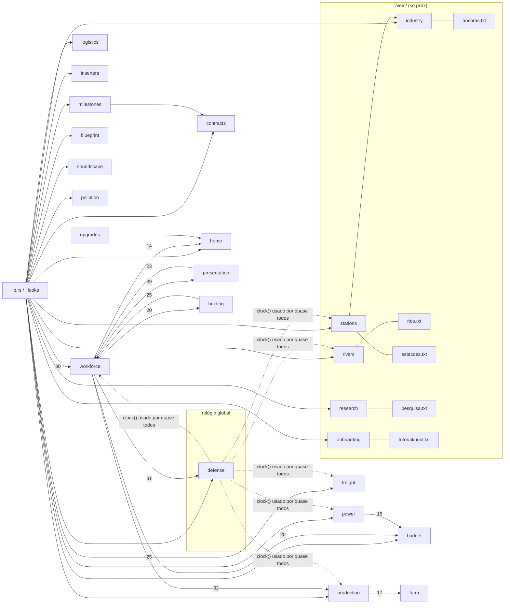

# A1 — Arquitetura técnica do Veio (main 0.25.0 × candidata PR #47)

Autor: OPUS A (arqueólogo técnico). Data: 2026-11-08, ~20:40 UTC.
Ramos auditados: `main@53267af` (Veio 0.25.0) e `pr47@80980db` (`origin/claude/project-thread-l94frq`).
Evidência: E1 = executado nesta sessão (logs em `SP/a/logs/`); E2 = lido no código (arquivo:linha@ramo); E3 = documento/commit; E4 = chat/memória; ND = não determinado.
Caminhos de código são relativos a `native/api/src/` salvo indicação.

---

## 1. Estrutura do repositório

| Pasta/arquivo | main@53267af | pr47@80980db | Papel |
|---|---|---|---|
| `native/api/` | crate `mod-veio` 0.25.0, edition 2024, 16 módulos, 16 770 linhas Rust (contando `native/`) | mesmo crate, 29 módulos, 32 156 linhas | O mod nativo (Rust) carregado pelo Horizon |
| `native/api/Cargo.toml` | `horizon-client = { git = "https://github.com/horizon-rust/horizon" }` **sem `rev`, sem Cargo.lock** | idem | Dependência não fixada: a compilação real pega o Horizon que o launcher tiver (E2) |
| `native/offline-check/` | workspace com `horizon-client` (stub, 955 linhas, 44 métodos de `Host`) + `veio-check` | stub com 1090 linhas, 52 métodos de `Host` | Testes offline; **não** é o Horizon |
| `native/horizon-mixin.toml` | presente | presente | Manifesto de mixins (o mapa finito em WIP usa outro, `.draft`) |
| `content/` | 529 JSON, 93 páginas de guia, 65 texturas 16×16 (E1 `check_project`) | 742 JSON, 100 páginas, 89 texturas (E1) | Datapack/assets: blocos, itens, receitas, avanços, menus, lang, livros |
| `tools/` | 14 scripts (`build_*`, `check_*`, `package.py`, `sim_economy.py`, `production.json`) | 31 entradas: + `build_blueprints`, `build_house`, `build_machine_audio`, `build_onboarding`, `build_first_steps`, `build_transport_guide`, `check_machine_audio`, `check_machine_forms`, `machine_forms.py`, `machine_audio.json`, `benchmark_factory.py`, `prepare_world_map_check.py`, `world_map_probe.rs`, `preview_*` | Geradores e verificadores |
| `launcher/` + `launcher.exe` | launcher Cargo 0.10.0; `.exe` sha 85723581…, 887 808 B, perfil nativo `dev` | launcher Cargo **0.16.1**; `.exe` sha cc7fefaa…, 941 568 B, perfil `performance`, escolha de visual | Instala conteúdo e compila o nativo via `horizon-launcher native-build` |
| `release/` | `Veio-0.25.0.zip` (blob e01ef74) | o **mesmo** `Veio-0.25.0.zip` + `Veio-Realismo-1.1.zip` (contém **Veio 0.16.1**, 656 arquivos, `launcher.exe` próprio) + `Veio-Realismo-1.1-atualizacao.zip` (8 arquivos, só shader) | Pacotes |
| `visuals/veio-industrial/` | — | pacote de shader `horizon-shaders.toml` (api "0.1", 251 linhas WGSL) | "Realismo leve" |
| `third_party/audio/kenney/` | — | 30 `.ogg` licenciados + `SOURCES.json` | Sons das máquinas |
| `work-in-progress/finite-world/` | — | 10 `.rs` + `hooks/` + `horizon-mixin.toml.draft` + `CONTINUAR.md` | Mapa finito (desligado, fora do crate) |
| `docs/visual/` | — | 2 PNG (antes/depois, catálogo) | Material de revisão |
| `Escolher-Visual.cmd`, `Jogar-Leve.cmd` | — | `launcher.exe --graphics` / `--visual leve` | Atalhos Windows |
| Docs raiz | README, TRABALHADORES, LOGISTICA, PERFORMANCE, COORDENACAO, CONTRIBUTING, CREDITS | + CONSOLIDACAO, HANDOFF_OBRAS, MAPA, TRANSPORTES, VISUAL-MAQUINAS | Ver A5 |
| `.github/` | **não existe** | **não existe** | Sem CI (E2) |

## 2. Ponto de entrada `native/api/src/lib.rs`

### 2.1 Forma
`pub fn hooks() -> Box<dyn Hooks>` devolve `Factory`, que implementa `horizon_client::mod_api::Hooks` (main `lib.rs:67`; pr47 `lib.rs:82`). Todo o mod roda dentro desses ganchos; não há thread própria. Estado global = `static Mutex<…>`/atomics por módulo + NBT dos block entities + (só pr47) arquivos em `<mundo>/veio/`.

### 2.2 Ganchos implementados (E2, extraídos de `impl Hooks for Factory`)
- **main (23):** `block_entity`, `block_entity_container`, `block_entity_energy`, `block_entity_render_bounding_box`, `block_entity_submit`, `block_entity_tick`, `block_entity_ticks`, `block_entity_update_tag`, `container_accepts`, `entity_tick_pre`, `menu_button`, `menu_slot_rules`, `player_logged_in`, `player_respawned`, `register_goals`, `right_click_block`, `screen`, `screen_click`, `screen_draw`, `screen_tooltip`, `tick`, `tooltip`, `trade_with_villager`.
- **pr47 (+10 = 33):** `chunk_load`, `inventory_move_item`, `living_entity_use_item_finish`, `perform_command`, `place_block`, `player_bed_enter`, `player_logged_out`, `player_spawn_point_set`, `register_commands`, `server_about_to_start`. Nenhum removido.
- **Ausentes nos dois** (pedidos em `HANDOFF_OBRAS.md` para proteção de obras/ruínas): `destroy_block`, `left_click_block`, `use_item_on`, `explosion_detonate`.

### 2.3 Ordem do `tick` global
- main `lib.rs:232`: `defense::advance_clock` → `budget::begin_tick` → `power::maintenance` → `workforce::maintenance` → `workforce::spawn::tick` → `pollution::update`.
- pr47 `lib.rs:326`: **retorna cedo se `host.window()`** (cliente) → `advance_clock` → `soundscape::refresh` → `budget::begin_tick` → `power::maintenance` → `workforce::maintenance` → `workforce::world_tick` → `rivers::tick` → `onboarding::server_tick` → `home::tick` → `milestones::census::tick` → `pollution::update` → `industry::maintain` → `stations::maintain`.
- `server_about_to_start` (pr47 `lib.rs:89`) limpa estado de `home`, `census` e `blueprint`. Outros `static` (ledger, holding, trade, stations, rivers, research, industry) têm sua própria detecção de troca de mundo via `world_dir` (stations `maintain` em `stations.rs:217`; rivers `CHECK_WORLD_EVERY=100` em `rivers.rs:47`) — não há um reset único. Na main não há `server_about_to_start`: estado em memória pode vazar entre mundos na mesma sessão (E2 por ausência; efeito em jogo ND).
- Dois detectores de "sou o servidor": `host.window()` (stub devolve `false`) e `industry::on_server` (`industry.rs:106`, chama `surface_heights` vazio e testa `is_ok`). Redundância sem documentação (E2).

### 2.4 Despacho por bloco
- `block_entity_tick` (main `:319`, pr47 `:462`) → `tick_factory` (main `:735`, pr47 `:1093`). No pr47 a cadeia de `if/else` por id passa por: freight (terminais/porto de drone/caravana), inserters, lift, blueprint, contracts (o grande projeto executa `advancement grant @a only veio:grand_project`, `lib.rs:1101`), industry (monitor), milestones (quadro), workforce (postos, centro, casas, lojas, canteiro, Lar), defense (Tesla), research (laboratório), industry (âncora), stations, production (máquinas).
- `record_performance` (pr47 `:1198`) alimenta `perf` (amostras para `check_performance`).
- Constantes de topo: `REPAIR=50` (kit de reparo recupera 50 %), `OBSERVE_EVERY=7` (amostragem de mobs em `entity_tick_pre`). Capacidades de energia: bateria 30 000 FE, Tesla `defense::CAPACITY` 20 000, máquinas comuns 2 000, `max_insert/max_extract` 80/tick; pr47 acrescenta `freight::DRONE` 8 000.

## 3. Host e stub offline

### 3.1 O que o stub é
`native/offline-check/horizon-client/src/mod_api.rs` reproduz as assinaturas de `Hooks`/`Host` copiadas do Horizon **66f3981 (2026-11-05)**; o HEAD atual do Horizon é **5f7cadf (2026-11-08 19:52 +0100)**. Os métodos de `Host` do stub têm corpo trivial (ex.: `window()` → `false`, `world_dir()` → `unimplemented!` no harness da vila em `workforce/tests.rs`). `veio-check` inclui `native/api/src` por caminho e roda os `#[test]`.

### 3.2 Métodos de `Host` (E2)
- main: 44. pr47: 52 — a mais `acting_player`, `level_block`, `level_is_loaded`, `mod_block_entity`, `read_columns`, `send_map`, `window`, `world_dir`.
- Origem dos métodos/ganchos novos (git log -S, E2): `world_dir`, `window`, `inventory_move_item`, `place_block`, `player_logged_out`, `register_commands`, `perform_command`, `mod_block_entity` entraram em c1b3ba5 (Codex); `server_about_to_start` em fd2a446; `acting_player`, `send_map`, `player_spawn_point_set`, `player_bed_enter`, `living_entity_use_item_finish` em d1e2f30; `level_block`, `level_is_loaded` em 90721ca. Todos antes da compilação nativa alegada pelo Codex (4ffb605, 08/11 02:35 −0300, E3). **`read_columns` e `chunk_load` entraram depois (bcfb9d5, PR #40) e nunca passaram por compilação real** (E2+E3).

### 3.3 Conferência contra o Horizon real (E2, `SP/a/horizon_ref`, só leitura)
- `native-hooks.json` de 66f3981 e de 5f7cadf: os 33 ganchos do pr47 existem; `container_accepts` e `register_goals` vêm de `tools/native-hook-fragments/` do Horizon.
- Os 52 métodos de `Host` existem como `fn native_<nome>` em `crates/horizon-client/src/game/native_*.rs` em 66f3981 **e** em 5f7cadf (`dimension`, `move_items` em `machines/native_items.rs`).
- Comparação normalizada de tipos: 2 diferenças — `set_block_property` (real tem `&mut Ticks` e `flags: i32` a mais; provavelmente adaptados pelo trait gerado, ND) e `world_dir` (`PathBuf`, mesmo tipo). `native_chunk_load(dimension: &str, chunk: [i32;2], new: bool)` confere com o gancho usado.
- O Horizon tem `native_chunk_tickets.rs` (API de tickets de chunk), alternativa mais limpa ao comando `forceload` que a âncora usa (`industry.rs:285`).
- **Não verificado:** compilação (`tools/check_native_api.py` exige o `.rmeta` real), semântica (ex.: `read_columns` em chunk recém-gerado, efeito de `edit_blocks` durante `chunk_load`), ordem de ganchos, threads, comportamento de `run_command` com `forceload`/`advancement grant` no servidor integrado do Horizon.

### 3.4 Shader
`visuals/veio-industrial/horizon-shaders.toml` declara `api = "0.1"`, `schema = 1`, estágios `[sky]`, `[material]`, `[shadow]`, `[[post]]`, `[[materials]]`. O `Manifest::parse` do Horizon 5f7cadf (`crates/horizon-shader-api/src/manifest.rs:600-660`) aceita 0.1 e 0.2 e só rejeita `[tonemap]`/`[frame]` em 0.1 → manifesto compatível (E2). WGSL não validado (`horizon-shader check` não executado; ND).

## 4. Módulos

| Módulo | main | pr47 | Responsabilidade (E2) |
|---|---|---|---|
| `budget` | ✓ | ✓ (igual) | Cotas globais por tick: `LIMITS=[512,384,4096,2048,512,1024]` para Area, Terrain, Topology, Planning, Workforce, HaulSearch (`budget.rs:8`); `STALE=[2,2,2,2,20,2]` |
| `presentation` | ✓ | ✓ | Desenho de telas, cores, `STATUS_KEYS` (44 entradas no pr47), `DATA_SLOTS=13` |
| `contracts` | ✓ | ✓ (+131 linhas) | Central de contratos (railway/village/beacon), EXPORT perpétuo, fases do grande projeto (pr47) |
| `logistics`, `logistics_controls` | ✓ | ✓ | Esteiras, divisor, fusor, filtros; pr47 + esteira expressa e túnel |
| `inserters` | ✓ | ✓ | Braços (normal, rápido, longo) |
| `operations` | ✓ | ✓ | Entregas e `accepts_delivery` |
| `defense` | ✓ | ✓ | Relógio global `clock()` e Tesla: `RANGE 10`, `SHOT_COST 2400`, `COOLDOWN 40`, `CAPACITY 20000` (`defense.rs:12-15`) |
| `farm` | ✓ | ✓ | Lavoura automática (`RADIUS 4`, 3 camadas, `HARVEST_COST 120`, `GROW_COST 40`) |
| `pollution` | ✓ | ✓ (+33) | Poluição e ataques: `NOTICE 400`, `RAID 1200`, `STEP 64`, `MAX_WAVE 12`, arqueiros da 3ª noite, brutos da 5ª, golpe 25/50 (`pollution.rs:28-45`) |
| `production` (+`crops`, `data`, `extraction`, `forestry`, `generation`, `pantry`, `ranch`) | ✓ | ✓ + `water.rs` | Máquinas por tabela (`data.rs` gerado de `tools/production.json`), jazidas, geradores, renováveis |
| `power` | ✓ | ✓ (igual) | Postes e rede: madeira (alcance 8, 120/t, 1000), aço (16, 400, 4000), `MAX_LINKS 6` (`power.rs:28-31`) |
| `tutorial` | ✓ | ✓ (+13) | Dicas e chaves dinâmicas `veio.help.*`/`veio.guide.make.*` |
| `upgrades` | ✓ | ✓ (+66) | Módulos speed/efficiency/productivity; Mk.II (`MK2_FLAG 16`); aplica `home::time_factor` (`upgrades.rs:44`, pr47) |
| `holding` | ✓ | ✓ (+16) | 11 abas; divisões 1–9, `FOREIGN 10` |
| `workforce` (+`society/`, `foreman/`, `center`, `zones`, `village`, `spawn`, `barracks`, …) | ✓ | ✓ + `home`, `projects`, `requests`, `site`, `staff`, `focus`, `ladders`, `blueprints`, `blueprint_data` | Aldeões, vila, sociedade, economia, centro de controle, obras |
| `blueprint` | — | ✓ | Copiadora/prancheta, `[5,9,15,21]`, `HEIGHT 24`, `MAX_BLOCKS 6000` |
| `appearance`, `motion` | — | ✓ | Silhuetas e animação (34 formas, 27 silhuetas distintas, E1 `check_machine_forms`) |
| `soundscape` | — | ✓ | Áudio posicional (`RANGE 12`, `TAIL 48`) |
| `freight` (+`caravan`) | — | ✓ | Terminal ferroviário, drones, caravanas |
| `lift` | — | ✓ | Elevador de carga (`STEP 4`) |
| `milestones` (+`census`) | — | ✓ | Quadro da fábrica, licenças, pedidos do dia, alertas |
| `home` (+`food`) | — | ✓ | Casa do fundador (13×11), bônus de refeição global |
| `industry` | — | ✓ | Âncora de chunk e monitor |
| `research` | — | ✓ | Laboratório de pesquisa (#40) |
| `stations` | — | ✓ | Estações de carga/descarga e produção virtual |
| `rivers` | — | ✓ | Rios em tempo de execução |
| `onboarding` | — | ✓ | Tutorial interativo por jogador |
| `perf` | ✓ | ✓ | Métricas e cenários |

## 5. Persistência

| Onde | main | pr47 | Observação |
|---|---|---|---|
| NBT de block entity | "Company", "Public", "Wallet", "Prices", estado de máquinas, postos, zonas, comércio exterior (`trade::persist`, `VERSION 3`, `trade.rs:389`, chamado em `workforce/mod.rs:959`) | idem + "Water" (mB), "Home"/"HomeBeds", estado de obras | Sobrevive a reinício. Saldos de ledger são copiados ao NBT do dono a cada ciclo |
| `static Mutex` em memória | ledger (com `BORDERS`, `ledger.rs:48`), holding (contas por divisão), CONNECTIONS, TRADES, poluição | idem + PORTS (freight), census, blueprint, home | **Perde-se ao reiniciar**: poluição (doc admite), contas da holding, CONNECTIONS. TRADES é re-persistido no NBT do centro |
| `<mundo>/veio/` | **não existe** | `tutorial/<uuid>.txt`, `rios.txt`, `estacoes.txt`, `ancoras.txt`, `pesquisa.txt` | Só rios e tutorial gravam via arquivo temporário (atômico); estações, âncoras e pesquisa não |
| Command storage / tags | — | `veio:home built`, tag `veio_village` | Usados pela casa do fundador |

Formato `estacoes.txt`: linhas `S dim x y z canal visto item ritmo` e `P canal item qtd` (`stations.rs:207`). Não há versão de formato em nenhum dos 5 arquivos (E2).

## 6. Pipeline de conteúdo

```
tools/production.json ──build_production.py──► native/api/src/production/data.rs (+ receitas/guias)
tools/build_content.py ──► content/data|assets (76 blocos, 25 itens no pr47; 55/16 na main)
tools/build_textures.py, build_belts.py ──► texturas 16×16 (PNG)
tools/build_tutorial.py ──► livros (Guia 100 pág., Industry guide 26 pág. no pr47)
pr47: build_blueprints.py (9 plantas, 7542 blocos, paleta 120), build_house.py (251 comandos),
      build_machine_audio.py (30 .ogg), build_onboarding.py, build_first_steps.py, build_transport_guide.py
tools/check_project.py ──► valida JSON, traduções, páginas (≤14 linhas; Guia ≤100 pág.), texturas, chama sim_economy.py
```

Reprodutibilidade (E1, cópias em `SP/a/tmp/{main,pr47}`, todos os `build_*.py` executados): main difere só em `belt_rail.png` e `fast_belt_rail.png` (bytes; pixels idênticos — zlib); pr47 difere só nos 30 `.ogg` (codificação não determinística). `data.rs`, guias, lang, plantas e função da casa em sincronia. Saídas registradas: `build_content` "76 blocos e 25 itens"; `build_production` "57 receitas, 23 jazidas, 28 alimentos"; blueprints "9 plantas, 7542 blocos, paleta 120"; `build_house` "251 comandos"; `build_tutorial` "Industry guide 26, Guide 100".

`production.json`: as 53 receitas da main são idênticas no pr47 (tempos e energia da 0.25 preservados = decisão 9); o pr47 acrescenta 4 (motor, processador, automation_core, mk2_kit).

## 7. Launcher e empacotamento

- `tools/package.py` monta `dist/Veio-<versão>.zip` com `launcher.exe`, `content/`, `native/`, `LEIA-ME.txt`; no pr47 também `visuals/` e `third_party/audio/kenney`. O executável "é gerado, nunca versionado" (docstring), mas **os dois ramos versionam `launcher.exe`** na raiz.
- main: `launcher.exe` = o do zip 0.25.0 (sha 85723581…), perfil nativo `dev` (commits 12cd631/0eaeb34). Testes do launcher: 2 ok (E1).
- pr47: `launcher.exe` é o binário compilado pelo Codex em a3303bb (Cargo 0.16.1), `NATIVE_PROFILE = "performance"` (`launcher/src/main.rs:26`), argumentos `--instance … --trust-native-code --profile performance` (`:66`), escolha de visual `realismo-8gb`/`leve` (`launcher/src/visuals.rs:23-32`), `leve` zera `HORIZON_SHADER_PACK` (`:95`). Testes do launcher: 6 ok (E1). `check_project` não confere a versão do launcher.
- **O pr47 não tem pacote próprio**: `release/Veio-0.25.0.zip` é o blob e01ef74 da main (conteúdo = árvore da main, exceto LEIA-ME). `release/Veio-Realismo-1.1.zip` contém `Veio-0.16.1/` (Cargo `native/api` 0.16.1) — código antigo do Codex.
- `launcher.exe` Windows não é compilável nesta nuvem (E4 memória; não tentado).

## 8. Visuals / realismo leve (pr47)

- Shader `veio_industrial` 1.1.0: sol/luar, metais e pintura distintos, chuva, água com profundidade; sombra 1024 px a 48 blocos; 1 pós-processamento; `[[materials]]` mapeia sprites de ferro/aço/máquinas do Veio para material id 1. Opção "leve" desliga o pacote.
- Silhuetas: `appearance.rs` + `tools/machine_forms.py` (34 formas, 27 silhuetas distintas, E1). Colisão acompanha a forma (commit d396f69, E3).
- Animação: `motion.rs` (`STROKE`/`SWEEP` de 8 quadros).
- Som: `soundscape.rs`, 30 arquivos `.ogg` licenciados (E1 `check_machine_audio`).
- Nada disso foi visto rodando no jogo (ND). Benchmarks de quadro regrediram (ver §10).

## 9. Testes por módulo (E1, `python3 tools/check_rust.py`)

| Módulo | main | pr47 |
|---|---|---|
| workforce | 82 | 109 |
| production | 16 | 39 |
| tests (lib) | 29 | 35 |
| logistics | 16 | 17 |
| power | 9 | 9 |
| inserters | 9 | 9 |
| operations | 8 | 8 |
| budget | 3 | 3 |
| perf | 2 | 2 |
| logistics_controls | 2 | 3 |
| freight | — | 21 |
| onboarding | — | 19 (+3 ignorados que passam com `--ignored --test-threads=1`) |
| rivers | — | 9 |
| milestones | — | 9 |
| blueprint | — | 9 |
| soundscape | — | 7 |
| home | — | 5 |
| stations, research, motion, lift, industry, appearance | — | 2 cada |
| **Total** | **176 ok / 0 falhas / 5 ignorados** | **325 ok / 0 / 9 ignorados** |

Sem módulo de teste próprio (aparecem só em testes de `workforce`/lib, quando aparecem): `contracts`, `holding`, `defense`, `pollution`, `farm`, `upgrades`, `tutorial`, `presentation`. Módulos novos com 2 testes cada (stations, research, industry, lift) têm cobertura mínima para a superfície que expõem (âncora, produção virtual).

Avisos de compilação (E1): main 4 linhas, todas em `workforce/foreman.rs` (import `std::sync::Mutex` não usado `:21`; `fn distance` sem uso `:150`); pr47 3 avisos (`foreman.rs:149 distance`, `site.rs:142 sites_near`, `staff.rs:124 research_percent`, funções nunca chamadas).

## 10. Desempenho (E1)

`check_performance` (7 cenários, 3 amostras; checks idênticos nos dois ramos: `power_energy=129500 callbacks=33792`, `queue_tasks=8 source_reads=1045`). Medianas em ns, main → pr47: publish_2000_cables 134 926 → 103 717; configured_arm 585 368 → 373 389; working_machine_metrics 2 665 181 → 2 375 626; rejected_queue 1 773 340 → 1 732 591; 256_poles 2 290 182 → 1 530 921; dense_pole_links 874 753 → 610 864; foreman_95_node_queue 746 710 (9 267 aloc.) → 625 125 (9 427 aloc.). Nenhum sistema novo do pr47 (rios, estações, água, som) entra nesses cenários.

Benchmarks ignorados (4 execuções, `SP/a/logs/bench_repeat.log`):
- `bench_factory` (480 blocos): main ~272 µs/tick (275,5/351,6/268,3/253,3) → pr47 ~385 µs/tick (380,9/389,2/391,7/348,7), **≈ +40 %**; 936 → 943 alocações/tick; digest diferente, 1024 engrenagens nos dois.
- `bench_frame`: main 41–49 µs, **0 alocações**/quadro → pr47 59–82 µs, **329 alocações**/quadro (determinístico). Regressão da garantia da 0.17.1 ("nenhuma alocação ao desenhar um quadro", E3).
- `bench_large_village`: main 3,4 µs/tick (150 aldeões + 300 animais); **pr47 entra em pânico** `not implemented: world_dir` no harness (`workforce/tests.rs`) via `onboarding::session` — o benchmark de vila grande deixou de medir.
- `stations_cost --release` (pr47): "1000 estações descarregadas: 194.373µs por passo de 20 ticks" (E1).

## 11. Diagrama de dependências (pr47; arestas = nº de referências `modulo::` no código, E2)



Acoplamentos cíclicos fortes: `workforce ↔ presentation` (39/23) e `workforce ↔ holding` (20/25). `defense` é dono do relógio do mod, embora seu domínio seja a Tesla — dívida de nomeação (A6).

## 12. Diferenças main × pr47 (resumo técnico)

| Aspecto | main@53267af | pr47@80980db |
|---|---|---|
| Linhas Rust | 16 770 | 32 156 |
| Módulos | 16 | 29 |
| Ganchos / métodos de Host | 23 / 44 | 33 / 52 |
| Blocos / itens | 55 / 16 | 76 / 25 (+21 blocos: belt_tunnel, blueprint_designer, build_marker, caravan_station, cargo_lift, cargo_station, chunk_anchor, drone_port, express_belt, fabricator, factory_board, factory_monitor, home, hydro_turbine, pipe, pump, rail_terminal, research_lab, site, sprinkler, unloading_station; +9 itens: automation_core, clipboard, mk2_kit, motor, permit_electronics, permit_steel, permit_workshop, processor, route_card) |
| JSON / páginas / texturas | 529 / 93 / 65 | 742 / 100 / 89 (+ aviso: 29 páginas do village_guide > 14 linhas) |
| Testes | 176/0/5 | 325/0/9 |
| Persistência em disco | nenhuma | 5 arquivos texto |
| Pacote | `Veio-0.25.0.zip` coerente | nenhum pacote próprio; zip 0.25.0 é o da main; zip "Realismo 1.1" é 0.16.1 |
| Launcher | 0.10.0, perfil `dev` | 0.16.1, perfil `performance`, seleção de visual |
| Sem CI | sim | sim |
| Compilado contra Horizon real | ND (E3: a main 0.25 foi empacotada; nenhuma prova de `native-build` nesta sessão) | não; E3 de compilação só para 0.16.1 do Codex (4ffb605) |
