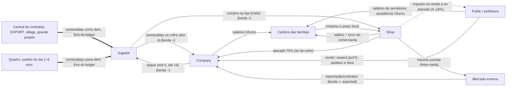

# A2 — Fichas técnicas por sistema (SIS-*)

Autor: OPUS A. Data: 2026-11-08. Ramos: `main@53267af` (0.25.0) e `pr47@80980db`.
Cada ficha tem **D — Implementação** (onde está, estado nas três camadas, o que funciona, stubs, testes) e **F — Pendências técnicas**.
Formato do estado: `main · pr47 · disperso`. "—" = não existe na camada. Nenhum item recebe "Validado": nada foi compilado contra o Horizon real nem jogado nesta sessão; "testes offline" = E1 de `tools/check_rust.py` (main 176/0/5, pr47 325/0/9).
Caminhos relativos a `native/api/src/` salvo indicação. Linhas citadas do pr47 valem para a main quando o arquivo é idêntico (ex.: `workforce/society/*`, `power.rs`, `budget.rs` — `git diff --stat` vazio entre os ramos).

## 0. Propostas de IDs (decisão de agente, não confirmada pelo dono)

| Proposta | Justificativa técnica |
|---|---|
| **SIS-PER** — Persistência e ciclo de vida do mundo | Estado espalhado em NBT, `static Mutex` e (pr47) 5 arquivos `<mundo>/veio/*.txt` sem versão e, em 3 deles, sem gravação atômica; reset de estado entre mundos só parcial (`server_about_to_start` só no pr47 e só para home/census/blueprint). É transversal a ECO, TRA, MUN, PRG e TUT e concentra riscos de save (A6). |
| **SIS-PES** — Pesquisa (separar de SIS-PRG) | Há **dois** sistemas de pesquisa que não se conhecem: o laboratório do #40 (`research.rs`, 4 tópicos, concede avanços `veio:research/*`) e o centro de pesquisa das obras (`workforce/staff.rs`, 5 pesquisas da vila). Colidem na chave `veio.research.done` (1 arg × 2 args). |
| **SIS-SOC** (opcional) — dividir SIS-VIL | `workforce/society/` (mod, ledger, market, trade, mayor) tem 0 diferença entre main e pr47 e é o núcleo econômico; SIS-VIL poderia ficar com casas/bairros/famílias e SIS-ECO/SIS-MER com contas e preços. Mantive os IDs do contexto nas fichas. |
| SIS-SOM | **Não** proponho: o som (`soundscape.rs`, 30 `.ogg`) fica bem em SIS-APR. |

---

## SIS-PLT — Plataforma, build e ferramentas

**D.** `native/api/Cargo.toml` (crate `mod-veio` 0.25.0, dependência git do Horizon **sem `rev`**); stub `native/offline-check/horizon-client` (Horizon 66f3981); `tools/check_project.py`, `check_rust.py`, `check_performance.py`, `check_native_api.py` (exige `.rmeta` real), `package.py`; launcher Rust em `launcher/`.
Estado: **Integrado · Integrado · —** (verificações offline: E1 nos dois ramos, exit 0).
- Funciona (E1): `check_project` main "529 JSON válidos; 93 páginas…; 65 texturas"; pr47 "742 JSON; 100 páginas; 89 texturas" + aviso "29 páginas de village_guide passam de 14 linhas". `check_rust` main 176/0/5 (4 linhas de aviso, `foreman.rs:21,150`), pr47 325/0/9 (3 avisos: `foreman.rs:149`, `site.rs:142`, `staff.rs:124`). `check_performance` 7 cenários ok nos dois. Launcher: 2 testes (main) / 6 testes (pr47). pr47 extra: `check_machine_audio` "30 licensed spatial sound files checked", `check_machine_forms` "34 machine forms… 27 distinct silhouettes".
- Stub: 44 (main) / 52 (pr47) métodos de `Host`; todos existem por nome no Horizon 66f3981 e 5f7cadf (E2, A1 §3.3).
- Geradores reprodutíveis (E1, A1 §6).
**F.** (1) Nenhuma compilação contra o Horizon real nesta sessão; `read_columns`/`chunk_load` nunca compilados. (2) Dependência do Horizon sem `rev` nem lockfile → build não reprodutível. (3) Sem CI (`.github` inexistente). (4) `check_project` não confere a versão do launcher (pr47: launcher 0.16.1 × mod 0.25.0). (5) `launcher.exe` versionado contra a própria docstring de `package.py`. (6) pr47 sem pacote próprio; `release/Veio-Realismo-1.1.zip` contém Veio 0.16.1. (7) `industry_guide` não passa por `check_page_fit`; Guia principal exatamente no teto de 100 páginas.

## SIS-MUN — Mundo (jazidas, rios, mapa finito)

**D.**
- Jazidas conectadas: `production/extraction.rs` (pr47) — pureza por blocos do mesmo minério conectados (`purity`, `:34-39`): 0–2 impura (tempo ×2), 3–6 normal, 7–15 pura (÷2), ≥16 industrial (÷4, só pr47, `rich_draw` dobra a energia, `:57`). `VEIN_LIMIT 16`, `VEIN_COST 24` (orçamento de busca), `PURITY_REFRESH 200` (`:11-15`). Main: área 3×3 abaixo, sem "industrial" (`main extraction.rs:26-28`).
- Rios: `rivers.rs` (pr47, 849 linhas) — traçados em tempo de execução sobre chunks **novos** (`chunk_loaded`, `:758`, chamado por `lib.rs:288`), nascentes acima de `SPRING_MIN 100`, espaçamento 40, foz ao nível `SEA 63`, `MAX_CUT 8`, `RUN_PER_FLOW 48`, `STEPS_PER_TICK 48`, `SCANS_PER_TICK 2`, `EDIT_CHUNKS_PER_TICK 2`, `CACHE_LIMIT 1536`, `MAX_TRAVEL 6000`, `SAVE_EVERY 1200` (`:26-50`). Estado em `rios.txt` (`:769`). Usa `read_columns` e `edit_blocks`.
- Mapa finito: `work-in-progress/finite-world/` (pr47; 10 `.rs`, ~1245 linhas), por mixins de motor (`horizon-mixin.toml.draft`), fora do crate.
Estado: jazidas conectadas **— · Integrado · Implementado isoladamente (PR #23/#20 contidos no pr47)**; rios **— · Integrado · —**; mapa finito **— · Em desenvolvimento (desligado) · Em desenvolvimento (c8e94dc, mesmo patch-id do 80980db)**.
- Testes: rivers 9 (E1). Jazidas: dentro de production 39.
**F.** (1) `read_columns`/`chunk_load` nunca compilados nem vistos no jogo (a memória do projeto também registra "não verificadas"). (2) Rios só em chunks novos: mundos existentes não ganham rios. (3) Mapa finito: `CONTINUAR.md` diz "bundle ativo… 0.16.1" (desatualizado), 22/24 injeções aplicadas, auditoria do Nether falhou, sem teste em partida (E3). (4) `MAPA.md` "Decisão de produto de 7 de novembro" é decisão de agente; o pedido do dono (20:09, decisão 11) é compatível mas não ratifica 15 000×15 000/bedrock. (5) Nenhum benchmark mede rios.

## SIS-EXT — Extração e processamento de minério

**D.** `production/extraction.rs` (tiers `:21-23`): broca (tier 1, 40 ticks, 6 FE/t), Mk2 (2, 20 t, 12 FE/t), Mk3 (3, 10 t, 30 FE/t). Britador, fornos e prensa via tabela `production/data.rs` ← `tools/production.json` (57 receitas, 23 jazidas, 28 alimentos no pr47; E1 `build_production`). Prensa 30 ticks/8 FE (decisão 9 cumprida — receitas da main idênticas no pr47, E2 por comparação de `production.json`).
Estado: **Integrado · Integrado · —** (variação de balanço "duas prensas por veio normal" do PR #19 Grok está no pr47).
- Testes: production 16 (main) / 39 (pr47).
**F.** (1) Pureza industrial (÷4 com energia ×2) só no pr47; sem benchmark de busca de veio em escala (`VEIN_COST 24` por tick é o único freio). (2) Cálculo de pureza é refeito a cada 200 ticks por broca: custo não medido com centenas de brocas.

## SIS-PRO — Produção (máquinas, receitas, módulos, Mk.II, grande indústria)

**D.** `production/mod.rs` + `data.rs`; `upgrades.rs` (módulos: velocidade tempo ×0,6/energia ×1,8/poluição ×1,5; eficiência energia ×0,6/poluição ×0,5; produtividade tempo ×1,15/energia ×1,4/poluição ×1,2/bônus **10 % na main → 20 % no pr47** (`main upgrades.rs:31`, `pr47 :35`). Mk.II (pr47, `with_tier`, `:50-52`): tempo ×0,5, energia ×2, poluição ×1,25, marcado por `MK2_FLAG 16`. `upgrades.rs:44` multiplica o tempo por `home::time_factor` (bônus de refeição).
Grande indústria (pr47, #40): 4 receitas novas — integrador aço + 4 fios → motor (100 t/20 FE); eletrônica 2 circuitos + 2 silício → processador (160/24); fabricador 2 motores + 2 processadores + 4 aço → automation_core (300/40); fabricador 2 motores + 1 processador + 8 engrenagens → mk2_kit (240/32).
Combustíveis (E2 `production.json`): gerador carvão 1600, bloco de carvão 16 000, vara de blaze 2400, bloco de alga seca 4000, graveto 100, tora 300; biomassa 600, plantas 75; gerador/biomassa 40 FE/t.
Estado: base **Integrado · Integrado · —**; grande indústria **— · Integrado · Implementado isoladamente (PR #40, contido)**; bônus de produtividade 20 % **— · Integrado · PR #20 (contido)**.
**F.** (1) Mudança de produtividade 10→20 % veio de `grok/mission-balance` (c5db4f6) sem decisão explícita do dono (só "junte tudo", decisão 10). (2) `time_factor` do bônus de refeição é global (atomics) — todas as máquinas de todos os jogadores aceleram quando um come. (3) Sem testes próprios de `upgrades`.

## SIS-ENE — Energia

**D.** `power.rs` (idêntico nos ramos): poste de madeira (alcance 8, área 2, 120 FE/t, buffer 1000), de aço (16, 3, 400, 4000), `MAX_LINKS 6`, `REFRESH 40`, `AREA_READS_PER_TICK 8` (`:28-34`). Renováveis em `production/generation.rs` (sensor a cada 40 t, roda d'água precisa de 8 faces de água, eólica ≥ 8 de "piso"). Bateria 30 000 FE; Tesla 20 000. pr47: hidrelétrica (`HYDRO_MAX 320`, `water.rs:328`), máquina a vapor consome 5 mB de água por operação (`STEAM_WATER`).
Estado: **Integrado · Integrado · —**. Testes: power 9 (E1). Perf: 256_poles 2,29 ms → 1,53 ms; dense_pole_links 0,87 → 0,61 ms (E1).
**F.** (1) Turbina hidrelétrica e consumo de água do vapor sem benchmark. (2) Liberação de steam_engine/battery/geothermal migrou para pesquisa no pr47 (ver SIS-PRG).

## SIS-AGU — Água encanada (pr47)

**D.** `production/water.rs`: NBT própria "Water" em mB (não usa tanques do Horizon). `FLOW_PER_FACE 200` mB por face, bomba `PUMP_PER_SOURCE 25` mB por bloco-fonte até `PUMP_SOURCES 4`, `PUMP_POWER 6` FE/t, lava `LAVA_PER_SOURCE 5`/`LAVA_BUCKET 1000`; aspersor: alimentado 1 em `FED_ONE_IN 10`, regado 1 em `WATERED_ONE_IN 30`, fertilidade máx. 400, `SOIL_WATER 2` (`:23-42, 233-238`).
Estado: **— · Integrado · Implementado isoladamente (#40, contido)**. Testes: dentro de production 39.
**F.** (1) Nenhum benchmark de rede de canos. (2) Lava nos canos (decisão 4) existe só como constante de vazão; comportamento no jogo ND.

## SIS-AGR — Agro e extrativismo

**D.** `farm.rs` (raio 4, 3 camadas, colheita 120 FE, crescimento 40 FE), `production/crops.rs` (plantio 20, crescimento 50, fila 16), `forestry.rs` (corte 200, plantio 20, tronco ≥ 4, 8 pontos), `ranch.rs` (raio 6, cap 10 animais, a cada 100 t), `pantry.rs` (preço 60, vila ≥ 3); postos de lavrador (`workforce/farmhand.rs`, alcance de água 4) e pastor (`shepherd.rs`, raio 6). Zonas de lavoura/cercado (`field_marker`, `pen_marker`). pr47: irrigação por aspersor (SIS-AGU).
Estado: **Integrado · Integrado · —**; irrigação **— · Integrado · —**.
**F.** (1) Lote 2 do Grok (`2d5a202`, "comida que não fecha o laço do trigo") foi registrado como substituído por merge sem reaplicar o código (008a980) — PR #7 continua aberto. (2) Interação aspersor × lavrador × colheitadeira só coberta por testes unitários.

## SIS-LOG — Logística local

**D.** `logistics.rs` (esteiras, pr47 + expressa e túnel `TUNNEL_REACH 6`, `BLOCKED_AFTER 8`), `logistics_controls.rs` (divisor/fusor/filtros), `inserters.rs` (`COST 40` FE), `operations.rs` (`accepts_delivery`, gancho `container_accepts`).
Estado: base **Integrado · Integrado · —**; expressa/túnel **— · Integrado · —** (#40).
Testes: logistics 16/17, inserters 9/9, logistics_controls 2/3, operations 8/8. Perf: configured_arm 585→373 µs, publish_2000_cables 135→104 µs (E1).
**F.** `bench_factory` (480 blocos, inclui esteiras e braços) ficou ≈ 40 % mais lento no pr47 (~272→~385 µs/tick, E1) sem diagnóstico.

## SIS-TRA — Transporte entre zonas (pr47)

**D.**
- Terminal ferroviário `veio:rail_terminal` (`freight.rs`): só define status/`FreightImport`; quem move a carga são carrinhos e funis vanilla. Decisão 6 cumprida (`trade::STATION` continua `veio:freight_station`).
- Drones (`freight.rs`): `RANGE 64`, até 16 itens por viagem, custo 800 + 32×distância FE, duração 20 + 2×distância ticks; exige chunks carregados (`level_is_loaded`); bloco `drone_port` com buffer 8000 FE. Registro `PORTS` em memória.
- Caravanas (`freight/caravan.rs`): `RANGE 512`; cavalo 16 itens/velocidade 1,1; burro 64/0,75; porco 8/0,5; ração no slot 7. Status 40–43 (`NO_ROUTE`, `NO_ANIMAL`, `NO_FEED`, `ANIMAL_BUSY`, `freight.rs:15-18`).
- Estações de carga/descarga (`stations.rs`, decisão 2): 16 canais por cor de corante, `CAPACITY 4096` itens por canal, `BATCH 8` a cada 8 ticks (1 item/t), `POWER_PER_ITEM 10`, janela de medição 1200 t, descarregado após 100 t (`:20-28`). `simulate` (`:117-140`) soma `ritmo × tempo` por item **sem consumir insumos nem energia** e põe no canal. Arquivo `estacoes.txt`.
- Elevador de carga (`lift.rs`, `STEP 4`).
Estado: **— · Integrado · Implementado isoladamente (PR #28 caravanas/drones/ferrovia; #40 estações; ambos contidos)**. Testes: freight 21, stations 2, lift 2. `stations_cost --release`: 1000 estações descarregadas 194 µs por passo de 20 ticks (E1).
**F.** (1) Produção virtual gera itens do nada (sem insumo, sem energia, sem verificar se a fábrica ainda existe): balanço e exploração (quebrar o posto enquanto descarregado) ND. (2) Canais **globais entre dimensões** (`pools` por canal, sem dimensão). (3) Colisão latente de status: 40/41 são também `center::ZONE_READY`/`STORE_FULL` (`center.rs:39-40`); `waiting()` filtra, gravidade baixa. (4) `PORTS` em memória: rotas de drone somem ao reiniciar até os portos tickarem.

## SIS-TRB — Aldeões trabalhadores

**D.** `workforce/mod.rs` (1581 linhas no pr47), `foreman.rs` (`RADIUS 12`, `SCAN 25`, `MAX_POSTS 6`, `MAX_QUEUE 8`, `MAX_NETWORK 24`, `TASK_STALE 200`, `HAUL_RANGE 12`, `DESK_FOOD 16`, `:22-45`), `foreman/planning.rs` (planejamento incremental, Codex 13758bd), `hauler.rs` (`RADIUS 6`, `SCAN 16`, `MAX_STATIONS 12`, `BATCH 16`), `farmhand.rs`, `shepherd.rs`, `storage.rs`, `zones.rs` (lados [9,13,17,21], custo [8,16,32] esmeraldas, trabalho [32,128,384], aldeões [6,12,20]), `village.rs` (`BASE_CAP 30`, `MAX_CAP 150`, `CHECK 5999`, chance 1/6, `MIN_ADULTS 2`), `spawn.rs` (`SEARCH 96`, `WAIT 600`, `MIN_VILLAGERS 3`). Cérebro/navegação e descanso noturno (0.16.0, 939c552). pr47: crescimento exige cama livre (PR #21), escadas entre andares (`ladders.rs`, alcance 24, até 6 andares).
Estado: **Integrado · Integrado · PR #21 (contido)**. Testes: workforce 82 (main) / 109 (pr47). Perf: foreman_95_node_queue 747→625 µs; `bench_large_village` main 3,4 µs/tick (150 aldeões + 300 animais) — **pr47 entra em pânico** (`world_dir` não implementado no harness).
**F.** (1) Benchmark de vila grande quebrado no pr47 (E1). (2) Avisos de código morto (`foreman.rs:149/150`). (3) Comportamento do cérebro/IA nunca observado em partida (E3: README pr47 linha 31 "As entregas da 0.11.0 à 0.25.0 aguardam teste no jogo").

## SIS-VIL — Sociedade da vila

**D.** `workforce/society/mod.rs` (idêntico nos ramos): `TURN 1200` ticks, 20 turnos/dia, `CAPACITY 4` moradores/casa, raios casa 10, poço 24, energia 12, loja 40, prefeitura 128, aglomeração 16 com limite 6, bairro 24, `STALE 3000`; status `HOUSED 29`, `NO_PERMIT 30`, `EMPTY_HOME 31` (`:36-75, 391-393`). `mayor.rs`: fases da vila `PHASES` (`:18`) com tuplas (12, 3, 40, 0, 0, 100, 0), (36, 9, 55, 400, 60, 100, 0), (80, 20, 70, 0, 0, 45, 3); indicadores IDH, Gini (O(n log n)), bairros. 12 bens de conforto (`GOODS`: lã 4/8, couro 6/12, …).
Estado: **Integrado · Integrado · —** (0.18.0 0aa3fbb).
**F.** (1) Significado de cada campo das tuplas de `PHASES` não está documentado no código lido (ND; ver ficha funcional do OPUS B). (2) `TRABALHADORES.md:589` fala em "STATUS_KEYS com 26 estados"; o código tem 44.

## SIS-ECO — Economia e contabilidade

**D.** `ledger.rs` (livros Company, Public, Shop + carteira das famílias no NBT da casa; `BORDERS` `:48`; `withhold` `:129`; `COMPANY_VAULT 4`, `COMPANY_CASHOUT 5`, `CASH_OUT 102`, `:211-214`; categorias de fluxo MADE 0, SOLD 1, WAGES 2, TAXES 3, RECEIVED 4, ASSIST 5, REDEEM 6, EXPORTS 7). `mod.rs`: 1 esmeralda = 60 moedas, `LIVING_COST 40`/dia, `WAGE_PER_TURN = 2×40/20 = 4` (80/dia), reservas da loja 600 e da assistência 200. `holding.rs`: 11 abas, divisões 1–9 + `FOREIGN 10`, `SAMPLE 100`. Detalhe na §Economia abaixo.
Estado: **Integrado · Integrado · —**. pr47 acrescenta `center::reward` (`center.rs:609`): recompensa de pedidos/obra sai do caixa público para a companhia; sem prefeitura retorna 0 (decisão 1 cumprida, E2).
Testes: dentro de workforce e `tools/sim_economy.py` (7 invariantes, chamado por `check_project`, E1 passa).
**F.** (1) **Fontes de esmeralda fora do ledger** (não passam por `border`): contrato EXPORT perpétuo (4 esmeraldas por 4 circuitos + 4 aço, main e pr47, `contracts.rs:63-66`), contrato village (8 esmeraldas), fases do grande projeto (32/48/64 esmeraldas, pr47 `:35-49`), pedido do dia do quadro (1–6 esmeraldas direto no slot 1, `milestones/mod.rs:147-150`). (2) `sim_economy.py` copia constantes à mão e não modela essas emissões. (3) Contas da holding só em memória. (4) Ver §Economia F.

## SIS-MER — Mercado e comércio exterior

**D.** `market.rs` (preços locais, atacado, importação de comida) e `trade.rs` (porto `veio:export_dock`, estação `veio:freight_station`, bolsa de 34 produtos, contratos). Detalhe na §Economia.
Estado: **Integrado · Integrado · —** (0.22–0.25).
**F.** (1) Índice diário determinístico (80–120) é previsível por qualquer jogador que conheça a fórmula. (2) Importação de comida limitada a 16 unidades por evento — escala com 150 aldeões ND.

## SIS-OBR — Obras e plantas (pr47)

**D.** `workforce/projects.rs` (bits: cantina 1, escola 2, ferraria 4, mercado 8, festival 16, biblioteca 32, correio 64, pousada 128, prefeitura 256, laboratório 512; decretos CALL 1<<10, RATION 1<<11, PLENTY 1<<12; slots `SITE 6`, `DECREE 7`; prestígio `TIERS [0,60,200,500]`, `:42-76`), `requests.rs` (27 itens no POOL, 4 pedidos, vencem em 3 dias, `PRESTIGE 10`), `site.rs` (`BATCH 10` blocos, `SURVEY 48`, estados 36–39, `:26-45`), `staff.rs` (`SHIFT 6`, `GROWTH 1200`, `RESEARCH_WORK 24`; 5 pesquisas: agronomia 1, carga 2, nutrição 4, pedagogia 8, engenharia 16, `:28-50`), `blueprints.rs` + `blueprint_data.rs` (9 plantas, 7542 blocos).
Estado: **— · Integrado · Implementado isoladamente (zip do usuário = f1452f5, contido)**.
**F.** (E2, conferido contra `HANDOFF_OBRAS.md`) (1) `workforce/ruins.rs` não existe. (2) Ganchos de proteção ausentes (`destroy_block`, `left_click_block`, `use_item_on`, `explosion_detonate`). (3) Menu `content/data/veio/horizon/menu/site.json` tem `slots: 1`; o código usa 3 (`workforce/mod.rs:150`, `SITE => (3, vec![0,1], vec![2])`). (4) Traduções faltando: `veio.site.no_staff` (`workforce/mod.rs:917`), `veio.center.project.idle` (`center.rs:690`), `veio.project.lab.name/.effect`, `veio.site.next.<papel>` (9 papéis), `veio.research.<agronomy|cargo|nutrition|pedagogy|engineering>.name/.effect`. (5) Colisão `veio.research.done` (1 arg em `research.rs` × 2 args em `staff.rs:391`). (6) `site.rs:142 sites_near` e `staff.rs:124 research_percent` nunca usadas. (7) `TRABALHADORES.md:234` diz estados 32–35 para o canteiro; código usa 36–39.

## SIS-LAR — Casa do fundador e Lar

**D.** Casa do fundador (Codex, `home/mod.rs`, 424 linhas): pegada 13×11, `REACH 9`, função de construção gerada (`build_house` 251 comandos), mural com mapas id 1970000 (4 mapas), storage `veio:home built`, tag `veio_village`. `home::time_factor` (`:101`) = só `food::time_factor`, **sem bônus da casa** (decisão 8 cumprida). `home/food.rs`: refeição tempo ×0,95 por 6000 t, banquete ×0,91 por 9600 t, em `static AtomicU64` (`:28-29`). Lar (`workforce/home.rs`, 871 linhas, obras): lareira slot 0, despensa 1–3, construção 4, convidados 6, banquete 1200 t, `MEAL_COOLDOWN 2400`, `MAX_LEVEL 4`, conforto 9×9 lido em 27 blocos por ciclo, categorias cama 15, porta 10, …, acabamento 15 (`:30-61`).
Estado: **— · Integrado · Implementado isoladamente (d1e2f30 Codex; f1452f5 obras; ambos contidos)**. Testes: home 5.
**F.** (1) Bônus de refeição global (todos os jogadores/dimensões), não persistido. (2) README pr47 linha 21 ainda diz que a casa do fundador "rendem 15% mais" — contradiz decisão 8. (3) Decisão 8 ("Lar dentro da casa do fundador") está no gerador: `tools/build_house.py:177-178` põe `veio:home[facing=south]` como lareira e `content/data/veio/function/home/build.mcfunction` contém o bloco (E2); execução da função no jogo ND.

## SIS-CTL — Centro de controle executivo

**D.** `workforce/center.rs` (main já tinha painel + abas da holding desde 0.20; pr47 +912 linhas): `RADIUS 64`, `META_UNIT 16`, metas nos slots 1–3, `PAGES 4` (Resumo, Atenção, Obras…), `VIEWS = PAGES + TABS − 1`, `MAX_ISSUES 10`, `CHARGE_EVERY 12`; cofre slot 4/saque slot 5 (`ledger::COMPANY_VAULT/CASHOUT`); obra 6, decreto 7 (pr47). `take_treasury` (`:395`) e `cash_out` (`:419`) até 16 esmeraldas. Foco/bússola `workforce/focus.rs` (pr47, `EXPIRE 12000`). `presentation.rs`: `DATA_SLOTS 13`, 44 `STATUS_KEYS`.
Estado: **Integrado (painel+holding) · Integrado (+obras, foco) · —**.
**F.** (1) Acoplamento `workforce ↔ presentation` 39/23 referências. (2) Chaves de status e códigos numéricos compartilhados entre sistemas (40/41) sem registro central.

## SIS-PRG — Progressão

**D.**
- Avanços JSON em `content/data/veio/advancement/` liberam receitas por `rewards.recipes`. **Nenhum `doLimitedCrafting`/gamerule no código ou conteúdo** (grep vazio nos dois ramos) → no comportamento vanilla, receita "não liberada" só some do livro de receitas; a fabricação continua possível (E2 por ausência; comportamento do Horizon ND).
- Main: steam_engine/battery/geothermal por `steel.json`; drill_mk2/solar/tesla por `circuits.json`; drill_mk3 por `upgrades.json`.
- pr47: os mesmos passam para `research/metallurgy.json`, `research/electronics.json`, `research/automation.json`. `steel.json` (critério estoque 16 aço + licença `permit_steel`) libera só `electronics` e `cargo_lift`.
- Quadro da fábrica (`milestones/mod.rs`, pr47): `PHASES` (`:37-52`) cobre 16 → 32 esteiras; engrenagem 32 → `permit_workshop`; aço 16 → `permit_steel`; circuito 16 → `permit_electronics`; circuito 32 → 2 diamantes. O texto "Libera" (`:246-247`) anuncia steam_engine/battery/geothermal, drill_mk2/solar/tesla, drill_mk3 — **que no pr47 vêm do laboratório**. Pedidos do dia (`ORDERS`, `:56-69`, 12 entradas, 1–6 esmeraldas, uma vez por dia por dimensão via `census::claim_order`, `census.rs:114`).
- Laboratório (`research.rs`, #40): metalurgia (aço 128 + engrenagem 128), eletrônica (circuito 128 + estrutura 128), automação (motor 64 + processador 64), escala (core 32 + aço 256), `POWER 24`, a cada 10 t; estado **único por mundo** em `pesquisa.txt`, concedido a `@a` (`:166`).
- Central de contratos (`contracts.rs`): workshop, railway (pr47 24 aço/12 módulos; main 16/8), village (pr47 24 circuitos/32 estruturas → 8 funis + 8 esmeraldas; main 12/24), beacon (pr47 1 estrela + 48 circuitos; main 32), EXPORT perpétuo; grande projeto em 4 fases (`PHASE_INTAKE 4` peças/tick), fase 4 concede `veio:grand_project` (`lib.rs:1101`).
Estado: avanços/contratos **Integrado · Integrado · —**; quadro e licenças **— · Integrado · Implementado isoladamente (import-factory-board fe30583 / import-progressao 2b9a3f9, contidos)**; laboratório e grande projeto **— · Integrado · #40 (contido)**. Testes: milestones 9, research 2.
**F.** (1) **Duas progressões conflitantes** (quadro × laboratório): o quadro promete o que só a pesquisa libera. (2) Gating por avanço possivelmente inócuo sem `doLimitedCrafting` (ND no Horizon). (3) Pesquisa e grande projeto concedem a todos os jogadores (`@a`). (4) Contagem de avanços: várias receitas liberadas por mais de um avanço (generator, cable, drill, belt, press, electronics; pr47 + factory_board).

## SIS-TUT — Tutorial e guias

**D.** `tutorial.rs` (dicas; chaves dinâmicas `veio.help.*`, `veio.guide.make.*`, `:52`); pr47 `onboarding.rs` (8 objetivos, slots gerador/prensa/montador/broca/central 0–4, `TRACE_TTL 6000`, `MAX_TRACE 128`, arquivos `<mundo>/veio/tutorial/<uuid>.txt`, comandos `veiotutorial ocultar|mostrar|reiniciar`) + `onboarding/transport.rs`. Livros gerados: Guia 100 páginas (teto do `check_project`), Industry guide 26, Vila (29 páginas > 14 linhas, aviso), Transportes.
Estado: dicas/guia **Integrado · Integrado · —**; tutorial interativo **— · Integrado · Substituído (0.15.1 zip: iteração anterior com `TRACE_TTL 200`)**. Testes: onboarding 19 + 3 ignorados (passam isolados, E1).
**F.** (1) Os 3 testes de onboarding só passam com `--test-threads=1` (estado global compartilhado). (2) `onboarding::session` chama `world_dir` e quebra o harness da vila (bench_large_village). (3) Guia no limite de 100 páginas: qualquer página nova falha o `check_project`.

## SIS-DEF — Ameaças e defesa

**D.** `pollution.rs` (`NOTICE 400`, `RAID 1200`, `STEP 64`, absorção 0,02, difusão 0,04, `MAX_WAVE 12`, arqueiros desde a 3ª noite, brutos desde a 5ª, golpe 25/50, chegada 26 blocos, `:28-47`); `defense.rs` (Tesla, relógio global); `workforce/barracks.rs` (milícia 7, guarda 5 + cura 3, arqueiro 5 a 16 blocos, mago 10 + metade em área de 5; patrulha 18, `:18-26`).
Estado: **Integrado · Integrado · PR #30 (conteúdo na main; PR aberto)**. pr47: defensores treinados patrulham também à noite (fa96ceb).
**F.** (1) Poluição só em memória — reinício zera o risco de ataque (doc admite). (2) Sem testes próprios de `pollution`/`defense`.

## SIS-MEG — Megafábricas (pr47)

**D.** `blueprint/mod.rs` (tamanhos [5,9,15,21], altura 24, até 6000 blocos, `LINK 256`, propriedades copiadas: 9; configs `RoutingPriority`, `Down`, `ManualDirection`, `LogisticsFilter`), prancheta (`blueprint_designer`), marco de obra (`build_marker`), elevador (`lift.rs`), escadas entre andares (`workforce/ladders.rs`).
Estado: **— · Integrado · Implementado isoladamente (import-megafactories e0ee148, contido)**. Testes: blueprint 9, lift 2.
**F.** Copiar 6000 blocos: custo por tick não medido; colocação depende de `place_block`/`edit_blocks` não verificados em jogo.

## SIS-APR — Apresentação (painéis, formas, animação, som, shader)

**D.** `presentation.rs`; `appearance.rs` + `tools/machine_forms.py` (34 formas, 27 silhuetas); `motion.rs`; `soundscape.rs` (30 `.ogg` Kenney, `RANGE 12`, `TAIL 48`); shader `visuals/veio-industrial` (api 0.1, aceito pelo `manifest.rs` do Horizon 5f7cadf); launcher com escolha de visual.
Estado: painéis **Integrado · Integrado · —**; formas/animação/som/shader **— · Integrado · PR #31/#49/#50 (contidos; ainda abertos)**. Testes: soundscape 7, motion 2, appearance 2.
**F.** (1) `bench_frame`: 0 → 329 alocações por quadro e 41–49 → 59–82 µs (E1). (2) WGSL não validado. (3) `.ogg` não reprodutíveis byte a byte.

## SIS-DES — Desempenho

**D.** `budget.rs` (cotas: Area 512, Terrain 384, Topology 4096, Planning 2048, Workforce 512, HaulSearch 1024; `STALE [2,2,2,2,20,2]`), buscas incrementais (topologia, capataz, carregador — branches Codex contidas), `perf.rs`, `tools/check_performance.py`, benchmarks ignorados.
Estado: **Integrado · Integrado · —**. Números em A1 §10.
**F.** (1) Regressões no pr47: fábrica +40 %, quadro 0→329 alocações, vila grande quebrada. (2) Sistemas novos (rios, estações, água, som, obras) fora de `check_performance`. (3) Sem teto global de ticks além das cotas de `budget` (a frente "Definir limite do mapa e otimizar" está em andamento, E4).

## SIS-MP — Multijogador LAN

**D.** pr47 `workforce/spawn.rs:151-152`: convidado da LAN vai para o centro conhecido (vila do anfitrião). Main: sem esse desvio (convidado ganharia outra vila onde aparece, segundo o comentário).
Estado: **Indeterminado (sem tratamento de convidado) · Integrado · PR #25 (contido; aberto)**.
**F.** Estado global por mundo (pesquisa, bônus de refeição, canais de estação) e `advancement grant @a` não distinguem jogadores; tutorial é por UUID. Nenhum teste multi-jogador.

---

## Economia e mercado em detalhe (E2, `workforce/society/*` idêntico em main e pr47)

### Unidades e ritmo
1 esmeralda = 60 moedas (`mod.rs:40`). Turno = 1200 ticks; 20 turnos por dia de 24 000 ticks. Custo de vida 40/dia; salário 4/turno = 80/dia (2× custo de vida). Comida 1 e conforto 1 por turno; poupança-alvo 2 dias; conforto até 80.

### Contas (livros)
- **Company** (cofre da companhia; procurado em qualquer lugar da dimensão, `ANYWHERE = i32::MAX/4`, `ledger.rs:112`).
- **Public** (prefeitura; a que "governa" a posição, raio 128).
- **Shop** (caixa de cada loja).
- **Carteira** das famílias (NBT "Wallet" da casa).
- Saldos vivem em `static Mutex` e são copiados ao NBT do bloco dono a cada ciclo. `BORDERS` (`:48`) conta por dimensão o que entrou (depósito de esmeraldas, compras do jogador, exportação) e saiu (saque).

### Formação de preço local (`market.rs`)
1. **Preço-base** (`base_price`, `:42`): produto da bolsa → `reference_cents/100`; comida → pontos de `pantry::value` ×1,5 se preparada (cooked_/baked_/_pie/_stew/_soup/cookie/cake/maçã e cenoura douradas) ou ×1 se crua; bens de conforto → tabela `GOODS`.
2. **Fator da loja** em % (NBT "Prices"), limitado a [50, 200]; preço local = base × fator / 100, mínimo 1.
3. **Alvo do fator** (`target`, `:90`): sem procura → (atual − 5), piso 70; com procura → 100/√(estoque/procura diária), cobertura mínima 0,25 (fator máx. 200); +25 se faltou comida no turno; limitado a [50, 200].
4. **Ajuste por turno** (`update_prices`, `:104`): fator novo = atual + (alvo − atual)/4; com conexão externa, teto = `import_ceiling` (`:145`) = custo de importação × 110 × 100 / ((100 − imposto) × base). A procura é média móvel diária das unidades vendidas por turno. Lembra até 12 itens (`REMEMBERED`).
5. **Venda ao jogador** (`bundle_at`, `:310`): o maior lote que cabe em 1 esmeralda, até 16 unidades; item acima de 60 moedas vai sozinho, arredondado para cima em esmeraldas.

### Liquidação (`receive_deliveries` `:200`, `settle` `:221`, `receive_sale` `:246`)
- Entregas novas na loja viram **"Payable"** por divisão da holding: preço local × 75 % (`WHOLESALE`) × unidades novas; registra `MADE` (PIB) na prefeitura.
- `settle` paga, por divisão, `min(devido, caixa da loja)`; **só se existir cofre da companhia** na dimensão (`company_open`); retém o imposto (`withhold`) para a prefeitura; o resto vai à companhia (`RECEIVED`) e a holding lança receita/imposto na divisão. Observação: a saída do caixa da loja é lançada na categoria `WAGES` do livro da loja (`:236`) — rótulo contábil discutível (dívida baixa).
- Venda no varejo (`receive_sale`): imposto retido, resto no caixa da loja (`SOLD`). Consequência: o mesmo bem é tributado **duas vezes** — no varejo (família → loja) e no atacado (loja → companhia).

### Impostos
`mayor::tax_rate` (`mayor.rs:13`): fase 1 = 4 %, 2 = 8 %, 3 = 12 %, demais = 16 %. `withhold` (`ledger.rs:129`) = valor × taxa/100, creditado à prefeitura que governa; sem prefeitura, 0.

### Salários e transferências (`wages`, `mod.rs:447-487`)
- Comerciante: pago pela própria loja, 4 + max(0, caixa − 4 − 600)/10 por turno (lucro distribuído).
- Servidor público: pago pela prefeitura (`OwedPublic` acumula até 1 dia).
- Demais trabalhadores: pagos pela companhia, custo lançado na divisão do posto (`holding::division_at`); `Owed` acumula até 1 dia.
- Assistência (`mod.rs:547-549`): 1 moeda/pessoa/turno se riqueza < 40 e caixa público > 200 (`ASSIST_RESERVE`).

### Comércio exterior (`trade.rs`)
- 34 produtos (`PRODUCTS`, `:46`) com valor-base e camada; fator de camada 100/150/200/300/400 %; índice diário determinístico 80–120 (`index`, `:106`).
- Absorção por camada 256/512/512/256/128 (`absorb`, `:128`); preço à vista = cheio × absorção/(absorção + pressão) (`spot_cents`, `:141`); sucata 25 %.
- Importação: frete 20 % + tarifa 10 %. Contratos: até 3; lote = 256/(camada+1) arredondado a 16 (mín. 16) + (n mod 4)×16; prazo 3–4 dias; paga preço cheio +50 %; reputação +1; camadas liberadas em reputação 1/3/6 (`TIER_AT`).
- Logística (`schedule`, `:504`): porto 9 pilhas a cada 2 turnos, frete 4 + 6 por pilha; estação 6 pilhas por turno, frete 2 + 12 por pilha. Exigências: água ≥ 20 blocos para o porto, fronteira a 96 blocos; status 32–35.
- Persistido no NBT do centro (`persist`, `VERSION 3`, `:389`).

### Fluxos entre contas

### F (economia)
1. Emissões fora do ledger (setas duplas acima) não aparecem em `BORDERS` nem em `sim_economy.py`; o EXPORT é ilimitado (4 esmeraldas a cada 4 circuitos + 4 aço) e existe também na main.
2. Holding e `BORDERS` em memória: indicadores zeram ao reiniciar (os saldos sobrevivem via NBT).
3. Dupla tributação e rótulo `WAGES` no `settle` (dívida de clareza, não perda de moeda).
4. `sim_economy.py` replica constantes à mão: divergência silenciosa possível ao mudar o Rust.

---

## Resumo das regras codificadas (consulta rápida)

| Regra | Valor | Fonte (E2) |
|---|---|---|
| Cotas de orçamento por tick | Area 512, Terrain 384, Topology 4096, Planning 2048, Workforce 512, HaulSearch 1024 | `budget.rs:8` |
| Broca / Mk2 / Mk3 | 40 t·6 FE / 20 t·12 FE / 10 t·30 FE | `extraction.rs:21-23` |
| Pureza | 0–2 ×2 tempo; 3–6 ×1; 7–15 ÷2; ≥16 ÷4 e energia ×2 (pr47) | `extraction.rs:34-57` |
| Módulos | vel. 0,6/1,8/1,5; efic. 1,0/0,6/0,5; prod. 1,15/1,4/1,2 + 10 % (main) / 20 % (pr47) | `upgrades.rs` |
| Mk.II | tempo ×0,5, energia ×2, poluição ×1,25 | pr47 `upgrades.rs:52` |
| Postes | madeira 8 bl./120 FE/t/1000; aço 16/400/4000; 6 ligações | `power.rs:28-31` |
| Tesla | alcance 10, tiro 2400 FE, recarga 40 t, 20 000 FE | `defense.rs:12-15` |
| Poluição | aviso 400, ataque 1200, onda máx. 12, arqueiros 3ª noite, brutos 5ª | `pollution.rs:28-45` |
| Vila | 30→150 aldeões, checagem 5999 t, chance 1/6, 2 adultos | `village.rs:21-28` |
| Zonas | lados 9/13/17/21; custo 8/16/32; trabalho 32/128/384; aldeões 6/12/20 | `zones.rs:23-27` |
| Capataz / carregador | raio 12, fila 8 / raio 6, lote 16 | `foreman.rs`, `hauler.rs` |
| Economia | 60 moedas/esm.; salário 4/turno; custo de vida 40/dia; impostos 4/8/12/16 % | `society/*` |
| Preço | fator 50–200 %, ocioso ≥ 70, alvo 100/√cobertura, +25 se falta comida, passo 1/4 | `market.rs:26-34, 90` |
| Comércio | frete 20 %, tarifa 10 %, prêmio de contrato 50 %, 3 contratos, sucata 25 % | `trade.rs:28-43, 138` |
| Água | 200 mB/face, bomba 25 mB × 4 fontes, 6 FE/t, vapor 5 mB, hidro máx. 320 | `water.rs` |
| Rios | nascente ≥ y100, mar y63, corte ≤ 8, 48 passos/t, cache 1536 | `rivers.rs:26-50` |
| Estações | 16 canais × 4096, 1 item/t, 10 FE/item, virtual após 100 t | `stations.rs:20-28` |
| Drones / caravanas | 64 bl., 16 itens, 800+32·d FE / 512 bl., cavalo 16, burro 64, porco 8 | `freight.rs`, `caravan.rs` |
| Pesquisa | 128+128 / 128+128 / 64+64 / 32+256; 24 FE; a cada 10 t | `research.rs:13-26` |
| Grande projeto | 4 fases, 4 peças/t; 32/48/64 esm. + módulos/kits; fase 4 → 2 estrelas + 2 sinalizadores | `contracts.rs:35-59` |
| Obras | prestígio 0/60/200/500; pedidos 4, vencem em 3 dias, +10 | `projects.rs:75`, `requests.rs:61-64` |
| Lar | refeição a cada 2400 t, nível máx. 4, conforto 27 blocos/ciclo | `workforce/home.rs:46-53` |
| Refeição (fundador) | ×0,95 por 6000 t; banquete ×0,91 por 9600 t (global) | `home/food.rs:22-29` |
| Megafábrica | 5/9/15/21, altura 24, 6000 blocos | `blueprint/mod.rs:26-30` |
