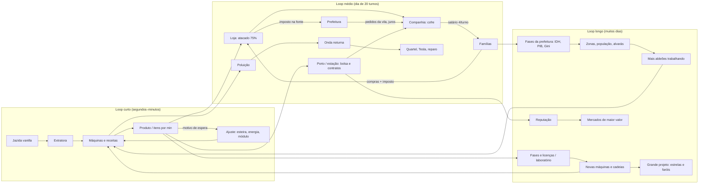

# B1 — Visão do Veio

Autor: OPUS B. Data: 2026-11-08. Bases: `main@53267af` (0.25.0) e `pr47@80980db`. As decisões citadas (DEC-NNN) estão em B3; as funcionalidades (FUN-*), em B2.

Toda afirmação traz a origem:
- **[Dono]**: texto do Luiz no chat, com hora UTC (E4, fonte primária).
- **[Dono via agente]**: um agente escreveu "pedido do usuário" num documento (E3), sem registro direto.
- **[Agente]**: decisão ou texto de agente, não confirmado pelo dono.
- **[Inferido]**: conclusão minha a partir das fontes.

---

## 1. O que é o Veio, em uma frase

> **Um jogo de fábrica no estilo Factorio/Satisfactory construído dentro do mundo vanilla do Minecraft. A fábrica extrai de jazidas reais, é operada por aldeões contratados e sustenta uma vila com economia própria. Roda no Horizon (Minecraft em Rust) num PC comum.**

- "Jogo de fábrica tipo Factorio/Satisfactory dentro do Minecraft": [Dono] 16:27 (DEC-001).
- "Automação industrial no mundo procedural do Minecraft, executada no Horizon": README desde a 0.6 [Agente, E3].
- "A fábrica faz parte do mundo do Minecraft: extrai das jazidas vanilla, queima combustíveis vanilla, leva energia por postes e fios, cuida da lavoura, polui e atrai ataques noturnos, defende a base e exporta para os povoados em troca de esmeraldas": README pr47:45 [Agente, E3].

O nome do projeto no GitHub é **MineFac**. O nome no jogo é **Veio**: veio de minério, a jazida conectada que dá a pureza (FUN-MUN-01). A origem do nome não está documentada; a leitura é [Inferido].

## 2. Pilares

| # | Pilar | O que significa no Veio | Evidência | Origem |
|---|---|---|---|---|
| P1 | **Fábrica de verdade, à la Factorio/Satisfactory** | Cadeias com razões inteiras e itens por minuto visíveis; gargalos em sequência (extração → energia → fio → poluição); módulos; cadeia funda (motor, processador, núcleo, kit Mk.II); copiadora de megafábrica | Chat 16:27, 16:38 ("razões visíveis: use os mecanismos de Satisfactory/Factorio"), 17:01; README "Gargalos"; GRANDE-INDUSTRIA | [Dono] P1 e as razões visíveis; [Agente] a implementação |
| P2 | **Dentro do mundo vanilla, sem remodelá-lo** | Jazidas vanilla que não esgotam; combustíveis da fornalha; lavoura de plantas vanilla com necessidades de água; rios traçados sobre o terreno; comércio pela tela de troca do Minecraft | Chat 15:55 ("não remodelar do zero o sistema do Minecraft"); README 0.7 "integração vanilla"; SOCIEDADE (troca vanilla) | [Dono] para agro e água; [Agente] para o resto |
| P3 | **Aldeões como mão de obra e como sociedade** | Aldeões contratados por esmeralda operam postos; a vila cresce com a fábrica até 150; famílias, lojas, prefeito, fases | Chat 16:27 ("muito trabalho vindo em aldeões, vilas, sistemas"); CLOUD.md ("frente atribuída pelo usuário"); TRABALHADORES; SOCIEDADE | [Dono] reconhece o eixo; [Dono via agente] a atribuição; [Agente] o desenho |
| P4 | **Economia fechada e legível** | A esmeralda é a moeda; o dinheiro só circula entre a companhia, as famílias, as lojas e a prefeitura; o comércio exterior sustenta a indústria maior | README 0.21–0.25; ECONOMIA (simulador, regras como testes); chat 17:18 (dono escolhe pagar pela prefeitura) | [Agente] o princípio; [Dono] só o fluxo de recompensas (DEC-035) |
| P5 | **A fábrica distante continua viva, sem pesar** | Produção virtual nas estações; âncora opcional; orçamento global de ticks; incremental em tudo | Chat 17:01, 17:03; DEC-041/043; ORCAMENTO-GLOBAL | [Dono] |
| P6 | **Leve num PC de 8 GB, com realismo opcional** | Perfis Realismo/Leve; shader opcional; a meta declarada é "realismo maior sem pesar o PC" | Chat 20:09 ("8 GB… é Rust, dá para pôr muito mais") | [Dono] |
| P7 | **Aprender fazendo** | Um objetivo na tela por vez, que só conta com produção nova e automação comprovada; livros como consulta | README pr47 "Tutorial"; chat 15:55 ("explicar no tutorial") | [Agente] o desenho; [Dono] pede explicação no tutorial |
| P8 | **Mundo finito e completo** | 15.000 × 15.000, todos os recursos garantidos, Nether 8:1 | MAPA.md ("decisão de produto"); chat 20:09 ("limite do mapa") | [Dono via agente] para o contrato; [Dono] para o limite; tamanho a confirmar (B6-Q9) |

**O que o Veio não é** [Inferido das fontes]:
- não é um modpack de tecnologia genérico: não há tanques do Horizon, e a água é NBT própria (DEC-050);
- não é um simulador de cidade separado do Minecraft: o VILA-CIDADE pede "sem inventar um sistema paralelo de habitantes";
- não é um mundo infinito com progresso fora da tela: a recuperação ao voltar foi abandonada (DEC-042);
- não é um jogo de "missões que dão dinheiro do nada". Esse é o princípio da economia fechada, mas o código ainda tem exceções (B6-Q1).

## 3. Público e plataforma

| Aspecto | Conteúdo | Origem |
|---|---|---|
| Jogador-alvo | Quem já conhece Minecraft ("Você conhece Minecraft; a vila ensina…", README pr47) e gosta de jogos de automação | [Agente, E3] e [Inferido] |
| Idioma | Português do Brasil como idioma principal, com tradução em inglês nos guias e legendas | README (E3) |
| Máquina de referência | PC com **8 GB de RAM** | [Dono] 20:09 |
| Sistema | Windows (o `launcher.exe` é a porta de entrada; não compila na nuvem) | README; memória (E4) |
| Plataforma de jogo | **Horizon**, Minecraft 26.3 reescrito em Rust; Horizon Launcher com instância "Veio" | README; CONTRIBUTING (E3) |
| Multijogador | LAN na mesma rede; o convidado vai para a vila do anfitrião | README pr47 (E3) |
| Modo | Sobrevivência como alvo; o criativo tem abas Veio – Indústria/Energia/Logística/Mundo; no modo pacífico não há ataques | README (E3) |

## 4. Identidade

| Traço | Descrição | Origem |
|---|---|---|
| **Fábrica dentro do mundo vanilla** | A extratora fica sobre a jazida que o Minecraft gerou. O valor da jazida depende do veio conectado. Combustível, comida, poluição e mobs são do jogo base. A vila é a `village_plains` do jogo, que cresce | [Agente] desde a 0.7; [Dono] reforça às 15:55 |
| **Aldeões** | O aldeão é o trabalhador (posto, comida, contratação), o morador (família, salário, consumo) e a vítima (os mobs o caçam à noite). Nenhum dos jogos de referência tem isso: é o diferencial principal | [Inferido] a partir de TRABALHADORES e SOCIEDADE |
| **Economia fechada** | Quatro livros. O imposto é retido na fonte. O preço local fica entre a exportação e o custo de importar. O salário é derivado do custo de vida. Os parâmetros são validados por um simulador | [Agente] (E3; E1 no modelo) |
| **Referências declaradas** | Factorio e Satisfactory ([Dono] 16:27, 16:38, 17:01). Satisfactory como "copiadora" e HUB ([Dono via agente]: MEGAFABRICAS, EXPERIENCIA-JOGADOR). Cities: Skylines nas conexões externas ([Agente], 0.23). Shapez nas jazidas conectadas (PR #23, "Pedido", autor ND). Punch Club no ritmo do dia ([Agente], EXPERIENCIA-JOGADOR) | misto |
| **Leveza** | "É Rust, dá para pôr muito mais" ([Dono] 20:09). Produção virtual em vez de simular tudo. Cotas por tick. Nenhuma alocação ao desenhar | [Dono] mais [Agente] |
| **Visual** | Estilo Minecraft: painéis como baú/fornalha, texturas desenhadas em código, 27 silhuetas de máquina. Realismo leve opcional | [Agente] (DEC-054/055); [Dono] pede mais realismo sem custo (DEC-056) |

## 5. A experiência, do minuto 0 às fases tardias

Esta é a experiência **descrita** pelo pr47. Nada foi jogado de verdade: desde a 0.11 não há teste em partida (README). Não há tempos medidos de sessão; o único número de ritmo documentado é "uma pilha que só uma linha funcionando entrega em um a três minutos" (README §Progressão).

| Momento | O que o jogador vê e faz | Sistemas | Camada |
|---|---|---|---|
| **Minuto 0** | Abre o launcher, que compila e cria a instância. Entra no mundo e nasce no centro da vila. Se não houver vila a 96 blocos, a `village_plains` é gerada em 30 s. A **casa do fundador** está pronta: painel de controle, lareira (`veio:home`), sofá, cama e mural com o mapa. Acima da barra aparece o objetivo 1: *colocar um gerador* | PLT, TRB, LAR, TUT | pr47 (a main não tem casa nem tutorial na tela) |
| **Primeira oficina** | Objetivos 2–4: energizar a prensa, fazer 4 chapas e 1 engrenagem. As instruções chegam pelo chat, sem abrir livro | TUT, PRO, ENE | pr47 |
| **Primeira automação** | Objetivos 5–7: extratora sobre cobre, prensa abastecida por esteira, braço, funil ou carregador, e chapas guardadas automaticamente | EXT, LOG | pr47 |
| **Primeira encomenda** | Objetivo 8: a central pede 24 chapas e 8 engrenagens e entrega 64 esteiras e 32 cabos. O tutorial acaba e "apresenta o próximo caminho pela vila" | PRG, TUT | pr47 |
| **Oficina (fase 2)** | Juntar 32 engrenagens abre a oficina (licença, triturador, forno de ligas, kits) e o **laboratório de pesquisa**. Primeiros gargalos de energia: "uma linha de engrenagens puxa 40 FE/t, mais do que uma roda d'água dá" | PRG, PES, ENE | pr47 |
| **Vila operária** | Contrata o lavrador por 1 esmeralda e o alimenta com pão (3 tarefas por pão). Depois vêm o carregador e o capataz com fila de tarefas. Abre zonas de lavoura e cercado com esmeraldas e tarefas. Usa o centro de controle (metas, cofre) | TRB, AGR, CTL | main e pr47 |
| **Aço e noite** | 16 aço; pesquisa *metallurgy* (vapor, geotermia, poste de aço, rancho). A poluição passa de 400 e vem o aviso; um dia depois, acima de 1.200, chega a primeira onda noturna. Quartel, Tesla e muros | PRO, PES, DEF | main e pr47 |
| **Sociedade** | Casas espalhadas, poço, loja com comerciante, prefeito. A vila sobe de Povoado para Vila (12 moradores, IDH 0,40). Salários saem do cofre e o atacado volta. Obras: canteiro, mestre de obras, refeitório, escola. Pedidos da vila pagos pelo caixa público | VIL, ECO, OBR | main (sociedade); pr47 (obras) |
| **Eletrônica e água** | 16 circuitos; pesquisa *electronics* (solar, Mk.II, Tesla, módulos, **hidrelétrica**, âncora, **estações**). Bombas no rio, canos, aspersores; a lavoura passa a ter necessidade de água | PES, AGU, AGR, ENE | pr47 |
| **Comércio exterior** | Porto no mar ou estação na fronteira. Vende à bolsa mundial e cumpre contratos (+50%), que sobem a reputação (1/3/6) e abrem eletrônicos e módulos. Se faltar comida, a loja importa | MER, ECO | main e pr47 |
| **Escala** | Transporte entre zonas (trem `rail_terminal`, drones, caravanas). Estações com produção virtual mantêm minas distantes vivas. Copiadora e elevador para megafábricas. Mk.II de máquinas | TRA, MEG, PRO | pr47 |
| **Fase tardia** | Cidade (36 moradores, PIB 400/dia, emprego 60%) e Metrópole (80, Gini ≤ 0,45, 3 bairros, 150 aldeões). Prestígio "Cidade operária". Pesquisas *automation*/*scale* (Mk.III, esteira expressa). **Grande projeto** em 4 fases até 2 estrelas do Nether e 2 faróis | VIL, OBR, PES, PRG | pr47 |
| **Fim de jogo** | Não está definido. O grande projeto é o "projeto final" do doc de lacunas, mas não há condição de vitória nem meta de produção sustentada (Concebido, DEC-023) | — | — (B6-Q10) |

## 6. Loops

| Loop | Escala de tempo | Ciclo | Recompensa | Sistemas |
|---|---|---|---|---|
| **Curto** | Segundos a minutos | Ver o motivo de espera (material, energia, saída, redstone) → corrigir (esteira, gerador, divisor) → ver itens/min subir | Produção estável; objetivo do tutorial ou entrega | PRO, LOG, ENE, EXT, TUT |
| **Médio** | Um dia de jogo: 20 turnos de 1.200 ticks | Pagar salários, as famílias comerem e comprarem, preços locais se moverem; pedido do dia; noite com onda se houver poluição; boletim da manhã; contrato com prazo de 3–4 dias | Lucro da holding, prestígio, reputação | ECO, VIL, MER, DEF, OBR, CTL |
| **Longo** | Muitos dias | Gates de fase/pesquisa → nova máquina → nova cadeia → expansão de zona e da vila → fase da prefeitura → mercados novos → grande projeto | Novas receitas, população, camadas de mercado, estrelas e faróis | PRG, PES, VIL, MER, TRA, MEG |

**Leitura** [Inferido]: o loop médio é onde o Veio difere de Factorio e Satisfactory. A produção precisa voltar como consumo da vila ou como exportação, e o dinheiro precisa circular. As fontes de esmeralda fora do circuito (B6-Q1) furam exatamente esse loop.

## 7. Restrições fundamentais

| Restrição | Consequência no desenho | Fonte |
|---|---|---|
| **Horizon não lê worldgen por datapack** | Rios traçados em tempo de execução sobre chunks novos. O mapa finito exige ganchos nativos (`native_chunk_generate` não existe no Horizon `66f3981`). As APIs `chunk_load`, `read_columns`, `world_dir` e forceload não foram verificadas no Horizon real | Memória (E4); MAPA.md; CONTINUAR.md (E3) |
| **Contrato do mapa (MAPA.md)** | Todo sistema de mundo deve funcionar em 15.000², com recursos garantidos e Nether a 8:1. Hoje é contrato, não funcionalidade | MAPA.md; CODEX.md: "Restrição obrigatória" (E3) |
| **PC de 8 GB** | Cotas por tick, buscas incrementais, produção virtual; realismo só como opcional; perfil Leve com 6 chunks | [Dono] 20:09 |
| **Não remodelar o Minecraft** | Plantas, blocos, comércio e mobs vanilla são reaproveitados; nada de sistema paralelo | [Dono] 15:55; VILA-CIDADE |
| **Teste em jogo fica com o jogador** | Agentes entregam sem abrir o jogo. Nada da 0.11 à 0.25 foi testado em partida | DEC-005 (E3) |
| **Livros do Minecraft** | Página ≤ 14 linhas; guia principal ≤ 100 páginas; conteúdo dividido em 5 livros | check_project (E3/E4) |
| **Windows e launcher** | O pacote é um zip com o `launcher.exe`; a recompilação nativa ao mudar de versão leva minutos | README (E3) |
| **Sem histórico anterior à 0.6** | Decisões das versões 0.1–0.5 são irrecuperáveis | git (E2) |

## 8. Decisões fundamentais

Fonte: B3.

| Decisão | ID | Origem |
|---|---|---|
| Jogo de fábrica tipo Factorio/Satisfactory dentro do Minecraft | DEC-001 | Dono |
| Plataforma Horizon, Rust nativo e conteúdo gerado por Python | DEC-002/003 | Fato / agente |
| Mundo finito de 15.000² | DEC-006 | Dono via agente (a confirmar) |
| Fábrica distante produz via estações, sem carregar tudo | DEC-041/043 | Dono / agente |
| Recuperação ao voltar abandonada | DEC-042 | Agente |
| Recompensas da vila pagas pela prefeitura | DEC-035 | Dono, contra a recomendação |
| Tempos de receita da 0.25 | DEC-045 | Dono |
| Casa do fundador com o Lar dentro | DEC-046 | Dono |
| Tudo no PR #47 | DEC-047/048 | Dono |
| Realismo sem pesar e limite do mapa | DEC-056 | Dono |
| Economia fechada | DEC-030 | Agente; **pilar sem confirmação explícita do dono** (B6-Q1) |

## 9. Matriz de autoria da visão

| Elemento da visão | Dono (chat) | Dono via agente (docs) | Só agente | Inferido |
|---|---|---|---|---|
| Fábrica tipo Factorio/Satisfactory no Minecraft | X | | | |
| Agricultura real, água e rios | X | | | |
| Fábrica longe viva e leve | X | | | |
| Razões visíveis (itens/min) | X | | | |
| Realismo leve num PC de 8 GB | X | | | |
| Mundo 15.000² com recursos garantidos | (limite) | X (tamanho) | | |
| Aldeões trabalhadores | (reconhece) | X (frente atribuída) | | |
| Copiadora de megafábrica | | X | | |
| Casa do fundador | (fusão com o Lar) | X (integração "solicitada") | | |
| Sociedade, fases da prefeitura, IDH/Gini | | | X | |
| Economia fechada de 4 livros | (só `reward`) | | X | |
| Comércio exterior estilo Cities: Skylines | | | X | |
| Obras, prestígio, decretos | | | X | |
| Quadro da fábrica e licenças | | | X | |
| Laboratório e grande projeto | (aprovou as lacunas) | | X (forma) | |
| Aldeão como diferencial central | | | | X |
| Fim de jogo | — | — | — | Indefinido |

**Achado** [Inferido]: boa parte do que hoje caracteriza o Veio nunca foi validado pelo dono como direção. A sociedade, a economia de 4 livros, o comércio exterior, as obras e o quadro (versões 0.18 a 0.25 e o pr47) vieram de agentes em menos de um dia. O B6 reúne as perguntas que fecham essa lacuna.
